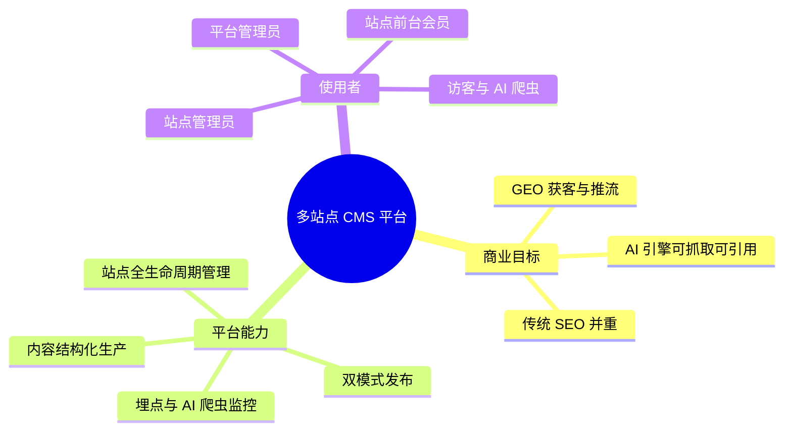

# 00 · 系统总纲

> 本文是架构层的总入口：定义系统是什么、边界在哪、按什么原则设计、追求哪些质量属性。
> 需求侧的范围与分期见 [`../REQUIREMENTS.md`](../REQUIREMENTS.md)；具体组件见 `01` 起各篇。

---

## 1. 系统定位

面向集团的多站点 CMS 内容平台：**一套平台管理 N 个企业站点**，站点与企业一对一。
区别于通用 CMS 的核心差异是——**所有架构取舍都优先服务 GEO（生成式引擎优化）获客目标**，传统 SEO 作为并列但次之的目标保留。

## 2. 术语（强制统一）

| 术语         | 指代                               | 目录                   |
| ------------ | ---------------------------------- | ---------------------- |
| **GEO 项目** | 生成的站点 / 站点渲染引擎          | `apps/geo`             |
| **管理后台** | admin 管理端                       | `apps/admin`           |
| **服务端**   | 数据层（NestJS + Prisma）          | `apps/server`          |
| **静态文件** | 经 `static_files` 表管理的上传资源 | `apps/server/uploads/` |

> 代码注释、文档、对话一律使用上述术语。禁止使用"web 端""前端主站""后端接口"等含糊说法。

## 3. 系统构成一览

| 部件     | 技术栈                | 运行形态                     | 核心职责                                     |
| -------- | --------------------- | ---------------------------- | -------------------------------------------- |
| 管理后台 | Nuxt 4 + Element Plus | SPA 静态资源（3000）         | 站点/内容/会员/监控的可视化管理              |
| 服务端   | NestJS 11 + Prisma 6  | Node API（3001，`/geoserver`） | 唯一数据出入口、鉴权、发布调度、埋点摄取     |
| GEO 项目 | Nuxt 4                | SSG 产物 或 SSR Node（3002） | 站点渲染引擎，产出可被 AI 抓取引用的 HTML    |
| 共享包   | TypeScript 类型       | 编译产物（`dist/`）          | 站点/内容/Block/API 的类型契约，防止契约漂移 |
| MySQL    | 8.x `utf8mb4`         | 容器或本地实例               | 全部业务数据，`trillionCms` 库               |

## 4. 架构原则（不可违背）

| #   | 原则                       | 落地方式                                                                      | 违反后果                              |
| --- | -------------------------- | ----------------------------------------------------------------------------- | ------------------------------------- |
| P1  | **单一事实来源**           | 规则自上而下单向依赖：REQUIREMENTS.md → spec → 代码                           | 模型幻觉、重复实现                    |
| P2  | **站点隔离双保险**         | 菜单/UX 由角色控制，数据安全由 Prisma `siteId` 强制过滤                       | 跨站数据泄漏                          |
| P3  | **契约先行、类型共享**     | `packages/shared` 只放类型；前后端共用，禁止各自定义                          | 前后端字段漂移                        |
| P4  | **配置化收口**             | 服务端配置统一 `src/config/`，管理后台 API 统一 `app/config/api/`             | 硬编码散落、改一处漏三处              |
| P5  | **结构化内容优先**         | Block 采用结构化表单（非富文本），元数据字段成为一等公民                      | GEO 断言无法自动化、llms.txt 无法生成 |
| P6  | **形态可切换、产物可回滚** | `Site.renderMode` 站点级开关 + 产物目录原子替换                               | 站点被永久锁死在一种形态              |
| P7  | **时间口径唯一**           | `utils/datetime.ts` + 覆盖 `Date.prototype.toJSON`，禁止 `toISOString()` 输出 | 接口时间早 8 小时                     |
| P8  | **发布即产出 GEO 资产**    | 每次发布强制生成 robots.txt / sitemap.xml / llms.txt / JSON-LD                | GEO 目标落空                          |

> P6 的实现约定见 [ADR-003](./08-adr.md#adr-003-双模式渲染引擎ssg--ssr-站点级开关)。

## 5. 质量属性目标

| 属性             | 目标                                                            | 当前实现状态                             |
| ---------------- | --------------------------------------------------------------- | ---------------------------------------- |
| **GEO 可抓取性** | AI 爬虫默认全放行；内容直出 HTML；llms.txt/sitemap/JSON-LD 齐备 | ✅ 已实现（见 `06`）                     |
| **GEO 可引用性** | 语义化 HTML、唯一 H1、FAQ 结构化数据、作者实体（E-E-A-T）       | ✅ Block 已覆盖 5 类，含 FAQPage JSON-LD |
| **安全性**       | 站点数据行级隔离、双 JWT 域、上传类型限制、Swagger 生产关闭     | ✅ 已实现（见 `02`、`05`）               |
| **可维护性**     | Monorepo + 模块化约定 + 无 git hooks 限制                       | ✅ 已实现                                |
| **信息密度**     | 管理后台 12px 基准字号 / 8px 间距栅格 / compact 控件            | ✅ 令牌已在 `tokens.scss`                |
| **可回滚性**     | 构建串行化 + 旧产物留 `.old` + 原子替换                         | ✅ 已实现（`06`）                        |
| **可观测性**     | 路由 PV/UV、AI 爬虫抓取摄取、`/health`                          | 🟡 基础版（品牌提及检测后置）            |

## 6. 范围边界

**在范围内（v1）**

- 站点全生命周期管理（含企业资质、备案号、SEO/GEO 默认值）
- Channel / Page / 结构化 Block 的内容生产与三态流转
- SSG 增量发布 + SSR 实时渲染双模式
- 站点会员（JWT-M）+ 静态站文件 islands
- 埋点与 AI 爬虫监控（含看板）
- 静态文件管理（本地存储 + URL 解耦）

**明确不在范围内**

| 项                               | 原因                                      |
| -------------------------------- | ----------------------------------------- |
| 每目录 README.md                 | 用户明确否决，统一到 PROJECT_STRUCTURE.md |
| husky / lint-staged / commitlint | 用户明确否决，不要提交限制                |
| changelog.md                     | 用户明确否决                              |
| Element UI（非 Plus）            | 不兼容 Vue 3                              |
| v1 多语言内容、版本回滚、CI      | 已排 Backlog                              |
| GEO 引用效果自动检测             | 后置，需外部 LLM 调用能力                 |
| 富文本自由编辑 Block             | 已决策结构化表单路线                      |

> 完整否决专区见 [`../REQUIREMENTS.md` §14](../REQUIREMENTS.md)。此处列出的是**架构层最容易误重引入**的条目。

## 7. 关键技术约束速查

| 约束项    | 取值                                                        |
| --------- | ----------------------------------------------------------- |
| Node 版本 | ≥ 20（构建脚本与 Nitro 依赖）                               |
| 包管理器  | pnpm（禁止 npm / yarn workspace）                           |
| 语言      | 全 TypeScript（禁止纯 JS 文件进入 `src/`）                  |
| 数据库    | MySQL `trillionCms`，`utf8mb4_unicode_ci`，`Asia/Shanghai`  |
| 时间格式  | `2026-10-05 10:10:10`（秒精度，`@db.DateTime(0)`）          |
| 产物目录  | `apps/geo/sites/<站点slug>/`（按站点分类，public 同级）     |
| 本地存储  | `apps/server/uploads/yyyy/mm/{uuid}.ext`，对外 `/static/**` |
| 共享包    | 编译型包，构建服务端前必须先 `pnpm build:shared`            |

---

> 下一步：[`01-system-context.md`](./01-system-context.md) —— 系统边界与容器协作。
