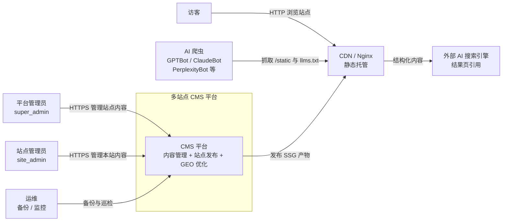
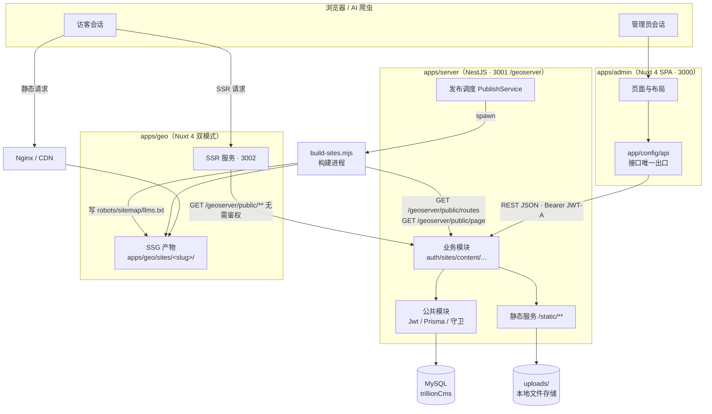
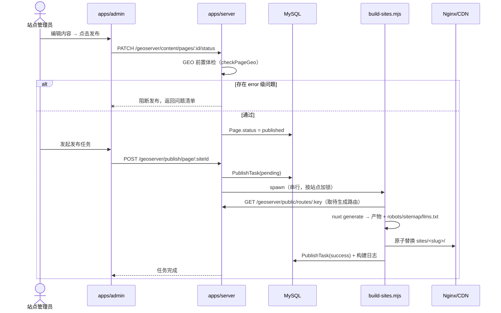
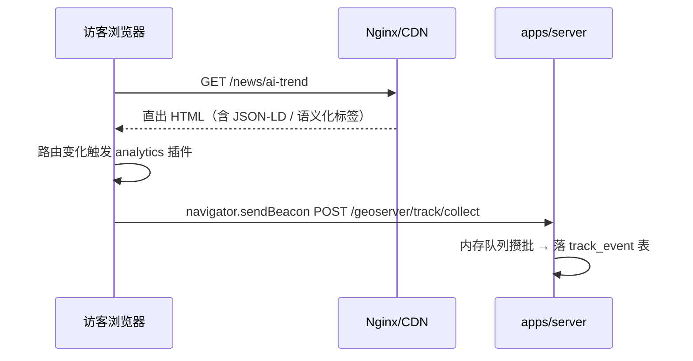
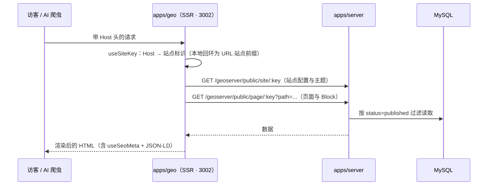

# 01 · 系统上下文与容器视图

> C4 Level 1（系统上下文）+ Level 2（容器）。回答：系统边界在哪、内部由哪些可独立部署的部件组成、它们怎么通信、关键场景怎么流转。
> 组件级（Level 3）见 [`02-server-architecture.md`](./02-server-architecture.md) 与 [`03-frontend-architecture.md`](./03-frontend-architecture.md)。

---

## 1. Level 1 · 系统上下文

**外部依赖清单**

| 外部对象        | 方向     | 协议/形式                           | 约束                                          |
| --------------- | -------- | ----------------------------------- | --------------------------------------------- |
| 平台/站点管理员 | 入站     | HTTPS + JWT-A                       | 无 token 访问受保护路由一律 401               |
| 站点会员        | 入站     | HTTPS + JWT-M                       | 会员按 `siteId` 隔离，跨站无效                |
| 访客            | 入站     | HTTP/HTTPS（静态或 SSR）            | 公开内容必须直出 HTML，不得被 JS islands 遮挡 |
| AI 爬虫         | 入站     | robots.txt / llms.txt / sitemap.xml | **默认放行**，站点级可配置屏蔽                |
| CDN / Nginx     | 出站依赖 | 静态文件托管                        | SSG 模式下承担全部前台流量                    |
| MySQL           | 出站依赖 | TCP 3306                            | 唯一持久化存储，Prisma 独占访问               |
| 外部 AI 引擎    | 出站影响 | ——                                  | v1 不做引用检测，仅记录爬虫抓取行为           |

> 说明：品牌提及检测（定期询问主流 LLM 是否引用本站内容）属后置能力，见 `06` 的 L4 层。

## 2. Level 2 · 容器视图

### 2.1 容器职责表

| 容器              | 技术形态                    | 关键职责                                                               | 不负责                     |
| ----------------- | --------------------------- | ---------------------------------------------------------------------- | -------------------------- |
| `apps/admin`      | Nuxt 4 **SPA**（客户端渲染） | 站点/内容/会员/监控的可视化管理；登录态维持；请求鉴权透传              | 不直连数据库、不做 SSG、不做 SSR |
| `apps/server`     | NestJS + Prisma             | 唯一的业务数据出入口；鉴权与授权；静态文件服务；发布任务调度；埋点摄取 | 不做 HTML 渲染             |
| `apps/geo`        | Nuxt 4（SSG 或 SSR）        | 站点前台渲染；GEO 元数据注入；双模式共用同一套模板 + Block 管线        | 不含管理功能、不写业务数据 |
| `packages/shared` | TypeScript 类型包（编译型） | 前后端共享的数据契约                                                   | 不含任何运行时逻辑         |
| MySQL             | 关系库                      | 持久化全部业务数据与埋点日志                                           | ——                         |
| Nginx / CDN       | 静态托管                    | SSG 产物的对外宿主；把 `/static/**` 反向代理回服务端或直连 uploads     | 不做业务判断               |
| `build-sites.mjs` | Node 脚本（短任务）         | 触发 `nuxt generate` 生成指定路由；产出 GEO 文件；原子替换产物目录     | 不常驻、不直接改数据库     |

### 2.2 通信矩阵

| 调用方       | 被调方   | 协议 / 路径                          | 鉴权            |
| ------------ | -------- | ------------------------------------ | --------------- |
| admin        | server   | REST `/geoserver/**`                       | JWT-A（Bearer） |
| geo SSR      | server   | REST `/geoserver/public/**`                | 无（公开只读）  |
| geo SSG 构建 | server   | REST `/geoserver/public/routes/:key` 等    | 无（构建期）    |
| 站点会员     | geo 前端 | 客户端 islands → `/geoserver/site-auth/**` | JWT-M           |
| 访客/爬虫    | geo 前端 | HTTP（静态直出或 SSR）               | 无              |
| server       | MySQL    | Prisma Client                        | 账号口令        |
| admin user   | server   | `/static/**`                         | 静态资源无鉴权  |

## 3. 关键运行时场景

### 3.1 管理员发布一个 SSG 站点

### 3.2 SSG 站点的访客访问与埋点

### 3.3 SSR 模式的实时渲染

> **两种模式的差异只在于"数据在构建期取还是运行期取"**：SSG 在构建期通过同一批 `public` 接口抓取数据并固化成 HTML，SSR 在运行期调用同一批接口实时渲染。模板与 Block 渲染管线完全共用，切换 `renderMode` 无需迁移内容。

---

> 下一步：[`02-server-architecture.md`](./02-server-architecture.md) —— 服务端组件与横切机制。
