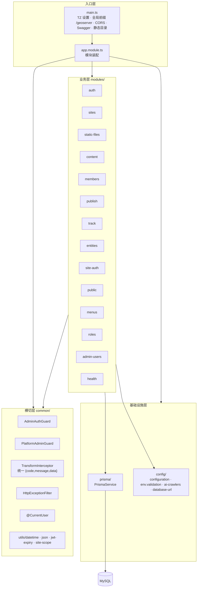
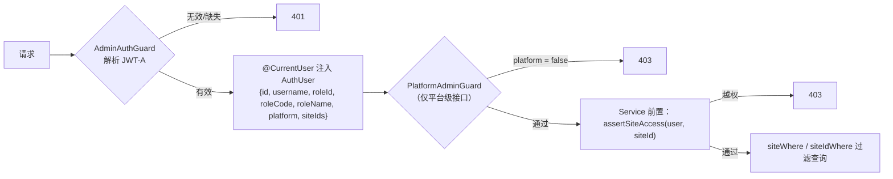

# 02 · 服务端架构（apps/server）

> 组件级视图。回答：模块怎么划、谁依赖谁、横切能力在哪层生效、站点隔离如何成为真正的安全边界。
> 数据模型见 [`04-data-model.md`](./04-data-model.md)，接口契约见 [`05-api-contract.md`](./05-api-contract.md)。

---

## 1. 分层结构



**依赖方向规则（强制）**

```
modules/  →  common/  ✅
modules/  →  config/  ✅
modules/  →  prisma/  ✅
modules/A →  modules/B（跨模块直接注入）  ❌ 需上升为公共能力或通过事件/任务解耦
common/   →  modules/  ❌ 禁止反向依赖
```

## 2. 启动流程（`src/main.ts`）

| 顺序 | 动作                                                        | 说明                                              |
| ---- | ----------------------------------------------------------- | ------------------------------------------------- |
| 1    | `process.env.TZ = 'Asia/Shanghai'`                          | 必须在任何日期操作之前执行                        |
| 2    | `ensureDatabaseUrl()`                                       | 由 `DB_HOST/PORT/USER/PASSWORD/NAME` 拼 URL       |
| 3    | 创建 `uploads/` 目录                                        | P0 本地存储根目录                                 |
| 4    | 覆盖 `Date.prototype.toJSON`                                | 使所有接口输出北京时间，**禁止回退**（判据见 §6） |
| 5    | CORS（按 env 白名单）                                       | 站点域名动态放行                                  |
| 6    | `setGlobalPrefix('geoserver')` + 全局 Pipe / Filter / Interceptor | 统一响应与校验                                    |
| 7    | `useStaticAssets('/static')`                                | 映射到 `uploads/`                                 |
| 8    | Swagger（**仅非生产**）                                     | `/geoserver/docs`                                       |
| 9    | `listen(3001)`                                              | 见 `07-deployment.md` 端口表                      |

## 3. 模块清单

| 模块           | 控制器路由       | 职责                                                       | 鉴权                 | 站点隔离 |
| -------------- | ---------------- | ---------------------------------------------------------- | -------------------- | -------- |
| `auth`         | `/geoserver/auth`      | 管理员登录（bcrypt 校验）、签发 JWT-A、`/me`               | 除登录外需 JWT-A     | ——       |
| `sites`        | `/geoserver/sites`     | 站点 CRUD、SEO/GEO 默认值、renderMode、主题配置            | JWT-A                | ✅       |
| `static-files` | `/geoserver/files`     | 上传（MIME 白名单 + 10MB 限制）、列表、删除                | JWT-A                | ✅       |
| `content`      | `/geoserver/content`   | Channel 树、Page CRUD、三态流转、GEO 体检                  | JWT-A                | ✅       |
| `members`      | `/geoserver/members`   | 站点会员查询与维护                                         | JWT-A                | ✅       |
| `publish`      | `/geoserver/publish`   | 发布任务入队、串行执行、调用构建脚本、查询任务             | JWT-A                | ✅       |
| `track`        | `/geoserver/track`     | 埋点摄取（攒批写库）、PV/UV 概览、AI 爬虫统计              | 摄取公开，查询需鉴权 | ✅       |
| `entities`     | `/geoserver/entities`  | 品牌/产品/机构实体与别名管理（GEO 实体一致性）             | JWT-A                | ✅       |
| `menus`        | `/geoserver/menus`     | 后台菜单树（按当前用户角色的菜单授权过滤）与菜单配置维护   | 树需登录，写操作限平台级角色 | ——  |
| `roles`        | `/geoserver/roles`     | 角色 CRUD 与「角色 → 菜单」授权（三级菜单、自动补全上级）  | JWT-A + 平台级角色   | ——       |
| `admin-users`  | `/geoserver/admin-users` | 后台用户 CRUD 与「用户 → 角色」绑定（含站点授权、安全护栏） | JWT-A + 平台级角色 | ——     |
| `site-auth`    | `/geoserver/site-auth` | 站点会员注册/登录/校验/获取自身信息（JWT-M）               | 除登录注册外需 JWT-M | ✅       |
| `public`       | `/geoserver/public`    | **无鉴权只读**：站点配置、路由清单、页面详情、robots、实体 | 无                   | 按 key   |
| `health`       | `/geoserver/health`    | 健康检查                                                   | 无                   | ——       |

> 合计 **57 条已注册路由**（在首轮全量验证 43 条之上新增：`menus` 5 条 + `roles` 5 条 + `admin-users` 4 条）。逐条清单与请求/响应字段见 [`05-api-contract.md`](./05-api-contract.md)。

## 4. 横切机制

### 4.1 统一响应

`common/interceptors/transform.interceptor.ts` 把所有成功响应包装为：

```json
{ "code": 0, "message": "ok", "data": {} }
```

异常由 `common/filters/http-exception.filter.ts` 统一包装为同构结构，HTTP 状态码保持不变。

### 4.2 鉴权与授权



**双 JWT 域**

| 域         | Token | 载荷                                                | 适用模块                    |
| ---------- | ----- | --------------------------------------------------- | --------------------------- |
| admin 用户 | JWT-A | `roleId` + `roleCode` + `platform` + `siteIds`      | auth/sites/content/roles/…  |
| 站点会员   | JWT-M | `memberId` + `siteId`                               | site-auth（客户端岛屿调用） |

> 角色由「用户 → 角色」绑定解析，登录时写入 JWT；**平台级判据是角色的 `platform` 标记**，不再硬编码角色字符串。

### 4.3 站点隔离（`common/utils/site-scope.ts`）

| 函数                             | 用途                                     |
| -------------------------------- | ---------------------------------------- |
| `assertSiteAccess(user, siteId)` | 越权直接抛 403（**安全边界，不可省略**） |
| `siteWhere(user, siteId)`        | 构造带 `siteId` 的查询条件               |
| `siteIdWhere(user, siteId)`      | 仅返回 siteId 条件（用于 task 等表）     |

> **重要**：菜单/界面隐藏站点只是 UX；真正的安全边界是 Guard + `site-scope` 强制过滤。二者必须同时存在（见 [ADR-005](./08-adr.md#adr-005-站点数据隔离双保险菜单--guard--查询过滤)）。

### 4.4 配置与工具

| 文件                         | 职责                                                       |
| ---------------------------- | ---------------------------------------------------------- |
| `config/configuration.ts`    | 配置工厂，集中读取环境变量（含时区、上传、CORS、GEO 目录） |
| `config/env.validation.ts`   | **zod 启动校验**，缺关键配置直接启动失败，避免运行期才炸   |
| `config/ai-crawlers.ts`      | AI 爬虫 UA 清单、`matchAiCrawler`、`buildRobotsTxt`        |
| `config/database-url.ts`     | 由 `DB_*` 变量拼装 `DATABASE_URL`（含特殊字符转义）        |
| `common/utils/datetime.ts`   | 北京时间格式化（**唯一时间出口**）                         |
| `common/utils/json.ts`       | Prisma JSON 字段的收窄与还原（`toJsonInput` / `fromJson`） |
| `common/utils/jwt-expiry.ts` | JWT 有效期类型收窄（`StringValue \| number`）              |

## 5. 发布与构建调度（`modules/publish`）

- 发布入口：`POST /geoserver/publish/page/:siteId`（页面级增量）与 `POST /geoserver/publish/site/:siteId`（整站重建）
- **串行锁**：`PublishService` 内 `running: Set<number>` 按 siteId 加锁，同站点并发发布时后来任务保持 `pending` 排队
- 任务状态机：`pending → running → success | failed`，日志写入 `PublishTask.log`，`finishedAt` 记录完成时间
- 执行方式：`spawn` 调用 `apps/geo/scripts/build-sites.mjs`，环境变量注入站点 slug、API 地址、产物临时目录
- 详细流水线与 GEO 产物见 [`06-publish-and-geo.md`](./06-publish-and-geo.md)

## 6. 已确认的约束（勿回退）

| 约束                                                                | 原因                                                                                   |
| ------------------------------------------------------------------- | -------------------------------------------------------------------------------------- |
| 禁止在业务代码里用 `toISOString()` 输出时间                         | Prisma 按 UTC 读写 DATETIME，会导致结果早 8 小时                                       |
| `prisma.groupBy` 使用 `take` 必须同时给 `orderBy`                   | Prisma 校验要求，`aiOverview` 已用 `_count.path` 排序                                  |
| Prisma JSON 字段写入必须过 `toJsonInput`                            | 否则缺索引签名的业务对象类型报错                                                       |
| `tsconfig.json` 必须显式 `rootDir: ./src`，且关闭 `incremental`     | 否则产物落到 `dist/apps/...`；`incremental` 与 `deleteOutDir` 冲突会导致二次构建无产物 |
| `packages/shared` 必须先于服务端构建                                | 服务端 `paths` 指向其 `dist/index.d.ts`（编译型包）                                    |
| 多个业务模块共用 Guard 时必须由全局 `CommonModule` 提供 `JwtModule` | 否则 DI 报 `UnknownDependenciesException`                                              |
| `Page` 没有 `channel` 关联字段                                      | 需先查 `Channel` 再按 `channelId` 过滤，不能写关联条件                                 |

> 完整修复清单与历史背景见 [`../REQUIREMENTS.md` §16](../REQUIREMENTS.md)。

---

> 下一步：[`03-frontend-architecture.md`](./03-frontend-architecture.md) —— 管理后台与 GEO 项目。
