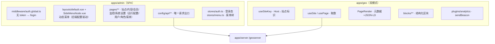
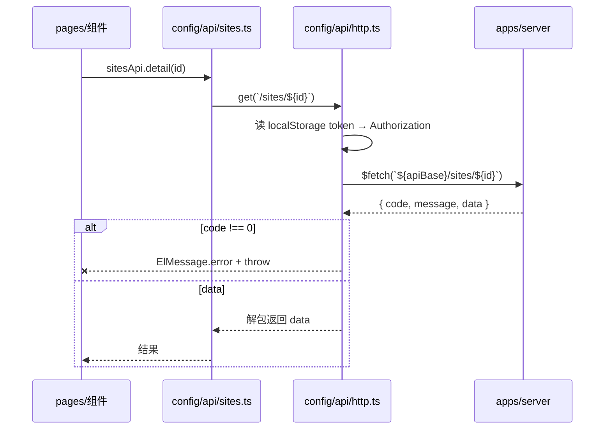
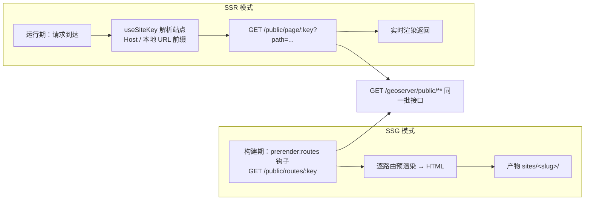

# 03 · 前端架构（apps/admin · apps/geo）

> 两个前端应用的分工、内部结构、渲染模式与状态流转。
> 接口调用方式统一由 [`05-api-contract.md`](./05-api-contract.md) 约束；GEO 产物规范见 [`06-publish-and-geo.md`](./06-publish-and-geo.md)。
> **术语**：专有名词（slug / 产物清单 / 内容指纹 / 块标识 …）统一解释见 [`../GLOSSARY.md`](../GLOSSARY.md)。

---

## 1. 两个前端应用的定位

| 维度         | 管理后台 `apps/admin`                       | GEO 项目 `apps/geo`                                  |
| ------------ | ------------------------------------------- | ---------------------------------------------------- |
| 使用者       | 平台管理员、站点管理员                      | 访客、AI 爬虫、站点会员                              |
| 渲染模式     | **SPA**（纯客户端渲染，见 ADR-017）         | **SSG / SSR 双模式**（`Site.renderMode` 站点级开关） |
| 是否需要登录 | 是（JWT-A，token 存 localStorage）          | 否（会员功能为客户端动效岛屿）                       |
| 数据来源     | 受保护业务接口 `/geoserver/**`              | 公开只读接口 `/geoserver/public/**`                  |
| UI 体系      | Element Plus + 深空控制台令牌（12px / 8px） | 站点主题（`Site.themeConfig` 驱动 CSS 变量）         |
| 产物形态     | `.output/`（SPA 静态资源，可任意静态托管）  | SSG：静态目录 `sites/<slug>/`；SSR：Node 服务        |

## 2. 管理后台

### 2.1 目录职责

| 路径                            | 职责                                                                                              |
| ------------------------------- | ------------------------------------------------------------------------------------------------- |
| `app/config/api/http.ts`        | 唯一请求封装：注入 token、统一错误提示、401 跳登录、`ApiResult` 类型                              |
| `app/config/api/*.ts`           | 按业务模块拆分的接口定义（auth / sites / files / content / news-faq / members / publish / track / menus / roles / users；`news-faq.ts` 见 2026-10-14 新闻/问答管理） |
| `app/config/menu.ts`            | 渲染模式/状态等字典映射（**菜单项与角色名均不再硬编码**：菜单来自 `/geoserver/menus/tree`，角色名随 `/auth/me` 返回；**状态色只给 `.c-*` 语义类名，不给色值**；`BUILD_STATUS_META` = 构建状态唯一口径，站点列表 / 内容编辑器 / 总览发布任务三处共用，见 [`06`](./06-publish-and-geo.md) §1.1） |
| `app/config/site-defaults.ts`   | 站点主题默认值（与后端 `SITE_DEFAULTS.theme` 对齐；**全项目唯一允许出现颜色字面量的 TS 文件**，ESLint 已豁免） |
| `app/config/glossary.ts`        | **专有名词字典（界面文案唯一事实来源）**：`TERMS.<key> = { label, hint }`；页面禁止硬编码这些名词与解释，取值用 `TERMS.x.label`、出问号用 `<TermHint term="x" />`（文档侧同口径解释见 [`../GLOSSARY.md`](../GLOSSARY.md)） |
| `app/components/TermHint.vue`   | **专有名词说明（问号说明的唯一实现）**：渲染「名词 + ?」，hover/聚焦显示含义；`show-label=false` 只出问号（按钮内用，按钮自行显示名词）；弹层固定 `popper-class="term-tooltip"`，宽度区间与行距在 `assets/scss/main.scss` 统一定义（150–300px、行高 1.6、自动换行），页面**禁止**自拼 `el-tooltip + .term-mark` |
| `app/stores/auth.ts`            | Pinia 登录态与当前用户信息（token 存 localStorage，刷新后由 `init()` 读回）                       |
| `app/stores/menu.ts`            | Pinia 菜单树：登录后拉取 `/geoserver/menus/tree`（按角色授权过滤），缓存并供布局与面包屑使用      |
| `app/components/SideMenuNode.vue` | 侧栏菜单递归节点（最多三级，目录可展开/收起，命中路由高亮）                                     |
| `app/components/*Dialog.vue`    | 业务弹窗组件（会员新增 / 新闻 `NewsDialog` / 问答 `FaqDialog` / 菜单表单 / 角色表单 / 角色菜单授权 / 用户表单）：`defineModel` 控制显隐、`emit('saved')` 通知父页面刷新；新闻弹窗的发布日期必填且**禁选早于今天的日期**（日期选择器禁用过去日期，与服务端 `todayInChina()` 校验同口径），问答无发布日期字段 |
| `app/components/PlainTextEditor.vue` | **纯文本编辑器（wangEditor 封装，2026-10-14）**：v-model 只暴露**纯文本**——初始化把段落间 `\n` 转 `
`，变更时用 `editor.getText()` 输出段落间 `\n`，样式不落库（最终提交只取纯文本，服务端按换行拆段落块）；工具栏精简（标题 + 基础强调，去图片 / 视频 / 表格 / 代码块 / 全屏）；实例 `shallowRef` 持有、`onBeforeUnmount` 时 `destroy()`，外部值异步回显经 watch `setHtml` 同步。新闻正文 / 问答答案用 |
| `app/utils/menu-tree.ts`        | 菜单树工具：平铺列表 ↔ 多级树（菜单管理页与角色授权页共用）                                       |
| `app/utils/tool.ts`             | 交互工具（**两个独立概念**）：时间维度 `debounce` / `throttle`（默认 `leading`，即先触发后防抖）；状态维度 `useLoading()`（`run` / `runKeyed` / `isLoading`） |
| `app/middleware/auth.global.ts` | 路由级守卫                                                                                        |
| `app/layouts/default.vue`       | 深空控制台骨架：动态侧边菜单（后端配置驱动） + 顶栏（角色名来自接口）                             |
| `app/pages/**`                  | 各功能页面，右侧"编辑"进入独立深入页（非弹窗）；系统设置为目录：运行配置 / 用户管理 / 角色管理 / 菜单管理；**站点管理为目录**（2026-10-14 起）：站点列表 /sites（原站点管理页改名）、新闻资讯 /sites/news、高频问答 /sites/faqs（el-table border + 分页 + 站点下拉，问答带分类筛选）。**新闻/问答管理为表驱动 id 寻址**（2026-10-15 起，ADR-039）：列表行 `NewsArticleItem` / `FaqItem` 携带表主键 `id`（`pageId` 可选，仅作发布产物弱引用），编辑 / 删除按 `id` 调接口，详情直读表**不再收 `siteId` 参数**；新闻表单发布日期必填、禁选过去日期，问答无发布日期字段 |
| `app/assets/scss/*`             | `tokens.scss`（设计令牌）→ `mixins.scss`（复用片段）→ `main.scss`（Element Plus 暗色覆盖 + 重置） |

### 2.2 请求链路（强制）

**硬规则**

1. 页面/组件**禁止**直接 `$fetch` / axios，必须走 `~/config/api` 下的模块
2. `app/config/` 目录下的相互导入**必须用 `~` 别名**（`import { sitesApi } from '~/config/api'`），禁止 `../../config/api` 相对路径
   —— 原因：Nuxt 4 的 `#app` 别名带尾斜杠，相对路径会被 import-protection（impound）误判为引用 Nuxt 构建期模块，报 `This module cannot be imported in the Vue part of your app`，实测必现
3. SCSS 令牌注入由 `nuxt.config.ts` 的 `vite.css.additionalData` 完成；被 `@use` 引入的 `mixins.scss` 需在自身顶部显式 `@use "tokens.scss"`（`additionalData` 只作用于入口文件）
4. Pinia **只**通过 `nuxt.config.ts` 的 `modules: ['@pinia/nuxt']` 接入：模块负责创建实例并自动导入 `app/stores/**`
   —— 禁止再手写 `createPinia` 插件（会造成两个实例，且 `useAuthStore` 等 store 不会被自动导入，实测报 `useAuthStore is not defined`）
5. 后台为 **SPA**（`ssr: false`，见 [`08`](./08-adr.md) ADR-017）：无 SSR、无 hydration，页面与路由守卫全部在浏览器执行；token 存 localStorage，`middleware/auth.global.ts` 直接判定
   —— 前端守卫只负责体验，真正的安全边界是服务端接口的 JWT 守卫
6. `element-plus` 与 `dayjs` **必须**走 Vite 依赖预构建（`nuxt.config.ts` 的 `vite.optimizeDeps.include`）；**禁止**把 element-plus 放进 `build.transpile`
   —— 一旦被排除预构建，浏览器会直接加载其 ESM 源码，内部 `import dayjs` 落到 CJS 的 `dayjs.min.js`，报 `does not provide an export named 'default'`，前端模块图崩溃、页面完全无法交互（实测必现）
7. 后台代码**不要写 SSR 专用分支**（`import.meta.server`、`<ClientOnly>`、以 cookie 让"服务端可读 token"的设计）：渲染模式是 SPA，这类分支只会增加噪音
8. 侧栏菜单**禁止在前端硬编码**：菜单是后台配置数据（`Menu` 表），由 `stores/menu.ts` 从 `/geoserver/menus/tree` 拉取后经 `SideMenuNode.vue` 递归渲染，最多三级（见 [08 ADR-018](./08-adr.md#adr-018-后台菜单数据驱动三级结构--平台级标记)）；菜单条目本身由**服务端种子**（`apps/server/prisma/seed.ts`，幂等键 `path`）维护——如 2026-10-14 起「站点管理」改为目录型（`path=null`），下挂站点列表 / 新闻资讯 / 高频问答，前端零配置
9. **角色与权限同样禁止前端硬编码**：用户的角色来自「用户 → 角色」绑定（`/geoserver/auth/me` 返回 `roleId/roleCode/roleName/platform`），前端只消费 `platform` 做展示判断，不维护角色枚举；权限边界始终在服务端（见 [08 ADR-019](./08-adr.md#adr-019-rbac用户--角色--菜单绑定)）
10. 数据表格统一 **`el-table` + `border`**（border 模式下才可自由拖拽列宽），**禁止手写 `<table>` 模拟数据表格**；border 表格的外框由表格承担，其所在面板不再叠加边框（样式基线在 `app/assets/scss/main.scss`）
11. **所有弹窗（不论大小）必须独立成组件** `app/components/*Dialog.vue`：`defineModel` 控制显隐、`emit('saved')` 通知父页面刷新；**页面文件内禁止内联 dialog 内容**
12. **写操作按钮：防抖与 loading 各司其职**：防抖（时间维度）用 `debounce(fn, DEBOUNCE_WAIT)`，loading（状态维度）用 `useLoading()`，**组合顺序固定为「防抖在外、loading 在内」**（`debounce(() => run(async () => {...}))`）；列表行内按钮用 `runKeyed(key, fn)` + `:loading="isLoading(key)"`。**禁止页面自写防抖、禁止按钮裸调接口**
13. **操作列统一（文案 / 颜色 / 结构 / 宽度）**：一律 `el-button link size="small"`（跳转也用 `navigateTo`，不与 `NuxtLink` 混用）；文案走词典（新建 · 编辑 · 删除 · 保存 · 提交审核 · 发布 · 刷新 · 上传 · 取消 · 返回），颜色走语义（主操作 `primary` · 正向流转 `success` · 破坏性 `danger` · 中性辅助默认色），顺序 预览 → 编辑 → 流转 → 删除；操作列统一挂 `class-name="ops-col"`（间距 / 换行 / 禁止省略号的规格在 `main.scss` 的 `.ops-col` 一处定义），**按钮排不下必须换行、禁止省略号**（省略号等于按钮消失），列宽按「按钮数 × 约 40px + 16px」估（站点行 5 个按钮取 210px）；详见 [AGENTS.md §7](../../AGENTS.md) 与 [REQUIREMENTS §8](../REQUIREMENTS.md)
14. **专有名词必须统一取值**：`slug` / `canonical` / 产物清单 / 内容指纹 / 块标识 这类名词只写在 `app/config/glossary.ts`，页面里**禁止硬编码中文名与解释**；显示名词用 `TERMS.<key>.label`（或 `<TermHint term="<key>" />` 连问号一起出），按钮内的说明问号统一用全局类 `.term-mark`（`main.scss`）
14. **API 基址只从 `runtimeConfig.public.apiBase` 取**（根 `env/` 派生、启动器注入）：**绝对地址**且含服务端全局前缀，缺省 `http://<PUBLIC_HOST>:<PORT_SERVER>/geoserver`——**服务端消费者**（SSG 构建脚本、nitro `/static` 代理、预览票据）不做同源改写，基址必须是完整 URL（见 [ADR-040](./08-adr.md)）；请求出口在浏览器端做一次**局域网自适应**——基址主机是回环地址（`localhost` / `127.0.0.1` / `0.0.0.0`）而当前页面主机不是回环地址时，改用页面主机名。**禁止**改为按页面 location 直接拼接口地址（会绕开 `env/` 这唯一来源）；GEO 侧同样规则见 `app/utils/api-base.ts`（SSR 不转换）。理由见 [08 ADR-021](./08-adr.md) 与 [07 §2.1](./07-deployment.md)
15. **后台挂在 `/geocms/` 基础路径下**（`nuxt.config.ts` 的 `app.baseURL`，ADR-040）：
    - 401 判断等「当前路由」口径一律用 `config/api/http.ts` 的 `currentRoutePath()`（剥离 `app.baseURL` 前缀）——`location.pathname` 是 `/geocms/login` 而路由路径是 `/login`，直接拿 pathname 判 `startsWith('/login')` 会把登录页误判成受保护页造成跳转循环
    - 新标签页打开站内地址统一 `window.open(router.resolve(path).href, '_blank')`：`window.open` 直写相对路径不经路由，**不会自动带 `/geocms/` 前缀**（打开即 404）

### 2.3 设计令牌

| 令牌族   | 取值 / 规则                                                                    |
| -------- | ------------------------------------------------------------------------------ |
| 字号     | `$font-size-base: 12px`                                                        |
| 间距     | `$sp-1..4` = 8 / 16 / 24 / 32px，**密度优先**，拒绝大留白；页面容器/筛选栏/面板标题统一 `$sp-1` |
| 滚动     | 主功能区（`.content`）**一屏内滚动**：`.main { min-height: 0; overflow: hidden }` + `html, body { overflow: hidden }`，禁止整页滚动 |
| 组件尺寸 | Element Plus 全局 `size: 'small'`（`plugins/element-plus.ts`），与密度规范一一对应 |
| 分页     | 默认 20 条 / 档位 `[10, 20, 30, 50, 100]`；前端 `config/pagination.ts` 与服务端 `common/constants.ts` 对齐 |
| 配色     | **亮色主题**：底色 `#F4F6FB`、面板 `#FFFFFF`、边框 `#D8DFEC`、主色 `#2563EB`、高亮 `#0E7490`、文字 `#1F2A44` |
| 主色梯度 | Element Plus 的 `--el-color-primary-light-3~9` / `dark-2` 由 **`color.mix()`** 从 `$c-primary` 派生（`main.scss` 顶部 `@use 'sass:color'`），换主色只改 `tokens.scss` 一处；**禁止全局 `mix()`**（Dart Sass 1.105 起报 `DEPRECATION WARNING [global-builtin]`，3.0 将移除） |
| 状态色   | 统一用 `main.scss` 的 `.c-success` / `.c-warning` / `.c-danger` / `.c-primary` / `.c-mute`，页面内禁止写死色值 |
| 数字     | 等宽字体（mono）                                                               |
| 组件密度 | Element Plus compact（`--el-*` CSS 变量覆盖，见 `main.scss`）                  |

## 3. GEO 项目（站点渲染引擎）

### 3.1 双模式取数

### 3.2 关键文件

| 文件 | 职责 |
| ---- | ---- |
| `app.vue` | 根组件：注入站点主题 CSS 变量（`:root`，`themeRootCss`）+ 引入站点样式层（原型 CSS 与派生变量，§7.4.1）；**必须显式使用 `<NuxtLayout>`** |
| `layouts/default.vue` | 站点外壳：`<FrameTopBar>` / `<FrameSiteHeader>` / `<main>` / `<FrameSiteFooter>`，移动端导航 |
| `composables/useSiteKey.ts` | 站点标识解析：SSR 以请求 Host 反查；本地回环地址按 **URL 首段（站点前缀）** 定位站点并剥离该前缀；构建期回退 `NUXT_PUBLIC_SITE_SLUG` |
| `composables/useSite.ts` | 拉取站点配置（含主题令牌、备案号、SEO 默认值），`useState` 全局共享 |
| `composables/usePage.ts` | **剥离站点前缀**后按路径解析页面与栏目，拉取页面详情 |
| `components/PageRender.vue` | 渲染主体：注入 `useSeoMeta` + canonical + JSON-LD，再按 Block 序列渲染；保证一页唯一 `<h1>` |
| `components/blocks/BlockRenderer.vue` | 块渲染器：按 `block.key` 经 `import.meta.glob('./Blk*.vue')` 解析为 `Blk<PascalKey>.vue` |
| `components/blocks/Blk*.vue`（43 个） | 块组件。框架相关：`BlkAnchorBar` `BlkArticleBody` `BlkArticleMeta` `BlkCaseCard` `BlkCertGrid` `BlkDataTable` `BlkDeviceRow` `BlkDoctorCard` `BlkEntityBanner` `BlkEnvGrid` `BlkFaqDetail` `BlkFaqIndex` `BlkFaqList` `BlkFeatureCards` `BlkFlowChain` `BlkGallery` `BlkGlassCard` `BlkHeroDark` `BlkHeroPanel` `BlkHotFaq` `BlkIndexList` `BlkJobList` `BlkLegalDoc` `BlkListRows` `BlkNapGrid` `BlkNotice` `BlkPager` `BlkPathCards` `BlkPostList` `BlkRelatedFaq` `BlkRouteRows` `BlkSectionHead` `BlkServiceCard` `BlkSideNews` `BlkSourceGrid` `BlkStatBar` `BlkStepTimeline` `BlkTagline` `BlkTelbar` `BlkTermCards` `BlkTrustGrid` `BlkVcardGrid` `BlkVisitCards`。**HTML 结构复用设计稿原型类名（§7.4.1）**；块实例可带 `section` 节奏提示（`plain`/`alt`/`plain-flush`/`alt-flush`，见 09 §7.2），由 BlockRenderer 决定外层 `<section>` 底色 |
| `components/frame/Frame*.vue` | 框架块（布局层，非页面 Block，见 `09` §7.1）：`FrameTopBar` `FrameSiteHeader` `FrameBreadcrumb` `FrameSiteFooter`，DOM 与类名对齐设计稿 |
| `public/assets/css/*` | 设计稿原型样式**原样落地**（`theme-b.css` / `site.css`），由 `app.vue` 引入（§7.4.1） |
| `public/assets/img/**` | 设计稿图片资产（`cert` / `device` / `doctor` / `env` 四组），Vite `public/` 直出，构建后落进 `sites/<slug>/assets/img/**` |
| `utils/theme.ts` | `DEFAULT_THEME_TOKENS` + `themeStyle` / `themeRootCss`（令牌 → CSS 变量） |
| `pages/index.vue` · `pages/[...slug].vue` | 首页与通配路由（`/<channelSlug>/<pageSlug>`，本地预览时为 `/<siteSlug>/<channelSlug>/<pageSlug>`） |
| `plugins/analytics.ts` | 仅客户端：`router.afterEach` → `navigator.sendBeacon` 上报 PV/UV |
| `components/MemberBadge.client.vue` | 会员岛屿：SSG 静态页上的客户端动态条，调 `/geoserver/site-auth/**` |
| `utils/seo.ts` | `buildMeta` 与 `buildJsonLd`（WebSite / Article / BreadcrumbList） |
| `scripts/build-sites.mjs` | SSG 构建脚本（详见 `06`） |
| `scripts/sync-blocks.mjs` | 从服务端拉取站点块代码落盘为 `app/components/blocks/Blk*.vue` |

### 3.3 已确认的约束（勿回退）

| 约束                                                            | 原因 / 症状                                                             |
| --------------------------------------------------------------- | ----------------------------------------------------------------------- |
| Vue SFC 的 `<template>` 内禁止写 `<script>`（含 JSON-LD）       | 编译/渲染报错，页面 500；改用 `useHead({ script: [...] })` 注入         |
| `usePage()` 返回的 `path` 是字符串，不是 ref                    | 曾按 `path.value` 使用导致 `undefined.split` 崩溃                       |
| `nuxt generate` 的 `publicDir` 缺省必须指向 `dist` 而非 `sites` | 否则 `generate` 会清空已发布的站点产物目录                              |
| Nitro 的 `prerender:routes` 钩子入参直接是 `Set<string>`        | 与部分文档的 `{ routes }` 形态不同，代码需兼容两种写法                  |
| 构建脚本查找 `nuxt` 可执行文件要走多候选路径探测                | hoisted 模式下 `apps/geo/node_modules/nuxt/bin/nuxt.mjs` 可能不存在     |
| SSG 站点的埋点依赖服务端公网可达                                | 纯本地部署时 `sendBeacon` 到不了 `/geoserver/track/collect`（部署文档已注明） |
| **`app.vue` 必须显式使用 `<NuxtLayout>`**                       | 否则 `definePageMeta({ layout })` **静默失效**：站点页头/页脚与 `<main>` 全部不渲染，页面只剩正文（实测踩坑） |
| **`nuxt.config.ts` 的 `components` 必须 `pathPrefix: false`**   | 否则 `components/blocks/BlockXxx.vue` 会被注册为 `<BlocksBlockXxx>`，`<BlockRenderer />` 解析失败 → **页面正文 Block 全部不渲染**，且只打印一条 Vue warn、不报错、构建照常通过（实测踩坑） |
| **设计稿 CSS 必须原样引入，不得转写** | 把原型类名"翻译"成自创类名必然引入视觉偏差（间距/卡片结构/断点），且设计稿一改就要重翻译。原型 CSS 放 `apps/geo/public/assets/css/`，块组件直接复用原型类名与 DOM（09 §7.4.1） |
| **`apps/geo/public/**` 变更会强制 `nuxt build`** | `build-sites.mjs` 的 `computeAppFingerprint()` 含 `public`，增删改资产即变更 `appHash`。这是预期行为，无需改构建脚本 |
| **站点主题默认值三处必须一致** | `apps/admin/app/config/site-defaults.ts`、`apps/server/.../sites/constants.ts` 的 `SITE_DEFAULTS.theme`、`apps/geo/app/utils/theme.ts` 的 `DEFAULT_THEME_TOKENS`；曾出现 `--bg` 三处不一致（设计稿 `#FFFFFF` vs 代码 `#F5F8FC`），导致整站底色偏灰（09 §7.4 勘误） |

## 4. 语义化标记规范（GEO 强制 · 管理后台豁免）

### 4.1 适用范围（强制边界）

| 范围 | 要求 | 原因 |
| ---- | ---- | ---- |
| `apps/geo`（GEO 项目 / 站点渲染引擎）与其 **Block 组件** | **强制执行** | 站点是对外获客入口：语义标记决定 SEO / GEO（AI 引擎解析质量）、结构化数据可信度与无障碍；Block 是页面内容的最终产物，标记错站点就错 |
| `apps/admin`（管理后台） | **不要求** | SPA 内部工具，无 SEO / 爬虫 / SSG 诉求；统一用 Element Plus 组件与布局 `div` 即可，**禁止为"语义正确"额外重构后台结构** |
| 后台的 Block **编辑表单** | 不要求 | 属管理端交互，不是站点产物（产物由 GEO 侧 Block 组件渲染） |

### 4.2 页面骨架

| 标签 | 用途 | 本项目落点 |
| ---- | ---- | ---------- |
| `<header>` | 全局页头（站点名 / 导航入口），可在 article/section 内局部复用 | `layouts/default.vue` 页头 |
| `<nav>` | 仅成组核心链接（主导航、面包屑）；面包屑固定 `<nav><ol><li>` | 站点导航（后续接入栏目树时使用） |
| `<main>` | 页面主体，**一页仅 1 个** | `layouts/default.vue` 内容区 |
| `<article>` | 独立完整内容，可嵌套 `<section>` | `PageRender.vue` 页面正文 |
| `<section>` | 主题分组，**必须带 h2/h3 标题**；纯样式布局改用 `
` | 各 Block 组件 |
| `<footer>` | 区域底部：企业名、备案号、版权（备案用 `<small>`） | `layouts/default.vue` 页脚 |

### 4.3 标题层级（硬约束）

- 一页**仅 1 个 `<h1>`**：由页面标题承担（`PageRender.vue` 的 `page.title`）
- **Block 内标题一律从 `<h2>` 起**：`BlkHeroDark` / `BlkSectionHead` / `BlkFaqList` / `BlkGallery` / `BlkVisitCards` 等块组件的标题均为 h2，FAQ 的问题为 h3
- 层级连续、禁止跳级；字号由 CSS 控制，**禁止用 `div` + 加粗模拟标题**
- 标题类元素一律 **`v-if` 防空标签**（无数据时不渲染空 `h2`）

### 4.4 文本语义

- 正文段落一律 `
`；引用用 `<blockquote><cite>`，行内短引用 `<q>`，缩写 `<abbr title>`
- 语义重要用 `<strong>`、强调用 `<em>`（**禁止用 `<b>` / `<i>` 代替**）
- 时间必须用 `<time datetime="YYYY-MM-DD">`（如 `PageRender` 的发布时间）
- **联系 / 地址信息用 `<address>`**（仅限联系信息，不得装普通正文）；邮箱用 `<a href="mailto:">`
- **电话号码一律纯展示（2026-10-14 需求，西安仁爱站点起）**：不得渲染为 `<a href="tel:">`，无跳转、无点击逻辑；机器抽取所需 `telephone` 由 JSON-LD 的 `MedicalClinic` 节点承担。涉及：`FrameTopBar` / `FrameSiteFooter`（框架件）与 `telbar` / `hero-dark` / `hero-panel` / `visit-cards`（块）——行动按钮中 `tel:` / `mailto:` / 空链接渲染为 `span.btn`（仅保留外观，site.css 抑制手型光标与悬停反馈），站内路径仍用 `NuxtLink`
- 术语与解释用 `<dl><dt><dd>`（如 `BlkNapGrid` / `BlkVisitCards`）
- 版权 / 备案 / 小字用 `<small>`

### 4.5 列表与图文

- 普通清单、菜单用 `<ul><li>`；有序步骤用 `<ol><li>`（禁止用 `div` 循环模拟列表）
- 图文单元用 `<figure>` + `<figcaption>`（如 `BlkGallery` / `BlkEnvGrid` / `BlkCertGrid` / `BlkDeviceRow`）
- `` **必须写 `alt`**；纯装饰图 `alt=""`；图片 URL 未接入时的占位块用 `role="img"` + `aria-label`

### 4.6 表单（站点侧，如会员登录岛屿）

- 输入必须 `<label for="id">` 绑定（视觉不需要时用 `.sr-only` 视觉隐藏），**禁止只用 `placeholder` 充当标签**
- 按语义选 `type`（`tel` / `email` / `url` / `password`）并给出 `autocomplete`
- 表单分类用 `<fieldset><legend>`；按钮写明 `type`（`submit` / `button`）

### 4.7 结构化数据

- JSON-LD 一律经 `useHead({ script: [...] })` 注入 head；**SFC 模板内禁止出现 `<script>`**
- FAQ Block 产出 FAQPage；页面产出 WebSite / Article / BreadcrumbList（见 `apps/geo/app/utils/seo.ts`）

### 4.8 自查清单（GEO 侧提交前必过）

1. 一页仅 1 个 `h1`；Block 标题从 `h2` 起、层级连续、无空标题
2. `header` / `main` / `article` / `section` / `footer` / `address` / `time` / `figure` / `dl` 用在该用的地方
3. 没有用 `div` 代替 `p` / `section`，没有用 `span` 代替 `strong` / `em`
4. 图片有 `alt`、表单有 `label`、时间有 `datetime`
5. 结构化数据经 `useHead` 注入，未破坏文档大纲

---

## 5. 站点内容编辑器与块代码化（2026-10-06 新增，详见 [`09`](./09-site-editor.md)）

本节只给结论与边界，完整规格在 [`09-site-editor.md`](./09-site-editor.md)。

| 议题 | 结论 |
| ---- | ---- |
| 编辑器形态 | 左侧内容树（目录 → 页面 → 块）+ 右侧「上预览下操作」；画布是 iframe 承载站点真实外观，不做可视化内容编辑 |
| 块的定义 | 块 = **数据库存储的 Vue SFC**（`BlockDefinition`），在线纯代码编辑；字段声明写在块代码内（`defineBlock({ key, name, fields, dataSource })`），服务端用 `@vue/compiler-sfc` 校验并抽取声明 |
| 块数据表单 | 由块声明的 `fields` 自动渲染（text / textarea / number / switch / select / file / url / link / list / group），后台不再为每种块手写表单 |
| 块分层 | **框架块**（门诊条 / 头部 / 面包屑 / 页脚）由布局层渲染，数据来自站点配置与导航表；**内容块**进页面 `blocks[]` |
| 块装载 | 服务端 → 渲染引擎内部接口 → 落盘 `apps/geo/app/components/blocks/Blk<PascalKey>.vue`（gitignore）→ `nuxt.config` 的 `components: [{ path: '~/components', pathPrefix: false }]` 统一注册 → `BlockRenderer` 经 `import.meta.glob('./Blk*.vue')` 动态解析、跳过停用块、输出 `data-block-id`、块缺失渲染占位 |
| 预览 | 渲染引擎以 **dev 模式常驻 + HMR**；`POST /preview/ticket` 签发短时票据，iframe 打开 `?__preview=<ticket>`；预览态禁索引、关埋点；预览提示**不注入页面内部**，由后台内容编辑器在画布头部展示（09 §7.5） |
| 数据注入契约 | 块内可直接拿到 `context.site / page / channel / block / items / entities / now / locale`，编辑页右侧面板逐项展示（见 09 §5） |
| 导航 | **独立配置**（`Navigation` + `NavigationItem`）；内容树仅用于后台可视化管理，不驱动站点导航 |
| 语义化 | 渲染引擎与全部内容块继续强制执行（唯一 H1、层级不跳级、结构化数据只经 `useHead` 注入）；后台不要求 |
| 主题 | 站点外观由站点 `themeTokens` 驱动（与后台 `tokens.scss` 完全解耦）；块只允许使用站点主题变量，禁止写死色值 |
| 设计稿还原 | 站点样式=设计稿原型 CSS **原样落地**（`apps/geo/public/assets/css/**`）+ 令牌变量桥接；块与框架组件 **直接复用原型类名与 DOM 结构**，不自创类名（09 §7.4.1，ADR-036/037） |
| 图片资产 | 双轨：设计稿图片整体复制到 `apps/geo/public/assets/img/**`（Vite 直出）+ 同一批经 `POST /files/upload` 入素材库；块内 `src` 写站点根相对路径 `/assets/img/<group>/<file>`（ADR-037） |

---

> 下一步：[`04-data-model.md`](./04-data-model.md) —— 13 张表的职责与口径。
