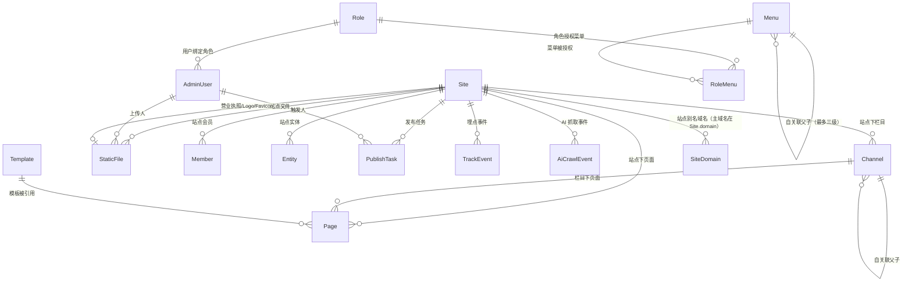
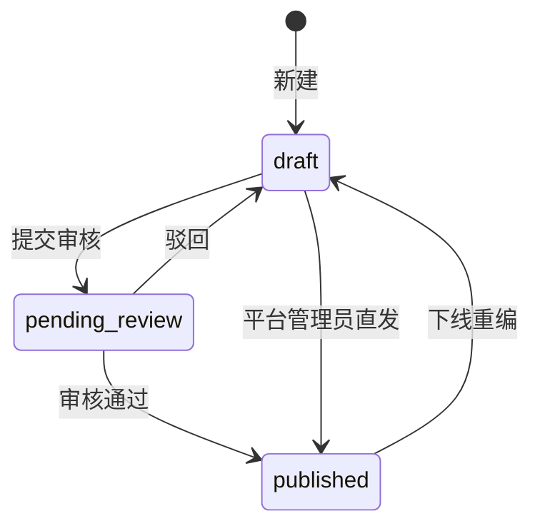

# 04 · 数据模型

> 16 张表的职责、关系、字段口径与隔离策略。逐条DDL 以 `apps/server/prisma/schema/*.prisma` 为准，本文说明**为什么这样设计**。
> **术语**：专有名词（物化路径 / 内容指纹 / 块标识 / 公共模板 …）统一解释见 [`../GLOSSARY.md`](../GLOSSARY.md)。

---

## 1. 概览



> 说明：`Site → StaticFile` 通过 `businessLicenseFileId / logoFileId / faviconFileId` 弱引用（未建外键约束），目的是避免删除文件时产生级联不可逆副作用；引用完整性由业务层保障。

## 2. 表清单

| 表             | 归属 | 职责一句话                                              | 隔离维度  |
| -------------- | ---- | ------------------------------------------------------- | --------- |
| `Site`         | 平台 | 站点 = 企业：资质、备案、SEO/GEO 默认值、渲染模式、主题 | 行本身    |
| `SiteDomain`   | 平台 | 站点别名域名映射（**主域名仍存 `Site.domain`**，本表只放别名） | `siteId`  |
| `AdminUser`    | 平台 | 管理员账号：绑定角色（`roleId`）+ 授权站点列表          | 角色+站点 |
| `Template`     | 平台 | 模板定义：key + Block 槽位序列                          | 全局      |
| `Channel`      | 站点 | 栏目树（`parentId` 自关联）                             | `siteId`  |
| `Page`         | 站点 | 页面 = 模板 + 结构化 Block + GEO 元数据                 | `siteId`  |
| `StaticFile`   | 站点 | 上传文件元信息（**URL 与物理存储解耦**）                | `siteId`  |
| `Member`       | 站点 | 站点会员，`(siteId, username)` 唯一                     | `siteId`  |
| `Entity`       | 站点 | 品牌/产品/机构实体与别名（GEO 一致性）                  | `siteId`  |
| `PublishTask`  | 站点 | 发布任务与构建日志                                      | `siteId`  |
| `TrackEvent`   | 站点 | 匿名路由访问事件（PV/UV 数据源）                        | `siteId`  |
| `AiCrawlEvent` | 站点 | AI 爬虫抓取记录（GEO 数据面）                           | `siteId`  |
| `Menu`         | 平台 | 后台侧栏菜单（`parentId` 自关联，最多三级）             | 全局      |
| `Role`         | 平台 | 后台角色（`platform` 标记是否平台级）                   | 全局      |
| `RoleMenu`     | 平台 | 角色-菜单授权关系（复合主键，授权即可见）               | 全局      |
| `NewsArticle`  | 站点 | 新闻文章**管理源**表（页面是发布产物，见 §8）           | `siteId`  |
| `FaqItem`      | 站点 | 问答条目**管理源**表（页面是发布产物，见 §8）           | `siteId`  |

> `Entity.siteId` 与 `StaticFile.siteId` 允许为 `null`，代表**集团级公共**资源。

### 2.1 主键与 ID 约定（强制，见 [ADR-043](./08-adr.md)）

- **形态**：所有表主键 `id String @id @db.VarChar(36) @default(uuid(7))` —— uuid v7 由**应用侧生成**，按时间有序
- **外键**：所有指向其它表的标量列同为 `String @db.VarChar(36)`（`siteId` / `channelId` / `parentId` / `roleId` / `menuId` / `*FileId` 等），**禁止 Int 外键**
- **禁止**：`@default(autoincrement())`、数据库侧 `AUTO_INCREMENT`
- **允许**：复合主键（仅 `RoleMenu` 的 `@@id([roleId, menuId])`），但不得含自增列
- **主键必须真实存在**：字符串 ID 不替代 PRIMARY KEY；建表 / 迁移后必须校验每张表都有主键（见 §6）
- **涉及 model（20 个）**：`AdminUser`、`Entity`、`Channel`、`Page`、`Template`、`BlockDefinition`、`BlockDefinitionVersion`、`Member`、`Navigation`、`NavigationItem`、`Menu`、`PublishTask`、`NewsArticle`、`FaqItem`、`Site`、`SiteDomain`、`StaticFile`、`Role`、`TrackEvent`、`AiCrawlEvent`
- **边界校验**：接口 `:id` 路径参数走 `ParseUUIDPipe`，服务端不再做 `Number(id)`

## 3. 核心表说明

### 3.1 `Site`（站点 = 企业）

| 分组             | 字段                                                                                                        | 设计要点                                                                    |
| ---------------- | ----------------------------------------------------------------------------------------------------------- | --------------------------------------------------------------------------- |
| 网站信息         | `name`、`slug`（唯一，同时是产物目录名）、`domain`（**主域名**）、`icpNumber`、`policeNumber`               | `slug` 改动需同步迁移产物目录（v1 未提供自动迁移）；`domain` 是**主域名**（域名或 `host:port`），生产填正式域名、本地开发填本地地址（如 `localhost:3002`），后台列表「预览」按**主域名 + `slug` 前缀**拼装（本地多站点共用 `localhost:3002` 时靠前缀区分目标站点）、SEO 绝对 URL（sitemap / llms.txt / JSON-LD）用主域名；别名域名见 3.1 下方的 `SiteDomain` |
| 企业主体         | `companyName`、`creditCode`、`businessLicenseFileId`、`companyAddress`、`contactPhone`、`contactEmail`      | 营业执照图片仅后台存档，不对外渲染                                          |
| SEO / GEO 默认值 | `seoTitle`、`seoDescription`、`seoKeywords`、`logoFileId`、`faviconFileId`、`defaultLocale`、`robotsPolicy` | 页面未单独配置时的兜底；`seoDescription` 同时作为 `llms.txt` 站点级摘要来源 |
| 平台配置         | `renderMode`（`ssg`/`ssr`）、`themeConfig`、`status`、`createdAt`、`updatedAt`                              | `themeConfig` 为 JSON，驱动 GEO 项目外观 CSS 变量                           |

**多域名映射（主域名 + 别名域名）**：一个站点可被多个域名访问，其中 `Site.domain` 是**主域名**（唯一），其余域名以 `SiteDomain`（`siteId` + `domain` 唯一）记录，例如 `www.xxx.com`、`xxx.cn`、备案备用域名。

- **不把主域名重复进 `SiteDomain`**：主域名只有一个真相来源（`Site.domain`），避免双写不一致；别名表只承担"额外域名 → 站点"的映射。
- **域名全局唯一**：别名域名不允许与任何站点的主域名或其他站点的别名域名重复（`SiteDomain.domain` 唯一约束 + 服务端校验兜底），保证"域名反查站点"结果唯一。
- **主域名与别名的分工**：SEO 绝对 URL / sitemap / llms.txt 一律用**主域名**，后台列表「预览」用**主域名 + `slug` 前缀**；别名域名只参与 **GEO 项目按请求 Host 反查站点**（SSR 运行时）与 robots.txt，页面内容与元数据完全一致。
- **生命周期**：别名域名随站点删除级联清理（真实外键 `ON DELETE CASCADE`）；站点编辑时按提交的数组**全量替换**（服务端事务内 diff 增删）。

### 3.2 `Page`（页面 = 模板 + Block）

关键字段与 GEO 的对应关系：

| 字段                                          | 作用                                                           | GEO 关联层 |
| --------------------------------------------- | -------------------------------------------------------------- | ---------- |
| `title`                                       | 渲染为页面唯一 H1                                              | L2         |
| `summary`                                     | `llms.txt` 摘要 + meta description 复用                        | L1/L3      |
| `blocks`                                      | 结构化 Block JSON 数组（契约见 `packages/shared` `BlockData`） | L1         |
| `authorName`                                  | E-E-A-T 权威性署名                                             | L1         |
| `seoTitle` / `seoDescription` / `seoKeywords` | 页面级覆盖站点默认值                                           | L3         |
| `status`                                      | `draft` / `pending_review` / `published`                       | ACL        |
| `publishedAt`                                 | 发布时间，用于内容新鲜度信号                                   | L2         |
| `templateId`                                  | 指向 `Template.key`，决定槽位序列                              | L3         |

**内容状态机**



> 服务端在 `draft/pending_review → published` 时会执行 GEO 前置体检；存在 `error` 级问题则阻断（见 `06`）。

### 3.3 `StaticFile`（URL 与存储解耦）

- 物理路径：`uploads/yyyy/mm/{uuid}.{ext}`
- 对外 URL：`/static/yyyy/mm/{uuid}.{ext}`
- 业务表只存 `fileId` 引用，**将来切对象存储只需改 URL 生成规则 + 迁移脚本，业务零改动**
- 上传约束：MIME 白名单、单文件 ≤ 10MB

### 3.4 `TrackEvent` / `AiCrawlEvent`（监控数据面）

| 表             | 用途                                                                   | 关键字段                                            |
| -------------- | ---------------------------------------------------------------------- | --------------------------------------------------- |
| `TrackEvent`   | PV/UV 统计；UV 依据本地生成的匿名 `anonId` 去重，不含个人信息          | `siteId`、`path`、`referrer`、`anonId`、`userAgent` |
| `AiCrawlEvent` | 记录 GPTBot / ClaudeBot / PerplexityBot 等抓取情况，后期做引用效果分析 | `siteId`、`botType`、`path`、`status`、`bytes`      |

### 3.5 `Menu`（后台菜单配置）

| 字段                      | 作用                                                                  |
| ------------------------- | --------------------------------------------------------------------- |
| `parentId`                | 自关联上级菜单，`null` = 一级；层级由链路推导，**服务端强制最多三级** |
| `title` / `path`          | 侧栏展示文本与路由路径；目录型菜单 `path` 为 `null`，仅用于展开子级   |
| `sort`                    | 同级排序，升序（与 `parentId` 组索引，侧栏主查询路径）                |
| `visible` / `status`      | 侧栏是否渲染 / 是否启用（`disabled` 或隐藏项不出现在侧栏树中）        |
| `createdAt` / `updatedAt` | 中国时区时间串，管理页展示                                            |

- **可见性来自授权**：菜单本身不带"平台级"标记，某角色能看到哪些菜单完全由 `RoleMenu` 决定（见 3.6）
- **菜单是体验层配置**：接口按角色授权过滤菜单树只是 UX；真正的安全边界仍是 `AdminAuthGuard` / `PlatformAdminGuard`（见 ADR-005、ADR-018）
- **不挂 `siteId`**：后台菜单为全平台一份（多站点共用同一后台壳），站点差异由站点选择器承担
- 删除策略：图谱简单，存在子菜单时**拒绝删除**（`400`）；菜单删除时其授权记录由 `RoleMenu` 级联清理

### 3.6 `Role` / `RoleMenu`（用户 → 角色 → 菜单）

权限模型为三层绑定：**用户绑角色（`AdminUser.roleId`）· 角色绑菜单（`RoleMenu`）**。

| 表 / 字段                        | 作用                                                                         |
| -------------------------------- | ---------------------------------------------------------------------------- |
| `Role.code`                      | 角色标识（唯一），如 `admin` / `site_admin`；内置角色的 `code` 不允许修改    |
| `Role.platform`                  | **是否平台级角色**：平台级操作的唯一判据（`PlatformAdminGuard` 按此放行）    |
| `Role.builtin`                   | 内置角色：禁止删除，禁止停用（避免系统失去管理入口）                         |
| `Role.status`                    | `active` / `disabled`；停用后该角色的用户无法登录                            |
| `RoleMenu(roleId, menuId)`       | 复合主键的授权关系；删除角色或菜单时级联清理                                 |
| `AdminUser.roleId`               | 用户 → 角色的外键（`ON DELETE RESTRICT`，角色仍被用户引用时不可删除）        |

- 授权**自动补全祖先**：保存角色的菜单授权时服务端会把所有上级菜单一并写入，避免"授权了子菜单却看不到"（侧栏建树需要完整链路）
- 安全护栏：内置角色不可删除 / 不可停用 / 不可改标识；系统必须始终保留至少一个可用的平台级用户（不可删除自己、不可把最后一个平台级用户降级或停用）
- 角色信息随 JWT 下发（`roleId/roleCode/roleName/platform`），**角色变更需用户重新登录生效**——取舍与理由见 [ADR-019](./08-adr.md#adr-019-rbac用户--角色--菜单绑定)

## 4. 字段口径（强制）

| 项        | 约定                                                                          | 理由                                             |
| --------- | ----------------------------------------------------------------------------- | ------------------------------------------------ |
| 时间精度  | 统一 `@db.DateTime(0)`                                                        | 需求指定格式 `2026-10-05 10:10:10`，禁用毫秒尾数 |
| 命名      | Prisma 字段 camelCase + `@map("snake_case")` 落库为下划线                     | 代码友好 + 库表规范                              |
| 时间读写  | Prisma 按 **UTC** 读写 MySQL `DATETIME`（Prisma 标准行为，勿改）              | 强改为墙钟会破坏往返一致性                       |
| 对外输出  | 一律走 `common/utils/datetime.ts`（覆盖 `Date.prototype.toJSON`）输出北京时间 | 直接 `toISOString()` 会早 8 小时（**禁止**）     |
| 注释      | 每个 model 与字段必须写 `///` 中文注释                                        | 同步进生成的 client 类型与库 COMMENT，降低误用   |
| JSON 字段 | 列表类用 `Json @default("[]")`，配置类用带默认值的 JSON 字符串                | Prisma 写入需经 `toJsonInput` 收窄               |

## 5. 隔离与索引

| 策略         | 落地                                                                                                                                                                   |
| ------------ | ---------------------------------------------------------------------------------------------------------------------------------------------------------------------- |
| 行级隔离     | 所有内容/日志类表挂 `siteId`，查询经 `siteWhere` / `siteIdWhere` 强制过滤                                                                                              |
| 越权阻断     | `assertSiteAccess(user, siteId)` 在 Service 入口执行（Guard 之外的第二道防线）                                                                                         |
| 唯一性       | 栏目 `@@unique([siteId, slug])`、页面 `@@unique([siteId, channelId, slug])`、会员 `@@unique([siteId, username])`、站点别名域名 `SiteDomain.domain`（全局唯一）        |
| 查询热点索引 | `@@index([siteId, status])`（Page）、`@@index([siteId, path])`（TrackEvent）、`@@index([siteId, botType])`（AiCrawlEvent）、`@@index([siteId, status])`（PublishTask） |

## 6. Schema 组织与迁移

```
apps/server/prisma/
├── schema/
│   ├── main.prisma          # datasource + generator（唯一入口）
│   ├── defaults.prisma      # JSON 默认值文档说明
│   ├── site.prisma          # Site / SiteDomain（别名域名映射）
│   ├── static-file.prisma   # StaticFile
│   ├── admin-user.prisma    # AdminUser
│   ├── member.prisma        # Member
│   ├── content.prisma       # Channel / Page / Template
│   ├── entity.prisma        # Entity
│   ├── track.prisma         # TrackEvent / AiCrawlEvent
│   ├── publish-task.prisma  # PublishTask
│   ├── news-faq.prisma      # NewsArticle / FaqItem（新闻问答管理源）
│   ├── menu.prisma          # Menu
│   ├── role.prisma          # Role / RoleMenu
│   └── migrations/          # Prisma 迁移历史
└── seed.ts                  # 种子：内置角色 + 角色菜单授权 + admin 账号 + 后台菜单 + 3 个模板 + 示例站点 star-tech
```

- **禁止写单一大 schema 文件**；新增模型按领域新建文件
- 迁移：`prisma migrate dev --name <语义名>`；生产：`prisma migrate deploy`
- 种子：`prisma db seed`（经 `tsx prisma/seed.ts` 执行），可重复执行（已用 upsert 幂等设计）
- **迁移历史（2026-10-20 重建为单条基线）**：仓库内只保留 `20261020120000_init_id_string`（由 `prisma migrate diff --from-empty` 生成，含 21 张表的完整 DDL、全部外键与 `PRIMARY KEY`）。此前的 `20261005103528_init` 等历史迁移与当下 schema 已严重漂移（缺 `path` / `content_hash` / `draft` / `Role` 关联等），故于 2026-10-20 以基线整体替换；**空库**直接 `pnpm db:deploy*` 即建成当前结构
- **主键与 ID 改造（2026-10-20，ADR-043）**：全表主键由 Int 自增改为 **uuid v7 字符串**（应用侧生成、时间有序），存量数据经「old→new 映射表 + `INSERT ... SELECT` 改写全部外键列 + JSON 内嵌 id（`AdminUser.siteIds` / `PublishTask.targets.pageIds`）」一次性重映射；本地库已按此重建，线上库以本地重建结果整体替换（见 §2.1）
- **主键校验（强制）**：建表 / 迁移完成后必须复核「每张表都有真实 PRIMARY KEY」——字符串 ID **不替代**主键约束；漏主键会让 Prisma 省略 id 的 INSERT 直接被 MySQL 拒绝（`P2011 Null constraint violation` / 1075），线上曾因此全线写失败
- **迁移方式**：Windows 下 MySQL `lower_case_table_names=1` 会让 `prisma migrate dev` 对自关联外键产生 drift 误报（并要求 reset），故一律为**手工维护 SQL + `prisma migrate deploy`** 路径，避免误 reset 开发库

---

## 7. 新增数据模型（2026-10-06，详见 [`09`](./09-site-editor.md) §3）

> 逐条 DDL 以 `apps/server/prisma/schema/*.prisma` 为准；本节登记改动范围，避免文档漂移。

### 7.1 扩展现有表

| 表 | 新增字段 | 口径 |
| -- | -------- | ---- |
| `Site` | `legalName` / `commonName` / `abbrName`、`clinicRegNo` / `licenseValidFrom` / `licenseValidTo` / `orgType` / `level` / `legalPerson` / `principal` / `foundDate` / `practiceScopes`、`addressFull` / `postalCode` / `lat` / `lng`、`phone` / `phoneServiceHours`、`openingHours`、`medicalInsurance` / `insuranceNo`、`sameAs`、`themeTokens`、`geoJsonLd` / `geoJsonLdMode`、`llmsTxt` / `llmsTxtMode`、`headExtra` / `headExtraMode`、`robotsMeta` | **NAP 唯一事实来源是机构实体档案页**；`Site` 只存值，页面只读引用 |
| `Channel` | `path`（`@@unique([siteId, path])`） | 物化路径，目录默认不超 5 层、仅校验不成环 |
| `Page` | `path`（`@@unique([siteId, path])`）、`kind`（`static` / `list` / `detail`）、`draft`（整页草稿快照 JSON）、`contentHash` / `publishedHash`、`jsonLd` / `jsonLdMode`、`sort` | `path` 是「页面 ↔ 线上地址 ↔ 产物文件」的唯一锚点；`status = published` 后 `slug` / `channelId` 锁定（服务端 400） |
| `StaticFile` | `caption` / `location` / `takenAt` / `imageNo` | 对应图集块"每张图必须有文字、可追溯" |
| `PublishTask` | `scope`（`page` / `site`）、`targets`、`buildId`、`artifact` | **移除**块级发布语义 |

### 7.2 新增表

| 表 | 职责 | 关键约束 |
| -- | ---- | -------- |
| `BlockDefinition` | 块代码唯一事实来源（`siteId = 0` 为**公共模板**，其余为**站点块**＝站点独有副本；见 [09 §4.5](./09-site-editor.md)） | `key` `^[a-z][a-z0-9-]{1,40}$`；`@unique([key, siteId])`；`code` / `codeHash` / `version` / `compileStatus` |
| `BlockDefinitionVersion` | 块代码版本留档（回退上一版） | `@unique([blockId, version])` |
| `Navigation` | 导航分组（`header` / `footer-1`~`footer-4`） | 站点级；**不从内容树推导** |
| `NavigationItem` | 导航项（`label` / `pageId` / `href` / `sort` / `status`） | 未指向页面且无 `href` 的项在后台告警 |

### 7.3 迁移与回填

- 迁移走「手工维护 SQL + `prisma migrate deploy`」（Windows 下 `lower_case_table_names=1` 会让 `migrate dev` 误报 drift）
- 回填：`Channel.path` / `Page.path` 推导；旧 `Page.blocks` 补 `id`（nanoid）与 `enabled` 并升级为 `{ id, key, enabled, data }`
- 种子：新增菜单（内容编辑器 / 块库 / 导航管理）+ 内置块定义

---

## 8. 新闻/问答独立数据表（2026-10-15，表为管理源、页面是发布产物）

> 背景：新闻/问答此前仅以「Page + 块数据」形态存在，列表/详情都从 `Page.blocks` 解析，管理面增删改要同时操控多个页面与派生块。本轮引入独立数据表作为**管理源**，`Page` 退化为**发布产物**：管理面 CRUD 直读/直写表，保存后由 news-faq 模块把表内容物化成详情页标准块组合并重算派生块（列表页、related-faq），再自动触发页面级发布。迁移 `20261015100000_add_news_faq_tables`（手工维护 SQL + `migrate deploy`）。

### 8.1 表结构（DDL 以 `apps/server/prisma/schema/news-faq.prisma` 为准）

| 表 | 字段 | 关键约束 |
| -- | ---- | -------- |
| `NewsArticle` 新闻文章 | `siteId` / `title`(200) / `summary`(500，缺省取正文首段截断) / `content`(**Text 纯文本，\n 分段**) / `publishDate`(10，`YYYY-MM-DD`，不允许早于今天) / `slug`(120) / `status`(20，默认 `published`) / `pageId`(Int?) / `createdAt` / `updatedAt` | `@@unique([siteId, slug])`；`@@index([siteId])` |
| `FaqItem` 问答条目 | `siteId` / `question`(200) / `category`(100) / `answer`(**Text 纯文本，\n 分段**) / `slug`(120，形态 `q{三位序号}`) / `status`(20，默认 `published`) / `pageId`(Int?) / `createdAt` / `updatedAt` | `@@unique([siteId, slug])`；`@@index([siteId, category])` |

设计口径：

- **`pageId` 为 `Page` 弱引用（不建外键）**：与「发布产物可被站点编辑器独立删除」的现实一致；引用完整性由业务层保障——编辑时 `pageId` 为空或页面缺失会按 slug **补建/挂接**页面。
- **`slug` 创建后不可修改**（编辑 DTO 不收 slug），访问地址 `path = /news/{slug}`、`/faq/{slug}` 由 slug 拼出，保证 URL 稳定性（GEO 前提）。
- **正文是纯文本按 `\n` 分段**，不用富文本（REQUIREMENTS 禁项）；发布时拆为 `article-body` 段落块 / `faq-detail` 段落。
- **时间字段**：`createdAt` / `updatedAt` 走 `@db.DateTime(0)` 惯例，接口输出经 `formatDateTime`（中国时区）；`publishDate` 是业务日期字符串（`VarChar 10`），不走 DATETIME。
- 管理面「保存即发布」：`status` 恒为 `published`，编辑 DTO 不收 `status`。

### 8.2 数据回填

`apps/server/scripts/backfill-news-faq-tables.mjs`（一次性，幂等按 siteId+slug 判重）：siteId=3 的 `/news/*` 详情页 → `NewsArticle`（title/summary 取页面，content=article-body 段落按 `\n` 拼接，publishDate=article-meta.date，slug=去 `/news/` 前缀，pageId=page.id）；`/faq/qNNN` → `FaqItem`（question/cat/paragraphs 取 faq-detail 块）。预期结果：**NewsArticle 7 条、FaqItem 102 条**。

---

> 下一步：[`05-api-contract.md`](./05-api-contract.md) —— 接口清单与鉴权矩阵。
