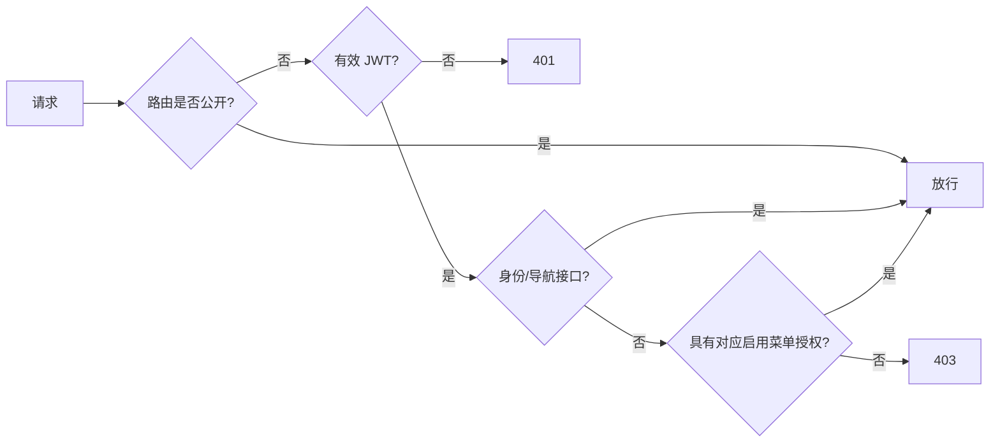

# 05 · 接口契约

> 全部对外 REST 接口的清单、鉴权矩阵与约定。逐条实现以 `apps/server/src/modules/**/*.controller.ts` 为准。
> 管理后台的调用封装见 [`03-frontend-architecture.md`](./03-frontend-architecture.md) §2.2。
> **术语**：专有名词（预览票据 / 产物清单 / 模板库 …）统一解释见 [`../GLOSSARY.md`](../GLOSSARY.md)。

---

## 1. 通用约定

| 项       | 值                                                                |
| -------- | ----------------------------------------------------------------- |
| Base URL | `http://<server-host>:3001/geoserver`                             |
| 协议     | REST over HTTP/JSON                                               |
| 鉴权方式 | `Authorization: Bearer <token>`                                   |
| 成功响应 | `{ "code": 0, "message": "ok", "data": <T> }`                     |
| 失败响应 | `{ "code": <HTTP状态码>, "message": "<错误描述>", "data": null }` |
| 时间格式 | `2026-10-05 10:10:10`（北京时间，见 `04` §4 口径）                |
| 分页入参 | `page`（默认 1）、`pageSize`（**默认 20**，档位 `[10, 20, 30, 50, 100]`；越界或非法值回退默认值，见 `src/common/constants.ts`） |
| 分页出参 | `{ list, total, page, pageSize }`                                 |
| 文档     | Swagger `/geoserver/docs`，**生产环境关闭**                             |

### 1.1 状态码

| 状态 | 何时出现                                      | 前端处理               |
| ---- | --------------------------------------------- | ---------------------- |
| 200  | 成功                                          | 解包 `data`            |
| 400  | 参数校验失败 / 业务约束冲突（如上传类型不符） | `ElMessage.error`      |
| 401  | 缺失或失效 token                              | 清 token 并跳 `/login` |
| 403  | 无对应菜单授权 / 内部调用凭证错误 / 需求 IP 被封禁 | 提示无权限或请求被拒绝 |
| 404  | 资源不存在                                    | 提示未找到             |
| 500  | 未处理异常（过滤器统一兜底）                  | 提示 + 记录日志        |

## 2. 鉴权矩阵

| 层级                | 适用范围                                                                                           | 实现位置                              |
| ------------------- | -------------------------------------------------------------------------------------------------- | ------------------------------------- |
| 公开无鉴权          | `/geoserver/auth/login`、`/geoserver/health`、`/geoserver/public/**`、`/geoserver/track/collect`、`/geoserver/site-auth/register | login`                                | 控制器未挂 Guard |
| JWT-A（身份接口） | `/auth/me`、当前用户菜单树等身份/导航接口 | `AdminAuthGuard` |
| JWT-A + 对应菜单 | 全平台管理业务接口；不按用户/角色 siteIds 或 platform 限制数据/操作 | AdminAuthGuard + MenuPermissionGuard，启用菜单 RoleMenu 授权 |
| 内部调用身份 | `/internal/access-events` 等内部写入/渲染接口，不公开给浏览器 | 内部令牌缺失/错误拒绝，不能以 CORS 代替 |
| JWT-M（站点会员）   | `/geoserver/site-auth/verify`、`/geoserver/site-auth/me`                                           | 会员域 token                          |

> 2026-11-06 按上游与用户授权，管理业务控制器已统一登录 + 菜单授权；§3/§6 历史“平台级/站点级”鉴权列不再适用，实际菜单映射以 §2.1 与 02 §4.3 为准。会员 JWT-M、资源归属、内部身份与防锁死保留。不自动向角色补授菜单。

图示仅描述管理 JWT-A 目标流程；内部调用及 JWT-M 独立鉴权，不走公开无校验分支。菜单隐藏不代替接口拒绝。

### 2.1 全平台权限调整与菜单映射

管理控制器已接入对应菜单，PlatformAdminGuard 不再挂业务路由；site-scope 仅显式筛选，assertSiteAccess 为兼容空入口；登录/用户视图与用户 DTO/UI 已移除 siteIds，不删历史数据库列。接口菜单映射见 02 §4.3，共享站点选择、角色列表、菜单授权树、上传与块详情仅开放对应消费菜单，不扩大独占维护权限。

| 范围 | 当前调用点 | 要求 |
| --- | --- | --- |
| 登录用户与站点授权 | common/utils/site-scope.ts、decorators/current-user、guards/admin-auth、auth/auth.service、admin-users/service 与 DTO；管理后台用户表单/用户页 | 取消 user.siteIds 授权条件及站点授权入口；保留登录、角色绑定、账号安全护栏 |
| 站点与内容 | sites.service、bootstrap.service、content.service、editor.service、news-faq.service、catalog/products.service/cases.service | 区分 assertSiteAccess/siteWhere/siteIdWhere 的授权条件和业务 siteId 条件，只移除前者；站点归属、同站关联、派生和显式筛选保留 |
| 资源、渲染与发布 | static-files、entities、members、blocks、navigation、geo、preview、publish 服务及相关控制器 | 统一对应菜单校验，移除后台站点数据权限与平台角色业务门槛；公共块副本隔离、短时预览票据、内部令牌、发布约束不取消 |
| 平台维护与现有统计 | sites/publish/menus/roles/admin-users/blocks 等平台守卫；track 两个统计读口 | 按功能菜单控制接口，不只隐藏侧栏；不增加 track 的站点授权，不将其统计纳入新监控；菜单与角色关联维护仍保留 |
| 当前新增入口 | RequireMenu、MenuPermissionGuard、access/demands 控制器 | 新入口已接入；监控 `/monitor`、需求及封禁 `/sites/demands`；新增菜单不补授既有角色（含空授权角色），仅新建内置角色初始化默认授权 |

MenuPermissionGuard 按启用 Menu.path + RoleMenu 校验，未声明拒绝；单路径、任一消费路径、all共同操作、blocks实际归属四种声明。块创建以 scope=public 优先于 siteId 判定模板权限，防止伪造 siteId 绕过。公开写口仅保留 track 摄取、会员注册/登录、需求提交与既有专用校验；没有匿名内容维护入口。测试先失败后通过，含全管理路由元数据与真实 Nest HTTP 的401/403/跨站非平台成功；真实数据库与上线验收不由这些替身测试替代。

## 3. 接口清单（86 条）

### 3.1 auth · 管理员鉴权

| 方法 | 路径          | 用途                     | 鉴权  |
| ---- | ------------- | ------------------------ | ----- |
| POST | `/auth/login` | 登录并签发 JWT-A         | 公开  |
| GET  | `/auth/me`    | 当前管理员身份与角色信息，不返回 siteIds | JWT-A |

### 3.2 sites · 站点管理

| 方法   | 路径         | 用途                                | 鉴权               |
| ------ | ------------ | ----------------------------------- | ------------------ |
| GET    | `/sites`     | 分页列表（支持模式/状态筛选、搜索） | JWT-A              |
| GET    | `/sites/:id` | 站点详情（含企业资质与 SEO 默认值） | JWT-A              |

> **构建状态字段**：`GET /sites`、`GET /sites/:id` 每个站点额外带 `build`：最新一条构建任务摘要（`null` = 从未构建），站点管理列表的「构建状态」列与编辑器按钮锁定都用它，详见 §3.6。
| POST   | `/sites`     | 新建站点                            | JWT-A + 平台管理员 |
| PATCH  | `/sites/:id` | 编辑站点（含渲染模式、主题）        | JWT-A + 平台管理员 |
| DELETE | `/sites/:id` | 删除站点                            | JWT-A + 平台管理员 |

> **多域名映射（主域名 + 别名域名）**：`Site.domain` 是主域名（必填，SEO 绝对 URL / 列表「预览」用），其余域名以 `domains: string[]` 表达：
>
> - `POST /sites`、`PATCH /sites/:id` 的 `domains` 为**别名域名数组**，语义是**全量替换**（不传或空数组 = 清空别名）；
> - `GET /sites`、`GET /sites/:id` 返回 `domains: string[]`（该站点全部别名域名）；
> - 别名域名**全局唯一**：与任一站点的主域名或其他站点的别名域名重复时返回 `400`；关键字搜索同时匹配站点名 / slug / 主域名 / 别名域名 / 企业名；
> - `/public/**` 的 `:key` 可取站点 `slug`、**主域名**或**任一别名域名**（GEO 项目 SSR 按请求 Host 反查站点即走此路径），返回内容与元数据一致；
> - 本地回环地址（`localhost` / `127.0.0.1`）下 GEO 以 URL 首段作为站点前缀传给 `:key`，并在请求页面前剥离该前缀（`/example-site/visit` → `path=/visit`），即后台站点列表「预览」地址的拼接口径；**预览票据（`POST /preview/ticket`）返回的 iframe 地址在回环基址下同样带该前缀**，iframe 内后续跳转由 GEO 全局中间件补齐前缀并保留票据（见 ADR-031）；站点地址一律走 shared 的 `buildSiteUrl`，各端禁止自行拼装。

### 3.3 files · 静态文件

| 方法   | 路径               | 用途                            | 鉴权  |
| ------ | ------------------ | ------------------------------- | ----- |
| POST   | `/files/upload`    | 上传文件（MIME 白名单、≤10MB）  | JWT-A |
| GET    | `/files`           | 按站点列出文件（`siteId` 可选） | JWT-A |
| PUT    | `/files/:id/replace` | **替换文件内容**（multipart 字段 `file`）：保持记录与 URL（物理路径名）不变，仅覆盖物理文件并更新 `sizeBytes` / `originalName`；新文件 MIME 必须与原记录一致，白名单与 10MB 上限同上传 | JWT-A |
| DELETE | `/files/:id`       | 删除文件记录与物理文件          | JWT-A |

### 3.4 content · 内容

| 方法   | 路径                           | 用途                                 | 鉴权  |
| ------ | ------------------------------ | ------------------------------------ | ----- |
| GET    | `/content/channels`            | 栏目树（按站点）                     | JWT-A |
| POST   | `/content/channels`            | 新建栏目                             | JWT-A |
| GET    | `/content/pages`               | 页面列表（可按站点、状态、栏目过滤） | JWT-A |
| GET    | `/content/pages/:id`           | 页面详情（含 Block 数组）            | JWT-A |
| POST   | `/content/pages`               | 新建页面                             | JWT-A |
| PATCH  | `/content/pages/:id`           | 编辑页面                             | JWT-A |
| PATCH  | `/content/pages/:id/status`    | 状态流转（含发布前 GEO 体检）        | JWT-A |
| GET    | `/content/pages/:id/geo-check` | 单独获取 GEO 体检结果                | JWT-A |
| DELETE | `/content/pages/:id`           | 删除页面                             | JWT-A |

### 3.5 members / entities · 会员与实体

| 方法   | 路径            | 用途                         | 鉴权  |
| ------ | --------------- | ---------------------------- | ----- |
| GET    | `/members`      | 站点会员列表                 | JWT-A |
| POST   | `/members`      | 新建站点会员                 | JWT-A |
| DELETE | `/members/:id`  | 删除会员                     | JWT-A |
| GET    | `/entities`     | 实体列表（含集团级公共实体） | JWT-A |
| POST   | `/entities`     | 新建实体                     | JWT-A |
| PATCH  | `/entities/:id` | 编辑实体与别名               | JWT-A |
| DELETE | `/entities/:id` | 删除实体                     | JWT-A |

### 3.6 publish · 发布

| 方法 | 路径                    | 用途                           | 鉴权               |
| ---- | ----------------------- | ------------------------------ | ------------------ |
| POST | `/publish/page/:siteId` | 页面级增量发布（入队）         | JWT-A              |
| POST | `/publish/site/:siteId` | 整站重建                       | JWT-A + 平台管理员 |
| GET  | `/publish/tasks`        | 任务列表与日志（取最近 20 条） | JWT-A              |
| GET  | `/publish/geo-docs/:siteId` | 站点 GEO 产物内容：读取**已构建产物目录里落盘的** `robots.txt` / `sitemap.xml` / `llms.txt`（含 `exists` / `size` / `updatedAt` / `content` 与清单 `generatedAt`），站点列表「GEO产物」弹窗数据源 | JWT-A |
| PUT  | `/publish/geo-docs/:siteId` | 手动替换 GEO 产物文件（body `{ key, content }`，key ∈ robots / sitemap / llms）：**非常规兜底**，仅用于自动结果无法满足特殊上线要求时人工直写；与构建互斥，下次 GEO 索引更新 / 整站重建会按统一口径重新生成并覆盖 | JWT-A |

**构建状态与互斥（2026-10-08 新增）**

- `GET /publish/artifacts/:siteId` 额外返回 `task`：该站点**最新一条**构建任务摘要 `{ id, scope, status, createdAt, finishedAt, log }`，无任务为 `null`。它是**构建状态标记与按钮锁定**的唯一数据来源，`status ∈ pending | running | success | failed`
- `GET /sites`（列表）与 `GET /sites/:id`（详情）每个站点额外返回 `build`（同一摘要结构，无任务为 `null`），站点管理列表的「构建状态」列据此渲染
- **同站点互斥（手动入口）**：站点存在 `pending` / `running` 任务时，`POST /publish/page/:siteId`、`POST /publish/site/:siteId` 直接返回 **`409`**（提示「正在构建中 / 已有任务排队中」），不再静默排队——手动入口要让运营看到「现在不能点」。**系统入口**（建站导入 `publish: true`）仍走排队，避免导入流程被已排队任务挡下；内存构建锁 + DB 状态仍双重保证同站点不会并发构建
- 任务与构建时间字段一律走 `formatDateTime`（`YYYY-MM-DD HH:mm:ss`，中国时区），不输出 ISO 串

### 3.7 track · 埋点与监控

本组为既有技术接口登记，不是新入站监控能力；本轮不删除、不新增统计消费或站点数据授权。新监控接口见 §7，不将 AiCrawlEvent 与 GeoAccessEvent 重复相加。

| 方法 | 路径                 | 用途                               | 鉴权  |
| ---- | -------------------- | ---------------------------------- | ----- |
| POST | `/track/collect`     | 埋点摄取（`sendBeacon`，攒批落库） | 公开  |
| GET  | `/track/overview`    | PV/UV 概览与 Top 页面              | JWT-A |
| GET  | `/track/ai-overview` | AI 爬虫抓取统计与 Top 路径         | JWT-A |
| POST | `/track/ai-crawl`    | AI 抓取事件摄取（支持批量）        | 公开  |

### 3.8 site-auth · 站点会员域

| 方法 | 路径                  | 用途                 | 鉴权  |
| ---- | --------------------- | -------------------- | ----- |
| POST | `/site-auth/register` | 会员注册（绑定站点） | 公开  |
| POST | `/site-auth/login`    | 会员登录并签发 JWT-M | 公开  |
| GET  | `/site-auth/verify`   | 校验会员 token       | JWT-M |
| GET  | `/site-auth/me`       | 会员自身信息         | JWT-M |

### 3.9 health / public

| 方法 | 路径                    | 用途                                           | 鉴权 |
| ---- | ----------------------- | ---------------------------------------------- | ---- |
| GET  | `/health`               | 健康检查                                       | 公开 |
| GET  | `/public/site/:key`     | 站点配置（GEO 项目 SSR/SSG 取数入口）          | 公开 |
| GET  | `/public/routes/:key`   | 已发布路由清单（构建目标 + 产物清单数据来源，支持 `?ids=`；每页含 `contentHash` 与 `blocks[].codeHash`） | 公开 |
| GET  | `/public/page/:key`     | 页面详情，入参 `?path=/xxx`（公开版，无草稿）  | 公开 |
| GET  | `/public/documents/:key`| 站点 GEO 文档（robots / sitemap / llms 正文，构建与「GEO 索引更新」共用） | 公开 |
| GET  | `/public/robots/:key`   | 按 `robotsPolicy` 动态生成 robots.txt          | 公开 |
| GET  | `/public/entities/:key` | 站点实体清单（llms.txt 与结构化数据来源）      | 公开 |

> `public` 模块只返回 `status = published` 的内容，草稿与待审核数据**绝不会**从这里泄漏。

### 3.10 menus · 后台菜单

| 方法   | 路径          | 用途                                                       | 鉴权              |
| ------ | ------------- | ---------------------------------------------------------- | ----------------- |
| GET    | `/menus/tree` | 侧栏菜单树（按当前用户角色的菜单授权过滤，最多三级）        | JWT-A             |
| GET    | `/menus`      | 菜单配置列表（平铺，含隐藏与停用项）                       | JWT-A + `/settings/menus` 或 `/settings/roles` |
| POST   | `/menus`      | 新建菜单（`parentId` 缺省为一级）                          | JWT-A + `/settings/menus` |
| PATCH  | `/menus/:id`  | 编辑菜单（换父级时校验环路与三级上限）                     | JWT-A + `/settings/menus` |
| DELETE | `/menus/:id`  | 删除菜单（存在子菜单返回 `400`，需先删子级）               | JWT-A + `/settings/menus` |

### 3.11 roles · 角色（用户 → 角色 → 菜单 的中间层）

| 方法   | 路径               | 用途                                                     | 鉴权              |
| ------ | ------------------ | -------------------------------------------------------- | ----------------- |
| GET    | `/roles`           | 角色列表（含 `menuIds` 授权与 `userCount` 绑定用户数）   | JWT-A + `/settings/roles` 或 `/settings/users` |
| POST   | `/roles`           | 新建角色（内置角色不可通过接口创建）                     | JWT-A + `/settings/roles` |
| PATCH  | `/roles/:id`       | 编辑角色（内置角色：标识与状态受保护）                   | JWT-A + `/settings/roles` |
| DELETE | `/roles/:id`       | 删除角色（内置角色或仍有用户绑定时返回 `400`）           | JWT-A + `/settings/roles` |
| PUT    | `/roles/:id/menus` | 保存菜单授权（覆盖式，服务端自动补全上级菜单）           | JWT-A + `/settings/roles` |

### 3.12 admin-users · 后台用户

| 方法   | 路径               | 用途                                                             | 鉴权              |
| ------ | ------------------ | ---------------------------------------------------------------- | ----------------- |
| GET    | `/admin-users`     | 用户列表（分页、关键字与角色筛选；永不返回密码）                 | JWT-A + `/settings/users` |
| POST   | `/admin-users`     | 新建用户（账号 + 密码 + roleId；不接收 siteIds 数据授权）         | JWT-A + `/settings/users` |
| PATCH  | `/admin-users/:id` | 编辑用户（账号不可改，`password` 留空表示不修改）                | JWT-A + `/settings/users` |
| DELETE | `/admin-users/:id` | 删除用户（不能删自己，须保留至少一个可用平台级用户，否则 `400`） | JWT-A + `/settings/users` |

> 菜单是**体验层**：`/menus/tree` 的过滤只是 UX，权限边界始终由 Guard 承担（见 [ADR-018](./08-adr.md#adr-018-后台菜单数据驱动)、[ADR-019](./08-adr.md#adr-019-rbac用户--角色--菜单绑定)）。

### 3.13 news-faq · 新闻资讯 / 高频问答（管理面）

> **表驱动**：新闻与问答的管理源是独立数据表 `NewsArticle` / `FaqItem`（见 [04 §8](./04-data-model.md)），`Page`（`kind=detail` 详情页，路径前缀 `/news/*` 与 `/faq/q*`）只是发布产物。
> 本组接口做管理面 CRUD，**每次增删改后自动重算派生块**（`/news`、`/faq` 列表页 + 同分类详情页 `related-faq`）
> 并自动触发**页面级**发布（系统入口、可排队），响应 `data` 携带 `affectedPages`（受影响页面 id 集合）与 `publishTaskId`（发布任务标识，无需发布时为 `null`）。
> 按登录 + 对应菜单授权；列表 siteId 用于主动筛选，详情直读表、不收 siteId、记录不存在 404。assertSiteAccess 仅为旧调用兼容空入口；记录 siteId 仍用于内容归属和派生，不以用户站点列表拒绝。

| 方法   | 路径                            | 用途                                                                     | 鉴权  |
| ------ | ------------------------------- | ------------------------------------------------------------------------ | ----- |
| GET    | `/news-faq/articles`            | 文章分页列表（读 `NewsArticle` 表：`?siteId&page&pageSize&keyword`，keyword 模糊匹配 title，按发布日期倒序；行含 `id, path, title, summary, publishDate, status, pageId`） | JWT-A |
| GET    | `/news-faq/articles/:id/detail` | 单条文章详情（**直读表，不接收 siteId 参数**；返回 `{ id, pageId, path, title, summary, publishDate, status, slug, content, bodyHtml, body }`，`content` 为 `bodyHtml` 派生的纯文本，`body` 为历史块数组（兼容）） | JWT-A |
| POST   | `/news-faq/articles`            | 新建文章（写表 → 建详情页；`{ siteId, title, summary?, publishDate, content?, bodyHtml?, body?, slug? }`；**正文以 `bodyHtml` 为准，字符串原样存储，不清洗、不归一**，`content` 由其派生；`body` 仅作历史兼容；`path=/news/{slug}`，slug 缺省自动生成 `news-YYYYMMDD-序号`，冲突 400；`publishDate` 必填且不允许早于今天） | JWT-A |
| PATCH  | `/news-faq/articles/:id`       | 编辑文章（`{ title?, summary?, publishDate?, content?, bodyHtml? }`；`bodyHtml` 传空串 = 清空正文；**slug 创建后不可改**；页面缺失自动补建） | JWT-A |
| DELETE | `/news-faq/articles/:id`        | 删除文章（删发布产物页面与表记录）                                        | JWT-A |
| GET    | `/news-faq/faqs`                | 问答分页列表（读 `FaqItem` 表：`?siteId&page&pageSize&keyword&category&featured`，keyword 模糊匹配 question，按 slug 倒序；`featured=1/0` 只看上架 / 只看未上架，缺省不限；行含 `id, path, question, category, status, featured, pageId`） | JWT-A |
| GET    | `/news-faq/categories`          | 问答分类清单（`?siteId`，`FaqItem.category` 去重，按首次出现顺序）        | JWT-A |
| GET    | `/news-faq/faqs/:id/detail`     | 单条问答详情（**直读表，不接收 siteId 参数**；返回 `{ id, pageId, path, question, category, status, featured, slug, answer, answerHtml }`，`answer` 纯文本、`answerHtml` 受限富文本（后台编辑器回显用）） | JWT-A |
| POST   | `/news-faq/faqs`                | 新建问答（`{ siteId, question, category, answer, answerHtml?, featured? }`；`path=/faq/q{三位序号}`，取现有最大序号 +1；`featured` 缺省 `true`；`answerHtml` 服务端白名单化并以它为准派生 `answer`） | JWT-A |
| PATCH  | `/news-faq/faqs/:id`            | 编辑问答（`{ question?, category?, answer?, answerHtml?, featured? }`；**slug 创建后不可改**；换分类时新旧分类的列表页与 related-faq 都重算；页面缺失自动补建） | JWT-A |
| PATCH  | `/news-faq/faqs/:id/featured`   | 上架开关（`{ featured: boolean }`；**只改 `featured` + 重算 `/faq` 列表页 + 发布**，不重写详情页、不重算 related-faq） | JWT-A |
| GET    | `/news-faq/faqs/:id/related`    | 关联问题读取（返回 `{ id, auto, ids, items }`；`auto=true` 表示还没手工指定，`ids/items` 是当下自动口径实际命中的那组） | JWT-A |
| PUT    | `/news-faq/faqs/:id/related`    | 关联问题保存（`{ ids: string[] }`，按数组顺序展示；**空数组＝恢复自动口径**；校验同站点、排除自身、去重、上限 8；只重算该详情页的 `faq-list` 并发布） | JWT-A |
| DELETE | `/news-faq/faqs/:id`            | 删除问答（删发布产物页面与表记录）                                        | JWT-A |

> 保存即发布：表记录 `status` 恒为 `published`（管理端保存免审核，与站点编辑器保存行为一致）。
> 发布日期校验：`publishDate` 必填、`/^\d{4}-\d{2}-\d{2}$/` 且**不允许早于今天**（Asia/Shanghai 口径），错误信息为中文（如「发布日期不能早于今天」）。
> 新闻正文以整篇 `bodyHtml` 为准（ADR-060）：管理表存储与详情回读保留输入字符串原文，包括空白、实体、标签、属性与媒体 URL，不清洗、不归一、不按换行拆块或重排；PATCH 未传保留原值，传空串清空正文。保存路径不再调用 `sanitizeArticleHtml`（ADR-061），站点渲染按存储内容原样输出；`sanitizeArticleHtml` 仅供采集 / 导入脚本使用；`content` 是派生纯文本。问答继续使用其受限 HTML 契约。新闻去分类（`post-list` / `article-meta` 块已无 category 字段，`/news` 列表 hero chips 置空、独立 pager 移除，分页由 `post-list` 客户端分页承担）。

### 3.14 catalog · 产品体系 / 成功案例（管理面）

> **表驱动**：产品与案例的管理源是 `ProductIndustry` / `Product` / `CaseStudy`（见 [04 §9](./04-data-model.md)），`Page` 只是发布产物。
> 与 §3.13 同口径：本组接口做管理面 CRUD，每次增删改后自动**重算列表页块**（`/products` 的分组结构、`/cases` 的 `case-grid.items`）并**派生详情页**，然后自动触发**页面级**发布（系统入口、可排队）。
> 权限同 §3.13：登录 + 对应菜单授权，列表 siteId 为主动筛选，详情直读记录、不收 siteId；不做后台用户站点数据授权，业务归属仍保留。

| 方法   | 路径                            | 用途 | 鉴权 |
| ------ | ------------------------------- | ---- | ---- |
| GET    | `/catalog/industries`           | 行业分组列表（`?siteId`，按 sort 升序；行含 `id, name, desc, moreLabel, sort, productCount`，`productCount` 用于后台判断能否删除分组） | JWT-A |
| POST   | `/catalog/industries`           | 新建分组（`{ siteId, name, desc?, moreLabel?, sort? }`；`(siteId, name)` 唯一，重名 400；`sort` 缺省取 max+1） | JWT-A |
| PATCH  | `/catalog/industries/:id`       | 编辑分组（改名时**事务内同步改写所有产品的 `industries` 引用** + 重算列表页分组头） | JWT-A |
| DELETE | `/catalog/industries/:id`       | 删除分组（**仍被产品引用时 400**，需先把产品移出该分组） | JWT-A |
| GET    | `/catalog/products`             | 产品分页列表（`?siteId&page&pageSize&keyword&series&industry`；`industries` 用 JSON `string_contains` 做多值匹配；行含卡片字段 + `path`，**不含详情字段**；响应附带 `seriesList` 供筛选下拉） | JWT-A |
| GET    | `/catalog/products/:id/detail`  | 单条产品详情（含 `systemIntro / layers / features / colors / faqs`） | JWT-A |
| POST   | `/catalog/products`             | 新建产品（`{ siteId, name, cnName?, series?, industries, desc?, img?, lead?, chips?, bgImage?, tags?, ... }`；`slug = slugify(name)`，路径占用 400；`sort` 取 max+1；**落表后立即派生详情页并回写 `pageId`**） | JWT-A |
| PATCH  | `/catalog/products/:id`         | 编辑产品（slug 不可改；有 `pageId` 走页面更新，无则补建；详情字段留空 = 该区块不输出） | JWT-A |
| DELETE | `/catalog/products/:id`         | 删除产品（删发布产物页面与表记录，重算列表页） | JWT-A |
| GET    | `/catalog/cases`                | 案例分页列表（`?siteId&page&pageSize&keyword&industry`；行含卡片字段（含 `industryId / client`）+ `path`，**不含详情字段**；响应附带 `industryList`，**来源是行业分类表 `ProductIndustry`**，不再是案例表 distinct） | JWT-A |
| GET    | `/catalog/cases/:id/detail`     | 单条案例详情（含 `industryId / client / systemNote / bodyHtml / bodyBlocks / body / images / sourceUrl`；`infoRows` 由服务端按字段派生，不入库不收参） | JWT-A |
| POST   | `/catalog/cases`                | 新建案例（`{ siteId, title, industryId?, industry?, client?, location?, area?, year?, system?, systemNote?, img?, lead?, chips?, bgImage?, bodyHtml?, body?, bodyBlocks?, images?, sourceUrl? }`；**行业只认分类表**：`industryId` 优先，回落 `industry` 名称精确匹配，给了值但未命中返回 400；**正文以 `bodyHtml` 为准，字符串原样存储，不清洗、不归一**，`body` 由其派生，`bodyBlocks` 仅作历史兼容；slug 缺省 `case-YYYYMMDD-序号`；落表后立即派生详情页） | JWT-A |
| PATCH  | `/catalog/cases/:id`            | 编辑案例（字段同 POST 且均可选；`bodyHtml` 传空串 = 清空正文；`industryId` 传空串 = 取消分类；slug 不可改；页面缺失自动补建） | JWT-A |
| DELETE | `/catalog/cases/:id`            | 删除案例（删发布产物页面与表记录，重算列表页） | JWT-A |

> **详情页派生走模板**（[ADR-052](./08-adr.md)）：块结构从站点既有同栏目 detail 页克隆，代码只做字段覆盖，不含任何站点文案。
> 成功案例详情仅展示当前记录有值的字段；空头图、行业等不得回落到模板内容。独立项目画廊及其标题不输出，历史 `images` 字段保留兼容但不派生画廊；图片通过整篇 `bodyHtml` 展示。项目信息与正文为空时对应分区和分区标题均不输出，通用结构标签只在有内容时出现。
> 案例 `bodyHtml` 管理表存储与详情回读保留输入字符串原文，包括空白、实体、标签、属性与媒体 URL，不清洗、不归一（本机回环媒体 URL 也不改）；PATCH 未传保留原值，传空串清空正文。发布详情页派生 `article-body.data.html` 时同样**原样输出存储内容**，不再经过 `sanitizeArticleHtml`（ADR-061，该工具仅保留给采集 / 导入脚本）；`body` 是派生纯文本。编辑器显示用的服务端/GEO基址不得回写正文。
> 响应口径与 §3.13 一致：`data` 含 `affectedPages` 与 `publishTaskId`；仅 `status='published'` 的页面进入发布队列。
> 产品/案例的 `pageId` 是**保存即自动建页**（不是可选项），因此新建接口的响应里 `pageId` 必定非空。

## 4. 关键接口要点

### 4.1 发布前的 GEO 体检

`PATCH /geoserver/content/pages/:id/status` 在流转到 `published` 时执行 `checkPageGeo`：

| 检查项              | 级别  | 扣分 |
| ------------------- | ----- | ---- |
| 缺 `title`          | error | -25  |
| 页面无 Block        | error | -25  |
| 缺 `summary`        | warn  | -15  |
| 无 FAQ Block        | warn  | -15  |
| 缺 `seoDescription` | warn  | -10  |
| 缺 `authorName`     | warn  | -10  |

存在任一 `error` 则 `passed = false`，接口拒绝流转并返回 issue 清单；`warn` 不阻断但应在页面高亮提示。

### 4.2 上传

- 路径 `/geoserver/files/upload`，字段名 `file`，`multipart/form-data`
- 服务端生成 `uploads/yyyy/mm/{uuid}.{ext}`，写入 `StaticFile` 并返回 `{ id, publicUrl, ... }`
- 校验不通过直接 400，不落任何文件

### 4.3 埋点摄取

- 浏览器侧用 `navigator.sendBeacon`（`application/json` Blob），不阻塞页面
- 服务端口径：单 IP 限流 + 站点 CORS 放行 + 内存队列攒批写 `track_event`
- SSG 站点要求服务端公网可达，否则上报失败（不影响页面可用性）

## 5. 兼容性约定

- 接口版本：v1 不引入 `/v1` 前缀，破坏性变更需走 ADR 并记录于 `08-adr.md`
- 新增字段只能追加，不得改变既有字段语义
- 响应结构的 `code/message/data` 三键固定，业务数据一律放 `data`

## 6. 站点编辑器接口（2026-10-06 新增，详见 [`09`](./09-site-editor.md) §6.4）

> 本节登记接口分组与鉴权，字段级契约以 `09-site-editor.md` 与 Swagger 为准。

| 分组 | 接口 | 鉴权 |
| ---- | ---- | ---- |
| 内容树 | `GET /content/editor/tree?siteId=` | JWT-A + `/content/editor` |
| 目录/页面操作 | 新建 / 删除 / 重命名 / 上下移（含 `kind`、`path` 校验与 **已发布地址锁定 400**） | JWT-A + `/content/editor`；普通内容 CRUD 按 `/content` |
| 草稿 | `GET` / `PUT` / `DELETE /content/editor/pages/:id/draft` | JWT-A + `/content/editor` |
| 块定义 | `GET /blocks?siteId=`（本站块 + 公共模板）、`GET /blocks/:key`（`?template=1` 只读模板）、`POST /blocks`、`PUT /blocks/:key`（编译校验 + 声明抽取；站点维度会先自动复制本站副本）、`GET /blocks/:key/usages`、`POST /blocks/:key/rollback`、`POST /blocks/:key/apply`（模板引入本站） | JWT-A + `/blocks` 或 `/blocks/templates`，按实际 scope/siteId；详情共享 `/content/editor`；模板副本边界保留 |
| 导航 | `GET /navigations?siteId=`、`PUT /navigations/:key`（整组全量提交 + 排序） | JWT-A + `/navigations` |
| 预览 | `POST /preview/ticket`（签发短时票据）；`GET /preview/page/:id`（渲染引擎调用，内部 token） | 票据签发按 JWT-A + sites/content/editor 任一菜单；读取保留票据/内部身份 |
| GEO 生成预览 | `POST /geo/preview`（纯计算，返回实际输出内容） | JWT-A + monitor/sites/editor 任一菜单 |
| GEO 就绪度体检 | `GET /geo/site-check?siteId=`（站点归属发布前检查：实体声明 / llms / robots AI 策略 / robots meta / sitemap 核心 URL / NAP，返回 `score` 与 `issues`） | JWT-A + monitor/sites/editor 任一菜单 |
| 发布 | `POST /publish/page/:siteId`、`POST /publish/site/:siteId`、`POST /publish/rollback`、`POST /publish/repair` | JWT-A + sites/content/editor 任一菜单，无平台角色业务门槛 |
| 产物与下载 | `GET /publish/artifacts/:siteId`、`GET /publish/geo-docs/:siteId`（站点 GEO 产物内容，只读）、`GET /publish/download/:siteId?mode=full\|html` | JWT-A + sites/content/editor 任一菜单 |
| 建站导入 | `POST /sites/bootstrap`（建站描述事务落库，幂等） | JWT-A + `/sites` |
| 渲染引擎内部 | `GET /public/list/:siteKey?channel=`、`GET /internal/blocks?...`（块代码清单） | 公开只读 / 内部 token |

---

## 7. 入站监控与需求接口（2026-11-06，当前实施中）

范围来自 REQUIREMENTS §7/§9。路径均相对 `/geoserver`；access/demands 已注册到根 AppModule。需求菜单、跟进和封禁路径按下表定稿；模块注册不代表真实数据库迁移或生产验收完成。

### 7.1 单条请求保存与分页

| 当前方法/路径 | 入参与响应 data | 鉴权与状态 |
| --- | --- | --- |
| POST `/internal/access-events` | CreateAccessEventDto：04 §3.7 请求字段，siteId/referer/browserVersion/agentToken/vendor/status 可选；occurredAt 字符串≤40；返回 `{ id }` | 当前以 x-internal-token 比对服务端 internalToken，缺配置/缺凭据/错误均 403；校验错误 400，保存失败 500；草稿指定 HTTP 200 |
| GET `/access-events` | page/pageSize、siteId≤36、from/to、clientIp≤64、path≤256、resourceType/accessCategory 枚举、agentToken≤64、status 整数；返回 `{ list, total, page, pageSize }`，行含请求/响应及 country/region/city/geoSource/geoDbVersion/geoStatus | JWT-A + `/monitor` 启用菜单授权；未登录 401，无菜单 403；不按用户站点列表过滤，不提供统计接口 |

内部字段长度与枚举见 04 §3.7；status 中断可空、durationMs 非负，时间输出走 formatDateTime。当前 parseDateTime 已区分 ISO 的 Z/偏移并保留毫秒，无时区输入按中国时间解析，非法日期返回 null；create 在解析失败时回退当前时间，查询忽略非法时间条件，不能将解析函数拒绝非法日期等同接口返回 400。GEO 的 00-access.ts/utils/access.ts 已接入调用，服务端 AccessModule 已注册，不再保留“未注册”差异；完整采集与真实数据库写入仍待联调。

当前 GEO 快照已剔除 URL query/hash、Referer 凭据与 query/hash，仅在直连对端命中 TRUSTED_PROXIES 时解析转发信息。Host 保留端口；未采用有效转发协议时按 socket TLS 状态选择 https/http，而非未知 scheme。此处登记现有实现，不代表生产代理拓扑、恶意转发头、finish/close 去重与异步保存链路已验收；配置及部署边界见 07 §3.3.1。

采集目标链路：GEO 放行前快照/计时，finish 或未完成的 close 仅一次调用 void 入口，内部异步捕获保存异常；路由不 await，不保存请求/响应体，不做批量队列、重试或零资源承诺。主流 UA 只匹配声明身份，规则证据缺口不猜厂商；地域保存时离线解析、查询不重算，DB-IP 署名必须保留。

### 7.2 需求与封禁契约（定稿）

| 操作 | 服务端路径 | 管理后台封装 | 鉴权/说明 |
| --- | --- | --- | --- |
| 验证码/提交 | GET `/demands/captcha`、POST `/demands/submit` | GEO widget 已调用，不经管理后台封装；真实站点联调待验收 | 匿名辅助/业务提交；提交 HTTP 200，no-store/noindex |
| widget 配置 | GET `/demands/widget-config` | GEO widget 已读取配置并使用 captchaPath/submitPath | 匿名，返回 version/widgetKey/siteName/captchaPath/submitPath；不发权限凭据 |
| 分页 | GET `/demands` | list | JWT-A + `/sites/demands` 启用菜单授权 |
| 单条详情 | GET `/demands/:id` | detail | 同上，id 为 UUID；不存在 404 |
| 跟进保存 | PATCH `/demands/:id/follow-up` | saveFollowUp | 同上，status/note 至少一项；界面同时提交两项 |
| 封禁列表 | GET `/demands/bans/list` | 暂不封装 | 同上，仅保留接口，不新增独立页面或菜单 |
| 人工禁用 | POST `/demands/ip-bans` | banIp | 同上，ip/reason，HTTP 200 |
| 解除封禁 | DELETE `/demands/ip-bans/:ip` | unbanIp | 同上，按 URL 编码后的 IP 解禁，返回 `{ ip }` |
| 菜单判据 | RequireMenu(`/sites/demands`) | 页面 `/sites/demands` | 需求与封禁共用授权；既有角色须显式授权，不自动补授 |

当前 DTO 输入：description 字符串 2~5000，contactName≤64、phone≤32、wechat≤64、email≤128且邮箱格式、otherContact≤255、sourceUrl≤512 均可选；submitKey 8~64 必填，captchaId≤64、captchaCode≤16 必填。这些是当前草稿值，不自动升级为已确认业务限制；trim 后描述有效性、手机号地区/格式、空可选邮箱处理、请求体上限待最小契约定稿。四栏任一有效已确认，不能要求手机号或四项全填。

跟进 DTO status（pending/followed）与 note≤5000 可选，至少一项；界面点击保存同时提交状态与单份备注。人工封禁输入 ip≤64、reason 2~255；分页遵循 §1，需求筛选 siteId/status/keyword≤128，封禁筛选 ip/source。管理端仅登录 + 对应菜单，无数据权限。列表/详情/跟进返回需求字段及 siteName、直接采集的 clientIp、当前有效 ban（无封禁为 null），移除 submitKey；时间走 formatDateTime。不得通过请求日志 IP 反推客户身份。

2026-11-06 定点核对：管理后台 demandsApi 的列表/详情/跟进/人工禁用/解禁路径、UUID 寻址、clientIp/ban 字段已与服务端对齐，删除“路径/标识/字段未对齐”的旧结论。静态对齐及替身 HTTP 回归不替代真实数据库、浏览器交互或部署验收；不扩大当前 DTO 草稿值的业务确认范围。

提交返回 `{ id, duplicated, createdAt }`，成功才显示收到；列表返回分页对象，跟进返回需求记录，人工禁用返回封禁记录，解禁返回 `{ ip }`。验证码不返回答案；所有错误保持统一包装，400 字段/来源/验证码无效、401 未登录、403 无菜单或封禁、404 记录不存在、429 轻度限流、500 保存失败；Retry-After 尚未提供。

### 7.3 安全顺序与本地验收门槛

- 来源按实际域名映射有效站点，不信任访客 siteId；Origin 必须是完整 HTTP(S) origin，Origin/Referer 同时存在时按协议、主机和有效端口核对，不能只比较域名。转发 Host 仅可信代理命中且无 Origin/Referer 时采用。main 仅对公开 captcha/submit/widget-config 与其预检动态放行有效站点来源，管理接口仍用配置白名单；CORS 不代替鉴权。
- 入口频率及平台共用 IP 名单按 REQUIREMENTS §7.4：main 在 Body 解析、DTO 和来源校验之前计数，控制器/服务不得重复计数；非法字段、畸形 JSON、超大 Body、非法来源均计入提交/验证码与合计频率。60 秒第 21 次验证码/第 11 次提交 429，第 61 次合计自动 30 分钟；预检、widget 配置、普通页面不计数。解析错误返回统一 400/413 包装，公开错误也 no-store/noindex。人工优先、到期/解除清计数、封禁期间不延长、不影响页面/爬虫。
- 挑战绑定归一化可信客户端 IP，校验和消耗均核对该 IP；跨 IP 的挑战视为不存在，不消耗、不计有效猜错。单挑战 5 次错误、5 分钟有效，同 IP 10 分钟第 20 次有效猜错封禁；保留成功幂等回读优先、数据库失败不消耗语义。
- 提交先过 IP 封禁/限流与来源校验，再按同站点 submitKey 回读，后验证挑战；保存成功后才消耗验证码，唯一冲突回读已保存记录。成功幂等重试仍受入口限流但不算猜错；进程内互斥不代表多进程共享计数。
- 公开需求已声明 no-store/noindex，不公开读取、不发访客会话 token、不进入 SSG/索引。正文/备注纯文本展示与参数化写库、字段白名单/请求体上限是独立防注入边界，验证码不代替。
- 旧 DashboardOverview 与总览种子定义删除，种子先清除旧 path=/ 菜单及 RoleMenu，再初始化新角色默认授权，不补授既有角色；根路径按授权菜单顺序导航，无菜单显示空态。本轮不运行种子或数据库迁移。全平台菜单映射已接入并通过控制器覆盖与替身回归；widget 代码接入已登记，但真实站点交互、真实数据库验收与站点发布不由权限回归或本轮文档核对推定完成。
