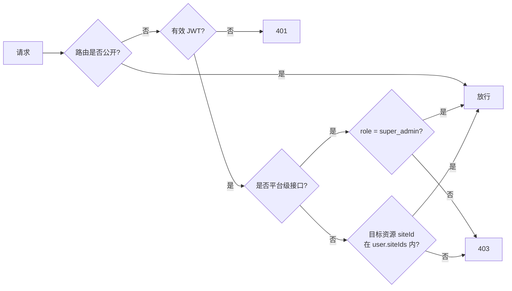

# 05 · 接口契约

> 全部对外 REST 接口的清单、鉴权矩阵与约定。逐条实现以 `apps/server/src/modules/**/*.controller.ts` 为准。
> 管理后台的调用封装见 [`03-frontend-architecture.md`](./03-frontend-architecture.md) §2.2。
> **术语**：专有名词（预览票据 / 产物清单 / 模板库 …）统一解释见 [`../GLOSSARY.md`](../GLOSSARY.md)。

---

## 1. 通用约定

| 项       | 值                                                                |
| -------- | ----------------------------------------------------------------- |
| Base URL | `http://<server-host>:3001/geoserver`                             |
| 协议     | REST over HTTP/JSON                                               |
| 鉴权方式 | `Authorization: Bearer <token>`                                   |
| 成功响应 | `{ "code": 0, "message": "ok", "data": <T> }`                     |
| 失败响应 | `{ "code": <HTTP状态码>, "message": "<错误描述>", "data": null }` |
| 时间格式 | `2026-10-05 10:10:10`（北京时间，见 `04` §4 口径）                |
| 分页入参 | `page`（默认 1）、`pageSize`（**默认 20**，档位 `[10, 20, 30, 50, 100]`；越界或非法值回退默认值，见 `src/common/constants.ts`） |
| 分页出参 | `{ list, total, page, pageSize }`                                 |
| 文档     | Swagger `/geoserver/docs`，**生产环境关闭**                             |

### 1.1 状态码

| 状态 | 何时出现                                      | 前端处理               |
| ---- | --------------------------------------------- | ---------------------- |
| 200  | 成功                                          | 解包 `data`            |
| 400  | 参数校验失败 / 业务约束冲突（如上传类型不符） | `ElMessage.error`      |
| 401  | 缺失或失效 token                              | 清 token 并跳 `/login` |
| 403  | 非平台管理员访问平台级接口 / 跨站点越权       | 提示无权限             |
| 404  | 资源不存在                                    | 提示未找到             |
| 500  | 未处理异常（过滤器统一兜底）                  | 提示 + 记录日志        |

## 2. 鉴权矩阵

| 层级                | 适用范围                                                                                           | 实现位置                              |
| ------------------- | -------------------------------------------------------------------------------------------------- | ------------------------------------- |
| 公开无鉴权          | `/geoserver/auth/login`、`/geoserver/health`、`/geoserver/public/**`、`/geoserver/track/collect`、`/geoserver/site-auth/register | login`                                | 控制器未挂 Guard |
| JWT-A（登录即可）   | 其余受保护接口                                                                                     | `@UseGuards(AdminAuthGuard)`          |
| JWT-A + 平台级角色  | 站点增删改、整站重建、菜单/角色/用户维护、members 删除等平台级操作                                 | 追加 `@UseGuards(PlatformAdminGuard)` |
| JWT-M（站点会员）   | `/geoserver/site-auth/verify`、`/geoserver/site-auth/me`                                           | 会员域 token                          |

> **平台级**的判据是「用户绑定的角色带 `platform` 标记」（RBAC），不再是硬编码的角色字符串；角色信息随 JWT 下发，`PlatformAdminGuard` 只读 `request.user.platform`（见 [ADR-019](./08-adr.md#adr-019-rbac用户--角色--菜单绑定)）。

## 3. 接口清单（72 条）

### 3.1 auth · 管理员鉴权

| 方法 | 路径          | 用途                     | 鉴权  |
| ---- | ------------- | ------------------------ | ----- |
| POST | `/auth/login` | 登录并签发 JWT-A         | 公开  |
| GET  | `/auth/me`    | 当前管理员信息与站点授权 | JWT-A |

### 3.2 sites · 站点管理

| 方法   | 路径         | 用途                                | 鉴权               |
| ------ | ------------ | ----------------------------------- | ------------------ |
| GET    | `/sites`     | 分页列表（支持模式/状态筛选、搜索） | JWT-A              |
| GET    | `/sites/:id` | 站点详情（含企业资质与 SEO 默认值） | JWT-A              |

> **构建状态字段**：`GET /sites`、`GET /sites/:id` 每个站点额外带 `build`：最新一条构建任务摘要（`null` = 从未构建），站点管理列表的「构建状态」列与编辑器按钮锁定都用它，详见 §3.6。
| POST   | `/sites`     | 新建站点                            | JWT-A + 平台管理员 |
| PATCH  | `/sites/:id` | 编辑站点（含渲染模式、主题）        | JWT-A + 平台管理员 |
| DELETE | `/sites/:id` | 删除站点                            | JWT-A + 平台管理员 |

> **多域名映射（主域名 + 别名域名）**：`Site.domain` 是主域名（必填，SEO 绝对 URL / 列表「预览」用），其余域名以 `domains: string[]` 表达：
>
> - `POST /sites`、`PATCH /sites/:id` 的 `domains` 为**别名域名数组**，语义是**全量替换**（不传或空数组 = 清空别名）；
> - `GET /sites`、`GET /sites/:id` 返回 `domains: string[]`（该站点全部别名域名）；
> - 别名域名**全局唯一**：与任一站点的主域名或其他站点的别名域名重复时返回 `400`；关键字搜索同时匹配站点名 / slug / 主域名 / 别名域名 / 企业名；
> - `/public/**` 的 `:key` 可取站点 `slug`、**主域名**或**任一别名域名**（GEO 项目 SSR 按请求 Host 反查站点即走此路径），返回内容与元数据一致；
> - 本地回环地址（`localhost` / `127.0.0.1`）下 GEO 以 URL 首段作为站点前缀传给 `:key`，并在请求页面前剥离该前缀（`/example-site/visit` → `path=/visit`），即后台站点列表「预览」地址的拼接口径；**预览票据（`POST /preview/ticket`）返回的 iframe 地址在回环基址下同样带该前缀**，iframe 内后续跳转由 GEO 全局中间件补齐前缀并保留票据（见 ADR-031）；站点地址一律走 shared 的 `buildSiteUrl`，各端禁止自行拼装。

### 3.3 files · 静态文件

| 方法   | 路径               | 用途                            | 鉴权  |
| ------ | ------------------ | ------------------------------- | ----- |
| POST   | `/files/upload`    | 上传文件（MIME 白名单、≤10MB）  | JWT-A |
| GET    | `/files`           | 按站点列出文件（`siteId` 可选） | JWT-A |
| PUT    | `/files/:id/replace` | **替换文件内容**（multipart 字段 `file`）：保持记录与 URL（物理路径名）不变，仅覆盖物理文件并更新 `sizeBytes` / `originalName`；新文件 MIME 必须与原记录一致，白名单与 10MB 上限同上传 | JWT-A |
| DELETE | `/files/:id`       | 删除文件记录与物理文件          | JWT-A |

### 3.4 content · 内容

| 方法   | 路径                           | 用途                                 | 鉴权  |
| ------ | ------------------------------ | ------------------------------------ | ----- |
| GET    | `/content/channels`            | 栏目树（按站点）                     | JWT-A |
| POST   | `/content/channels`            | 新建栏目                             | JWT-A |
| GET    | `/content/pages`               | 页面列表（可按站点、状态、栏目过滤） | JWT-A |
| GET    | `/content/pages/:id`           | 页面详情（含 Block 数组）            | JWT-A |
| POST   | `/content/pages`               | 新建页面                             | JWT-A |
| PATCH  | `/content/pages/:id`           | 编辑页面                             | JWT-A |
| PATCH  | `/content/pages/:id/status`    | 状态流转（含发布前 GEO 体检）        | JWT-A |
| GET    | `/content/pages/:id/geo-check` | 单独获取 GEO 体检结果                | JWT-A |
| DELETE | `/content/pages/:id`           | 删除页面                             | JWT-A |

### 3.5 members / entities · 会员与实体

| 方法   | 路径            | 用途                         | 鉴权  |
| ------ | --------------- | ---------------------------- | ----- |
| GET    | `/members`      | 站点会员列表                 | JWT-A |
| POST   | `/members`      | 新建站点会员                 | JWT-A |
| DELETE | `/members/:id`  | 删除会员                     | JWT-A |
| GET    | `/entities`     | 实体列表（含集团级公共实体） | JWT-A |
| POST   | `/entities`     | 新建实体                     | JWT-A |
| PATCH  | `/entities/:id` | 编辑实体与别名               | JWT-A |
| DELETE | `/entities/:id` | 删除实体                     | JWT-A |

### 3.6 publish · 发布

| 方法 | 路径                    | 用途                           | 鉴权               |
| ---- | ----------------------- | ------------------------------ | ------------------ |
| POST | `/publish/page/:siteId` | 页面级增量发布（入队）         | JWT-A              |
| POST | `/publish/site/:siteId` | 整站重建                       | JWT-A + 平台管理员 |
| GET  | `/publish/tasks`        | 任务列表与日志（取最近 20 条） | JWT-A              |
| GET  | `/publish/geo-docs/:siteId` | 站点 GEO 产物内容：读取**已构建产物目录里落盘的** `robots.txt` / `sitemap.xml` / `llms.txt`（含 `exists` / `size` / `updatedAt` / `content` 与清单 `generatedAt`），站点列表「GEO产物」弹窗数据源 | JWT-A |
| PUT  | `/publish/geo-docs/:siteId` | 手动替换 GEO 产物文件（body `{ key, content }`，key ∈ robots / sitemap / llms）：**非常规兜底**，仅用于自动结果无法满足特殊上线要求时人工直写；与构建互斥，下次 GEO 索引更新 / 整站重建会按统一口径重新生成并覆盖 | JWT-A |

**构建状态与互斥（2026-10-08 新增）**

- `GET /publish/artifacts/:siteId` 额外返回 `task`：该站点**最新一条**构建任务摘要 `{ id, scope, status, createdAt, finishedAt, log }`，无任务为 `null`。它是**构建状态标记与按钮锁定**的唯一数据来源，`status ∈ pending | running | success | failed`
- `GET /sites`（列表）与 `GET /sites/:id`（详情）每个站点额外返回 `build`（同一摘要结构，无任务为 `null`），站点管理列表的「构建状态」列据此渲染
- **同站点互斥（手动入口）**：站点存在 `pending` / `running` 任务时，`POST /publish/page/:siteId`、`POST /publish/site/:siteId` 直接返回 **`409`**（提示「正在构建中 / 已有任务排队中」），不再静默排队——手动入口要让运营看到「现在不能点」。**系统入口**（建站导入 `publish: true`）仍走排队，避免导入流程被已排队任务挡下；内存构建锁 + DB 状态仍双重保证同站点不会并发构建
- 任务与构建时间字段一律走 `formatDateTime`（`YYYY-MM-DD HH:mm:ss`，中国时区），不输出 ISO 串

### 3.7 track · 埋点与监控

| 方法 | 路径                 | 用途                               | 鉴权  |
| ---- | -------------------- | ---------------------------------- | ----- |
| POST | `/track/collect`     | 埋点摄取（`sendBeacon`，攒批落库） | 公开  |
| GET  | `/track/overview`    | PV/UV 概览与 Top 页面              | JWT-A |
| GET  | `/track/ai-overview` | AI 爬虫抓取统计与 Top 路径         | JWT-A |
| POST | `/track/ai-crawl`    | AI 抓取事件摄取（支持批量）        | 公开  |

### 3.8 site-auth · 站点会员域

| 方法 | 路径                  | 用途                 | 鉴权  |
| ---- | --------------------- | -------------------- | ----- |
| POST | `/site-auth/register` | 会员注册（绑定站点） | 公开  |
| POST | `/site-auth/login`    | 会员登录并签发 JWT-M | 公开  |
| GET  | `/site-auth/verify`   | 校验会员 token       | JWT-M |
| GET  | `/site-auth/me`       | 会员自身信息         | JWT-M |

### 3.9 health / public

| 方法 | 路径                    | 用途                                           | 鉴权 |
| ---- | ----------------------- | ---------------------------------------------- | ---- |
| GET  | `/health`               | 健康检查                                       | 公开 |
| GET  | `/public/site/:key`     | 站点配置（GEO 项目 SSR/SSG 取数入口）          | 公开 |
| GET  | `/public/routes/:key`   | 已发布路由清单（构建目标 + 产物清单数据来源，支持 `?ids=`；每页含 `contentHash` 与 `blocks[].codeHash`） | 公开 |
| GET  | `/public/page/:key`     | 页面详情，入参 `?path=/xxx`（公开版，无草稿）  | 公开 |
| GET  | `/public/documents/:key`| 站点 GEO 文档（robots / sitemap / llms 正文，构建与「GEO 索引更新」共用） | 公开 |
| GET  | `/public/robots/:key`   | 按 `robotsPolicy` 动态生成 robots.txt          | 公开 |
| GET  | `/public/entities/:key` | 站点实体清单（llms.txt 与结构化数据来源）      | 公开 |

> `public` 模块只返回 `status = published` 的内容，草稿与待审核数据**绝不会**从这里泄漏。

### 3.10 menus · 后台菜单

| 方法   | 路径          | 用途                                                       | 鉴权              |
| ------ | ------------- | ---------------------------------------------------------- | ----------------- |
| GET    | `/menus/tree` | 侧栏菜单树（按当前用户角色的菜单授权过滤，最多三级）        | JWT-A             |
| GET    | `/menus`      | 菜单配置列表（平铺，含隐藏与停用项）                       | JWT-A + 平台级角色 |
| POST   | `/menus`      | 新建菜单（`parentId` 缺省为一级）                          | JWT-A + 平台级角色 |
| PATCH  | `/menus/:id`  | 编辑菜单（换父级时校验环路与三级上限）                     | JWT-A + 平台级角色 |
| DELETE | `/menus/:id`  | 删除菜单（存在子菜单返回 `400`，需先删子级）               | JWT-A + 平台级角色 |

### 3.11 roles · 角色（用户 → 角色 → 菜单 的中间层）

| 方法   | 路径               | 用途                                                     | 鉴权              |
| ------ | ------------------ | -------------------------------------------------------- | ----------------- |
| GET    | `/roles`           | 角色列表（含 `menuIds` 授权与 `userCount` 绑定用户数）   | JWT-A + 平台级角色 |
| POST   | `/roles`           | 新建角色（内置角色不可通过接口创建）                     | JWT-A + 平台级角色 |
| PATCH  | `/roles/:id`       | 编辑角色（内置角色：标识与状态受保护）                   | JWT-A + 平台级角色 |
| DELETE | `/roles/:id`       | 删除角色（内置角色或仍有用户绑定时返回 `400`）           | JWT-A + 平台级角色 |
| PUT    | `/roles/:id/menus` | 保存菜单授权（覆盖式，服务端自动补全上级菜单）           | JWT-A + 平台级角色 |

### 3.12 admin-users · 后台用户

| 方法   | 路径               | 用途                                                             | 鉴权              |
| ------ | ------------------ | ---------------------------------------------------------------- | ----------------- |
| GET    | `/admin-users`     | 用户列表（分页、关键字与角色筛选；永不返回密码）                 | JWT-A + 平台级角色 |
| POST   | `/admin-users`     | 新建用户（账号 + 密码 + `roleId` 绑定角色 + 站点授权）           | JWT-A + 平台级角色 |
| PATCH  | `/admin-users/:id` | 编辑用户（账号不可改，`password` 留空表示不修改）                | JWT-A + 平台级角色 |
| DELETE | `/admin-users/:id` | 删除用户（不能删自己，须保留至少一个可用平台级用户，否则 `400`） | JWT-A + 平台级角色 |

> 菜单是**体验层**：`/menus/tree` 的过滤只是 UX，权限边界始终由 Guard 承担（见 [ADR-018](./08-adr.md#adr-018-后台菜单数据驱动)、[ADR-019](./08-adr.md#adr-019-rbac用户--角色--菜单绑定)）。

### 3.13 news-faq · 新闻资讯 / 高频问答（管理面）

> **表驱动**：新闻与问答的管理源是独立数据表 `NewsArticle` / `FaqItem`（见 [04 §8](./04-data-model.md)），`Page`（`kind=detail` 详情页，路径前缀 `/news/*` 与 `/faq/q*`）只是发布产物。
> 本组接口做管理面 CRUD，**每次增删改后自动重算派生块**（`/news`、`/faq` 列表页 + 同分类详情页 `related-faq`）
> 并自动触发**页面级**发布（系统入口、可排队），响应 `data` 携带 `affectedPages`（受影响页面 id 集合）与 `publishTaskId`（发布任务标识，无需发布时为 `null`）。
> 列表接口的 `siteId` 参与站点权限校验（`assertSiteAccess`，越权 403）；**详情接口直读表、不接收 `siteId` 参数**——按记录自身 `siteId` 归属鉴权（记录不存在 404，越权 403），修复了旧实现要求 `?siteId=` 而前端未传导致的 404。

| 方法   | 路径                            | 用途                                                                     | 鉴权  |
| ------ | ------------------------------- | ------------------------------------------------------------------------ | ----- |
| GET    | `/news-faq/articles`            | 文章分页列表（读 `NewsArticle` 表：`?siteId&page&pageSize&keyword`，keyword 模糊匹配 title，按发布日期倒序；行含 `id, path, title, summary, publishDate, status, pageId`） | JWT-A |
| GET    | `/news-faq/articles/:id/detail` | 单条文章详情（**直读表，不接收 siteId 参数**；返回 `{ id, pageId, path, title, summary, publishDate, status, slug, content }`，`content` 为纯文本正文） | JWT-A |
| POST   | `/news-faq/articles`            | 新建文章（写表 → 建详情页；`{ siteId, title, summary?, publishDate, content, slug? }`；`path=/news/{slug}`，slug 缺省自动生成 `news-YYYYMMDD-序号`，冲突 400；`publishDate` 必填且不允许早于今天） | JWT-A |
| PATCH  | `/news-faq/articles/:id`        | 编辑文章（`{ title?, summary?, publishDate?, content? }`；**slug 创建后不可改**；页面缺失自动补建） | JWT-A |
| DELETE | `/news-faq/articles/:id`        | 删除文章（删发布产物页面与表记录）                                        | JWT-A |
| GET    | `/news-faq/faqs`                | 问答分页列表（读 `FaqItem` 表：`?siteId&page&pageSize&keyword&category`，keyword 模糊匹配 question，按 slug 升序；行含 `id, path, question, category, status, pageId`） | JWT-A |
| GET    | `/news-faq/categories`          | 问答分类清单（`?siteId`，`FaqItem.category` 去重，按首次出现顺序）        | JWT-A |
| GET    | `/news-faq/faqs/:id/detail`     | 单条问答详情（**直读表，不接收 siteId 参数**；返回 `{ id, pageId, path, question, category, status, slug, answer }`，`answer` 为纯文本答案） | JWT-A |
| POST   | `/news-faq/faqs`                | 新建问答（`{ siteId, question, category, answer }`；`path=/faq/q{三位序号}`，取现有最大序号 +1） | JWT-A |
| PATCH  | `/news-faq/faqs/:id`            | 编辑问答（`{ question?, category?, answer? }`；**slug 创建后不可改**；换分类时新旧分类的列表页与 related-faq 都重算；页面缺失自动补建） | JWT-A |
| DELETE | `/news-faq/faqs/:id`            | 删除问答（删发布产物页面与表记录）                                        | JWT-A |

> 保存即发布：表记录 `status` 恒为 `published`（管理端保存免审核，与站点编辑器保存行为一致）。
> 发布日期校验：`publishDate` 必填、`/^\d{4}-\d{2}-\d{2}$/` 且**不允许早于今天**（Asia/Shanghai 口径），错误信息为中文（如「发布日期不能早于今天」）。
> 正文均为纯文本，按换行拆成段落块；新闻去分类（`post-list` / `article-meta` 块已无 category 字段，`/news` 列表 hero chips 置空、独立 pager 移除，分页由 `post-list` 客户端分页承担）。

## 4. 关键接口要点

### 4.1 发布前的 GEO 体检

`PATCH /geoserver/content/pages/:id/status` 在流转到 `published` 时执行 `checkPageGeo`：

| 检查项              | 级别  | 扣分 |
| ------------------- | ----- | ---- |
| 缺 `title`          | error | -25  |
| 页面无 Block        | error | -25  |
| 缺 `summary`        | warn  | -15  |
| 无 FAQ Block        | warn  | -15  |
| 缺 `seoDescription` | warn  | -10  |
| 缺 `authorName`     | warn  | -10  |

存在任一 `error` 则 `passed = false`，接口拒绝流转并返回 issue 清单；`warn` 不阻断但应在页面高亮提示。

### 4.2 上传

- 路径 `/geoserver/files/upload`，字段名 `file`，`multipart/form-data`
- 服务端生成 `uploads/yyyy/mm/{uuid}.{ext}`，写入 `StaticFile` 并返回 `{ id, publicUrl, ... }`
- 校验不通过直接 400，不落任何文件

### 4.3 埋点摄取

- 浏览器侧用 `navigator.sendBeacon`（`application/json` Blob），不阻塞页面
- 服务端口径：单 IP 限流 + 站点 CORS 放行 + 内存队列攒批写 `track_event`
- SSG 站点要求服务端公网可达，否则上报失败（不影响页面可用性）

## 5. 兼容性约定

- 接口版本：v1 不引入 `/v1` 前缀，破坏性变更需走 ADR 并记录于 `08-adr.md`
- 新增字段只能追加，不得改变既有字段语义
- 响应结构的 `code/message/data` 三键固定，业务数据一律放 `data`

## 6. 站点编辑器接口（2026-10-06 新增，详见 [`09`](./09-site-editor.md) §6.4）

> 本节登记接口分组与鉴权，字段级契约以 `09-site-editor.md` 与 Swagger 为准。

| 分组 | 接口 | 鉴权 |
| ---- | ---- | ---- |
| 内容树 | `GET /content/tree?siteId=` | JWT-A（站点级） |
| 目录/页面操作 | 新增 / 删除 / 重命名 / 上下移（含 `kind`、`path` 校验与 **已发布地址锁定 400**） | JWT-A（站点级） |
| 草稿 | `GET` / `PUT` / `DELETE /content/pages/:id/draft` | JWT-A（站点级） |
| 块定义 | `GET /blocks?siteId=`（本站块 + 公共模板）、`GET /blocks/:key`（`?template=1` 只读模板）、`POST /blocks`、`PUT /blocks/:key`（编译校验 + 声明抽取；站点维度会先自动复制本站副本）、`GET /blocks/:key/usages`、`POST /blocks/:key/rollback`、`POST /blocks/:key/apply`（模板引入本站） | 站点级；**模板库与公共模板（`siteId=0`）读写限平台级**；块隔离见 [09 §4.5](./09-site-editor.md) |
| 导航 | `GET /navigations?siteId=`、`PUT /navigations/:key`（整组全量提交 + 排序） | JWT-A（站点级） |
| 预览 | `POST /preview/ticket`（签发短时票据）；`GET /preview/page/:id`（渲染引擎调用，内部 token） | JWT-A / 内部 |
| GEO 生成预览 | `POST /geo/preview`（纯计算，返回实际输出内容） | JWT-A（站点级） |
| GEO 就绪度体检 | `GET /geo/site-check?siteId=`（站点级发布前检查：实体声明 / llms / robots AI 策略 / robots meta / sitemap 核心 URL / NAP，返回 `score` 与 `issues`） | JWT-A（站点级） |
| 发布 | `POST /publish/page/:siteId`、`POST /publish/site/:siteId`、`POST /publish/rollback`、`POST /publish/repair` | 单页站点级；**整站发布限平台级** |
| 产物与下载 | `GET /publish/artifacts/:siteId`、`GET /publish/geo-docs/:siteId`（站点级 GEO 产物内容，只读）、`GET /publish/download/:siteId?mode=full\|html` | JWT-A（站点级） |
| 建站导入 | `POST /sites/:id/bootstrap`（建站描述事务落库，幂等） | 平台级 |
| 渲染引擎内部 | `GET /public/list/:siteKey?channel=`、`GET /internal/blocks?...`（块代码清单） | 公开只读 / 内部 token |

---

> 下一步：[`06-publish-and-geo.md`](./06-publish-and-geo.md) —— 发布流水线与 GEO 产物。
