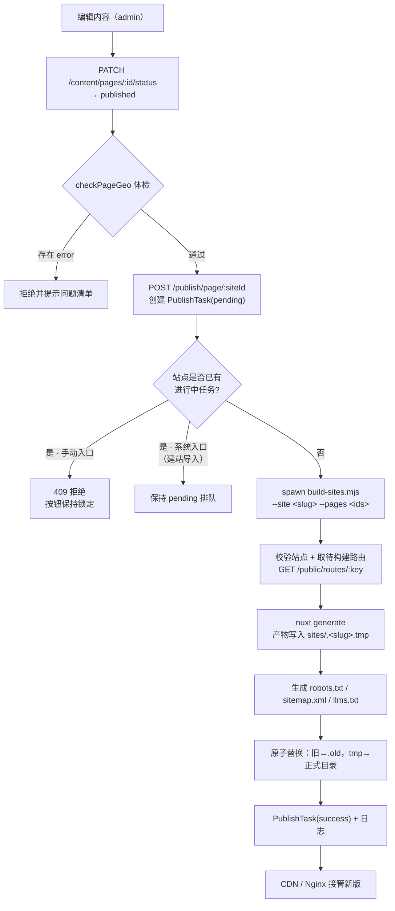
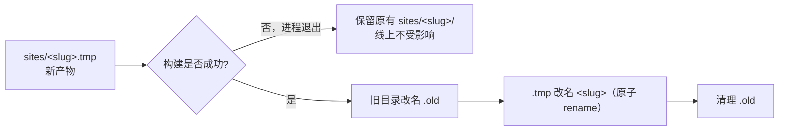
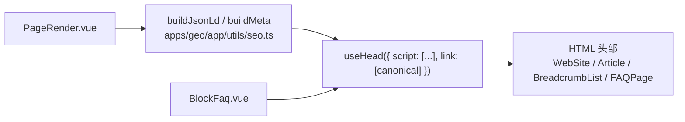
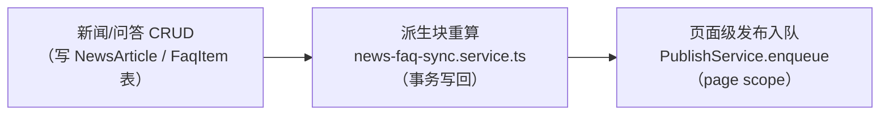

# 06 · 发布流水线与 GEO 落地

> 内容从"草稿"变成"线上可被 AI 引用的页面"的完整链路，以及 GEO 四层能力在哪些环节落地。
> 服务端侧的调度见 [`02-server-architecture.md`](./02-server-architecture.md) §5，接口见 [`05-api-contract.md`](./05-api-contract.md) §3.6。
> **术语**：专有名词（产物清单 / 内容指纹 / 增量发布 / AI 爬虫 …）统一解释见 [`../GLOSSARY.md`](../GLOSSARY.md)。

---

## 1. 流水线全景



**两种触发粒度**

| 类型       | 接口                         | 权限               | 说明                    |
| ---------- | ---------------------------- | ------------------ | ----------------------- |
| 页面级增量 | `POST /publish/page/:siteId` | JWT-A              | 仅构建变更页面 + 级联页 |
| 整站重建   | `POST /publish/site/:siteId` | JWT-A + 平台管理员 | 全量已发布页面重出      |

> SSR 模式站点：`build-sites.mjs` 检测到 `renderMode !== 'ssg'` 会直接跳过构建并提示"内容即时生效"，不会浪费构建资源。

### 1.1 构建状态与锁定（2026-10-08 新增）

状态取自 `PublishTask` **最新一条**记录（不新增表结构），对外由 `GET /publish/artifacts/:siteId` 的 `task` 与 `GET /sites` 的 `build` 暴露（见 [`05`](./05-api-contract.md) §3.6）：

| 状态 | 含义 | 界面表现（站点列表 / 编辑器） |
| --- | --- | --- |
| （无任务） | 从未构建 | 「未构建」，可发起 |
| `pending` | 已入队，等待同站点前一个任务结束（系统入口才会出现） | 「排队中」，按钮锁定 |
| `running` | 正在构建（spawn 构建脚本） | 「构建中」+ 已运行时长，按钮锁定并转圈 |
| `success` | 构建成功，产物已原子替换 | 「构建成功」+ 时间，可再次发起 |
| `failed` | 构建失败（**失败不影响线上旧产物**） | 「构建失败」+ 时间，悬停可看日志尾部，可重试 |

- **手动入口互斥**：站点存在 `pending` / `running` 任务时，`POST /publish/page|site` 返回 `409`，不排队（见 §1 流程图与 05 §3.6）；服务端仍以内存锁 + DB 状态双重保证同站点不并发构建
- **轮询**：前端在「进行中」期间每 3–4 秒刷新一次状态（站点列表、编辑器各一处），结束后自动刷新产物徽标并提示结果；不使用 WebSocket，避免为 v1 引入长连接
- 「GEO 索引更新」不是构建任务（同步写文件、秒级返回），但构建期间必须禁用——两者会写同一个产物目录

## 2. 原子替换与回滚



- 失败发生在 `nuxt generate` 阶段时，旧产物完好无损——这是**先把产物写临时目录**的核心价值
- 替换窗口极短（`rename` 系统调用），不会出现半新半旧的产物对外可见
- 若需要保留历史版本做回滚，应在替换前自行备份 `.old`（当前脚本在成功后清理该目录）

## 3. 产物规范

```
apps/geo/sites/<站点slug>/
├── index.html                 # 首页
├── news/ai-trend/index.html   # 栏目页/内容页（按 <channelSlug>/<pageSlug>）
├── 200.html · 404.html        # SPA 回退页
├── _payload.json · _nuxt/     # Nuxt 客户端资源与负载
├── robots.txt                 # AI 爬虫策略（默认放行）
├── sitemap.xml                # 已发布页面清单 + lastmod
└── llms.txt                   # LLM 专用内容索引
```

| 文件          | 生成方                       | 内容来源                                            |
| ------------- | ---------------------------- | --------------------------------------------------- |
| HTML          | `nuxt generate`              | `/public/routes/:key` + `/public/page/:key`         |
| `robots.txt`  | 服务端 `/public/robots/:key` | `Site.robotsPolicy` + 内置 AI UA 清单               |
| `sitemap.xml` | 构建脚本                     | 路由清单 + `updatedAt/publishedAt`                  |
| `llms.txt`    | 构建脚本                     | 站点名称/简介/企业主体/备案号/核心页面链接/实体清单 |

### 3.1 构建期已知告警（上游噪音，可忽略）

`pnpm build:sites` 的预渲染阶段会打印两条来自 `@nuxt/nitro-server@4.5.2` 的 rollup 告警（已确认 `nuxt` 与 `@nuxt/nitro-server` 当前均为最新版，升级无法消除）：

1. `.../nitro-server/dist/runtime/utils/cache-driver.mjs is imported by "virtual:#nitro-internal-virtual/storage", but could not be resolved – treating it as an external dependency`
2. `"H3Error", "H3Event", "deleteCookie", "getCookie" and "setCookie" are imported from external module "h3" but never used`

两条均为 nitro 内部虚拟模块的 externalize / tree-shaking 提示，与站点数据、Block 渲染无关。实测：构建退出码 0，`sites/<slug>/` 产物（HTML / robots.txt / sitemap.xml / llms.txt）完整正确。上游修复后本节可删除。

## 4. GEO 四层落地对照

| 层  | 目标       | 落地位置                                                                                         | 状态      |
| --- | ---------- | ------------------------------------------------------------------------------------------------ | --------- |
| L1  | 数据模型层 | `Page.summary / authorName / seo* / publishedAt`、`Entity` 表、内置 `faq` Block 类型             | ✅        |
| L2  | 模板渲染层 | 语义化 HTML（article/main/section）、唯一 H1、唯一 H1 由 `Page.title` 渲染、Block 组件不跳级标题 | ✅        |
| L3  | 构建产物层 | `robots.txt`（默认放行 AI 爬虫）、`sitemap.xml`、`llms.txt`、每页 JSON-LD、发布前体检            | ✅        |
| L4  | 监测运营层 | `AiCrawlEvent` 记录抓取、AI referrer 归因、`/track/ai-overview` 看板                             | 🟡 基础版 |

### 4.1 JSON-LD 注入方式



> **禁止**在 Vue SFC 的 `<template>` 中直接写 `<script type="application/ld+json">`，这会导致渲染 500。统一走 `useHead` 注入（见 [`03`](./03-frontend-architecture.md) §3.3）。

### 4.2 AI 爬虫策略

- 默认清单（服务端 `config/ai-crawlers.ts`）：`GPTBot`、`OAI-SearchBot`、`ChatGPT-User`、`ClaudeBot`、`PerplexityBot`、`Google-Extended`、`Bytespider` 等（当前 18 条 UA 规则）
- 站点级可通过 `Site.robotsPolicy` 屏蔽特定 UA 或追加放行
- 抓取行为由 nginx 侧采集后经 `POST /track/ai-crawl` 入 `AiCrawlEvent` 表

## 5. 发布前体检（`checkPageGeo`）

| 检查项              | 级别  | 扣分 | 说明                                    |
| ------------------- | ----- | ---- | --------------------------------------- |
| 缺 `title`          | error | -25  | 页面无 H1，AI 无法识别主体              |
| 无 Block 内容       | error | -25  | 空页面不得发布                          |
| 缺 `summary`        | warn  | -15  | llms.txt 与 meta description 无内容可用 |
| 无 FAQ Block        | warn  | -15  | 降低被引用的概率                        |
| 缺 `seoDescription` | warn  | -10  | SEO 描述缺失                            |
| 缺 `authorName`     | warn  | -10  | 缺 E-E-A-T 权威性信号                   |

存在 `error` 即阻断发布（见 [`05`](./05-api-contract.md) §4.1），`warn` 只在管理后台提示。

## 6. 后置能力（不在 v1）

| 能力                        | 说明                                        |
| --------------------------- | ------------------------------------------- |
| 品牌提及自动检测            | 定期询问主流 LLM 是否引用本站内容           |
| llms-full.txt               | 全文版 LLM 索引（当前只生成精简版）         |
| 多云 CDN 模式的 AI 抓取采集 | 需日志源适配器，当前仅支持自托管 nginx 方案 |
| 页面级精细调度（自动错峰）  | 当前为手动触发 + 串行队列                   |

## 7. 增量构建修复与产物清单（2026-10-06 新增，详见 [`09`](./09-site-editor.md) §8）

> ⚠️ **这是"页面级发布可用"的前置条件**，实现前必须先修。

### 7.1 既有缺陷

`apps/geo/scripts/build-sites.mjs` 的页面级增量当前为「新建临时目录 → 只渲染选中路由 → 整体改名覆盖站点目录」，后果：

- **丢掉站点其他页面**（未重建的页面从产物中消失）
- `sitemap.xml` / `llms.txt` 缩水为只含本次变更页

### 7.2 修复后的流程

```
1 取全量已发布路由 + 本次 targets
2 复制现有产物到 .tmp（首次构建为空）      ← 关键修正
3 nuxt generate 只渲染 targets 路由
4 sitemap.xml / llms.txt / 全站导览用【全量路由】生成
5 合并写产物清单 _trillion.json（本次覆盖、其余保留）
6 按 removedPaths 清理下线页
7 归档旧页到 .history（保留上一版）
8 原子替换（rename），【保留 .old 不再删除】
```

### 7.3 产物清单 `_trillion.json`

字段：`buildId / siteId / slug / domain / generatedAt / pages[{ pageId, path, file, contentHash, publishedAt, blocks[{ id, key, codeHash }] }]`。

用途：
- **页面 ↔ 产物一一对应**（后台徽标：内容指纹一致 = 已发布；不一致 = 待发布；清单无该页 = 产物缺失）
- 块代码指纹支撑「块代码已改 → 使用该块的页面待发布」（增量构建只重建目标页，不会静默更新其他页）

### 7.4 回退与修复

| 能力 | 实现 |
| ---- | ---- |
| 回退上一版 | 仅保留上一版（构建不删 `.old`）；回退 = 从 `.old` 拷回该页 + 更新清单 + 该页标记「待发布」，**不回退数据库内容** |
| 整站重建 | `POST /publish/site/:siteId`（平台级） |
| GEO 索引更新 | `POST /publish/repair`：仅重生成 robots / sitemap / llms / 清单，不重渲染页面（界面旧称「产物修复」） |
| 站点下载 | `GET /publish/download/:siteId?mode=full\|html` 流式 zip（`full` 含客户端资源可直接托管；`html` 供 CDN 回源） |

### 7.5 发布前检查清单（并入发布确认弹窗）

阻断项：缺 title/description、canonical 重复、医疗内容缺编审信息、案例含禁止字段、无机构实体声明（`MedicalClinic`）、无 llms.txt / robots 缺 AI 策略说明。
警告项：`robots meta` 未开完整摘要、NAP 三处不一致、`stat-bar` 缺统计口径、sitemap 缺核心 URL。

### 7.6 publishedHash 回写的失联 id 过滤（2026-10-14 修复）

`publish.service.ts` 的 `syncPublishedHashes` 原对产物清单里每个 `pageId` 直接 `update` 回写 `publishedHash`——站点数据重建后页面换 id，清单残留的历史 id 会让回写抛错（构建实际成功却报失败）。现改为**先按库存活过滤**：清单 `pageId` 批量查 `Page`，失联 id 跳过不回写，回写数量记入任务 `artifact.syncedPages`，不再阻断发布。

---

## 8. 新闻/问答管理自动发布（2026-10-14 新增，2026-10-15 改表驱动）

「站点管理 → 新闻资讯 / 高频问答」（服务端 `apps/server/src/modules/news-faq/`）的管理面 CRUD 以**独立数据表 `NewsArticle` / `FaqItem` 为唯一管理源**（数据模型见 [`04`](./04-data-model.md) §8，决策见 [ADR-039](./08-adr.md)），接口按表记录 `id` 寻址——列表/详情直读表，详情**不再收 `siteId` 参数**（按记录自身 `siteId` 归属鉴权）。`Page`（`kind=detail` 详情页，路径 `/news/*` 与 `/faq/q*`）**降级为发布产物**：表记录仅持 `pageId` 弱引用，页面缺失时保存自动补建。每次增删改按固定链路收尾：



- **派生块重算**（只重算派生块，固定文案块不动；块实例 id 同 key 顺序复用，常规编辑下内容指纹稳定）：
  - `/news` 列表页：`post-list.items` = 表内全部新闻按发布日期倒序（无分类字段）；`hero-dark.chips` 置空（新闻去分类）；移除独立 `pager` 块（分页由 `post-list` 客户端分页承担）
  - `/faq` 列表页：`hero-dark` 的 eyebrow / chips、`anchor-bar`、`hot-faq` 按全量问答重算；每个分类一组 `section-head`（含「共 N 条」）+ `faq-index`
  - 问答详情页：受影响分类（编辑换分类时含**新旧分类**）下所有详情页的 `related-faq.items` = 同分类其它问答前 8 条
- **自动发布**：受影响页面（详情页 + 列表页 + related-faq 牵连页）作为**页面级**任务入队（系统入口、可排队，受同站点串行与构建互斥约束）；响应携带 `affectedPages` 与 `publishTaskId`（无需发布时为 `null`）；**保存即发布**——表记录 `status` 恒为 `published`，新建详情页直接 `published`（免审核，与站点编辑器保存行为一致）
- **发布日期**：新闻 `publishDate` 必填、`YYYY-MM-DD` 且**不允许早于今天**（服务端中国时区 `todayInChina()` 强校验 + 管理端弹窗禁选过去日期）；问答无发布日期字段
- 接口契约见 [`05`](./05-api-contract.md) §3.13，界面落点见 [`03`](./03-frontend-architecture.md) §2.1

## 9. 站点图片素材库化与 /static 代理（2026-10-14 新增）

- **图片迁移脚本** `apps/server/scripts/sync-site-images.mjs`（一次性 + 幂等复核用）：把站点页面块里的 `/assets/img/**` 引用迁移入服务端素材库（本次 71 条 `StaticFile`，页面引用改写为 `/static/<yyyy>/<mm>/<uuid>.<ext>`）；源文件缺失的 **28 张 `env-NN.*`** 以真实环境图（hall.jpg / building.jpg）内容占位入库、`originalName` 保留 `env-NN.jpg` 便于在素材库识别替换；`--dry-run` 演练、`--site <id>` 指定站点；不触发发布/构建，全站重发由发布流程统一完成
- **GEO `/static` 同源代理** `apps/geo/server/routes/static/[...path].ts`（Nitro 路由）：站点图片走素材库 `/static` URL 后，GEO 站点（dev SSR 与缓存渲染服务两条运行形态）把自身 `/static/**` 请求代理到服务端静态目录——`apiBase` 剥 `/geoserver` 后缀得服务根（显式 `API_BASE` 不以 `/geoserver` 结尾时视为已指向服务根，按原样使用），上游状态码（含 404）、content-type 与查询串原样透传
- **素材库原位替换闭环**：`PUT /files/:id/replace`（见 [`05`](./05-api-contract.md) §3.3）保持记录与 `publicUrl` 不变、仅覆盖物理文件（新文件 MIME 必须与原记录一致）——因此**替换素材文件后站点引用即生效，无需重发站点**；上述 28 张占位环境图可在素材管理页「替换」为真实照片

---

> 下一步：[`07-deployment.md`](./07-deployment.md) —— 环境、编排与运维。
