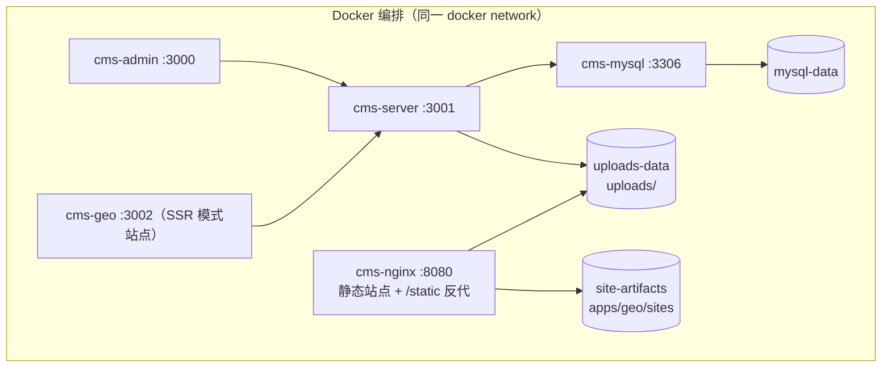

# 07 · 部署架构

> 双形态部署（Docker 编排 / 直接安装）的拓扑、端口、环境变量、持久化与运维要点。
> 一键命令与环境准备以 [`../../README.md`](../../README.md) 为准。
> **术语**：专有名词（代码上线 / 数据库上线 / 构建缓存 …）统一解释见 [`../GLOSSARY.md`](../GLOSSARY.md)。

---

## 1. 部署形态总览

| 形态   | 管理后台                     | GEO 项目                                                         | 服务端                    | MySQL       | 静态托管                    |
| ------ | ---------------------------- | ---------------------------------------------------------------- | ------------------------- | ----------- | --------------------------- |
| Docker | `cms-admin`（SPA 3000）      | `cms-geo`（SSR 3002）/ SSG 产物由 nginx 出                       | `cms-server`（3001）      | `cms-mysql` | `cms-nginx`（8080）         |
| 直装   | 一键 `pnpm allDev`；单端 `pnpm dev:admin`（3000） | 一键同上；单端 `pnpm dev:geo`（SSR）、`pnpm build:sites --site <slug>`（SSG） | 一键同上；单端 `pnpm dev:server`（3001） | 本地实例 | 本地 Nginx 或直接用产物目录 |
| 部署包 | `deploy/apps/admin/.output`（Nitro 自包含，3000） | `deploy/apps/geo/.output`（SSR 3002）+ `sites/` 由 nginx 出 | `deploy/apps/server/dist`（3001，全量 node_modules 含 prisma CLI） | 服务器实例 | 包内 `apps/geo/sites/<slug>/` + `nginx.conf.example` 模板 |

> **部署包（ADR-042）**：`pnpm pack:deploy` 在本地把三端产物、依赖（`pnpm deploy --node-linker=hoisted`，零 symlink）、`config/` 与 `env/` 汇集为仓库根 `deploy/`（gitignore），整体拷贝到服务器后 `node db.mjs deploy`（结构）→ `node start.mjs daemon`（守护运行三端，`stop` / `status` / `restart` 子命令）——服务器免 git / pnpm / PM2；操作口径见 [`10`](./10-launch-runbook.md) §4.0。包内 `config/` 仍是端口 / 连接串 / 密钥的唯一派生事实源，`start.mjs` 按其 `APPS` 清单驱动进程管理。

> 本地三端由根命令 **`pnpm allDev`** 一次拉起（先结束占用端口的旧进程，再并发启动，Ctrl+C 一并回收）；单端命令 `pnpm dev:server|admin|geo` 走同一个启动器，会先释放对应端口。
> 访问入口清单**打印两次**：① **启动摘要之后立刻打一份**（按配置端口）——就绪清单必须等 Nuxt 首次编译完成，期间终端不能没有地址信息；② **全部工程就绪且日志静默 5s 后再打一份**（按实际监听端口，端口回退时自动修正）。
> 两次都受补打机制守护：**日志静默 3 秒就把清单重新打到屏幕底部**（每来一行新日志重置计时，即 debounce），日志持续不停时每 15 秒兜底补打一次（上限 30 次），因此编译日志、Nuxt devtools 提示等把清单顶掉后地址都会自动回来；
> 同时入口会落盘到仓库根 `dev-endpoints.txt`（已 gitignore）：摘要阶段先写（按配置端口，终端会提示文件路径），就绪后覆盖为实际监听端口版 —— 即使某端迟迟不就绪、或终端被日志刷屏，也随时能打开该文件查到本机与局域网入口。
> **`allDev` 只负责启动进程，不做任何数据库操作**：不建库、不迁移、不写种子数据；数据库初始化始终是独立的 `pnpm db:generate / db:migrate / db:seed`（服务端启动时会连库，库未就绪则服务端启动失败，其余两端不受影响）。
>
> **开发形态 vs 上线形态**（`allDev` 只覆盖前者；**代码上线与数据库上线是两条命令**）：
>
> | 形态 | 命令 | 做什么 | 是否构建 | 是否改数据库 |
> | ---- | ---- | ------ | -------- | ------------ |
> | 开发 | `pnpm allDev` / `allDev:test` / `allDev:prod` | 源码直跑（`nest start --watch`、`nuxt dev`），改代码即时生效 | 否 | 否 |
> | 代码上线 | `pnpm release:test` / `release:prod` | 构建产物常驻（`node dist/main`、`node .output/server/index.mjs`） | 是 | **否**（只做只读检查，结构落后即拦下） |
> | 数据库上线 | `pnpm db:deploy:test` / `db:deploy:prod` | 增量应用迁移（`prisma migrate deploy`） | 否 | **是**（唯一的改结构入口） |
>
> **为什么拆成两条命令**：结构变更与代码发布是两件事——执行时机可能不同（先加字段再上代码，或先上代码再回填）、
> 影响面不同（迁移不可回滚、可能锁表）、审计点不同（谁在何时改了哪个库）。所以代码上线器**绝不执行迁移**，
> 发现结构落后只负责拦下并提示先跑 `pnpm db:deploy`。完整流程与选项见 §3.5；容器形态（§3.4）仍由 compose 显式注入变量。



## 2. 端口表

| 服务             | 容器端口 | 宿主映射 | 对外暴露建议                   |
| ---------------- | -------- | -------- | ------------------------------ |
| `cms-server`     | 3001     | 3001     | 需对 admin/geo 与 SSG 埋点可达 |
| `cms-admin`      | 3000     | 3000     | 内网或 VPN，建议不公网开放     |
| `cms-geo`（SSR） | 3002     | 3002     | 由 Nginx 反代（站点页 + 后台预览分流），不直接暴露 |
| `cms-nginx`      | 80       | 8080     | 公网 80/443                    |
| `cms-mysql`      | 3306     | 3306     | 仅内网，生产不要映射宿主       |

> **端口唯一事实来源**：根 [`config/ports.mjs`](../../config/ports.mjs)（server 3001 / admin 3000 / geo 3002）。
> 开发环境由启动器把端口以 `PORT` 注入各进程（服务端读 `PORT`；两个 Nuxt 应用经 `nuxt.config` 的 `devServer.port` 生效），
> **应用代码内不再出现端口字面量**；测试环境在 [`env/.env.test`](../../env/.env.test) 用 `PORT_SERVER/PORT_ADMIN/PORT_GEO` 覆盖为 3101/3100/3102。

### 2.1 局域网访问（仅开发形态）

开发时三个进程均监听 `0.0.0.0`（服务端 `main.ts` 显式指定；两个 Nuxt 的 `devServer.host` 固定 `0.0.0.0`），
启动器在入口清单末尾追加「局域网访问」段落，把 `localhost` 换成探测到的本机 IPv4（`config/index.mjs` 的 `detectLanHosts()`），
手机 / 其他电脑与开发机同网段时可直接打开（见 [ADR-021](./08-adr.md)）。

> 地址来源：启动摘要的「局域网 IP」行 + 入口清单的「局域网访问」段落。探测方式与 Vite 一致（`os.networkInterfaces()` 取全部 IPv4、跳过回环），
> **不做优先级排序、不区分物理 / 虚拟网卡**；多张网卡时逐行给全（WSL / Docker 地址也会列出，按实际能访问的那个用）；
> **探测为空（未联网 / 无可用网卡）时打印提示行**，不会静默略过。

| 需要配合的环节 | 处理方式 |
| -------------- | -------- |
| 跨域白名单   | 未显式配置 `CORS_ORIGINS` 时，白名单在 `http://<PUBLIC_HOST>:<端口>` 之外自动追加本机局域网 IP 的 admin/geo origin；**显式配置则完全以此为准**，需自行加入局域网地址 |
| 前端 API 基址 | `NUXT_PUBLIC_API_BASE` 由 `PUBLIC_HOST` 派生为 `localhost`；两个前端的请求出口在浏览器端检测到「基址为回环地址、页面主机不是回环地址」时，把 host 换成当前页面主机名（显式远端域名基址不受影响） |
| 站点识别（GEO） | SSR 按请求 Host 解析站点：先匹配 `Site.domain`（主域名），再匹配 `SiteDomain` 中的别名域名；**回环地址（`localhost` / `127.0.0.1`）下改用 URL 首段（站点前缀 = 站点 `slug`）解析站点并剥离该前缀**——后台站点列表「预览」即 `http://localhost:3002/<slug>`，多站点共用同一端口时据此区分；**内容编辑器的预览票据地址（`POST /preview/ticket` 返回的 `url`）在回环基址下同样插入该前缀**（`192.x.x.x` 这类 Host 仍走域名匹配，本地看站点内容可用该前缀、把 IP 配为站点域名，或用 `NUXT_PUBLIC_SITE_SLUG` 兜底）；**回环地址下前缀恒等于站点标识，iframe 内一切站内跳转由全局中间件统一补前缀并保留 query（刷新/新窗口不掉站），站点地址一律走 shared `buildSiteUrl` 拼装** |

> 生产形态（Docker / 直装）不涉及此约定：对外访问统一走 nginx 与域名，监听地址由容器与反代决定。

## 3. 配置与环境变量

### 3.1 三层分工（唯一事实来源）

| 层   | 位置                        | 放什么                                                                     | 谁消费                          |
| ---- | --------------------------- | -------------------------------------------------------------------------- | ------------------------------- |
| 值   | `env/.env.<环境>`           | 数据库账号、密钥、站点标识等**环境相关变量**                               | 启动器 / 执行器读取             |
| 结构 | `config/`                   | 端口表、应用清单、派生逻辑（API 基址 / CORS 白名单 / `DATABASE_URL` 拼装） | 启动器 / 执行器                 |
| 映射 | `apps/server/src/config/`   | 服务端配置工厂 + zod 启动校验（读注入的变量）                              | 服务端运行时                    |

加载链路：`scripts/dev.mjs`（或 `scripts/exec.mjs`）→ `config/index.mjs` 读取 `env/.env.<环境>` → 派生端口 / 基址 / 连接串 → 作为环境变量注入子进程。
**三个应用都不再自带 `.env`**（工程内 `.env` 已删除，避免多份事实来源），迁移、SSG 构建等脱离启动器的命令统一走 `scripts/exec.mjs` 注入；变量缺失直接失败（服务端由 zod 拦截）。

### 3.2 环境切换

| 命令                              | 环境        | 端口（server/admin/geo） | 数据库          |
| --------------------------------- | ----------- | ------------------------ | --------------- |
| `pnpm allDev`                     | development | 3001 / 3000 / 3002       | `trillionCms`   |
| `pnpm allDev:test`                | test        | 3101 / 3100 / 3102       | `trillionCms_test` |
| `pnpm allDev:prod`                | production  | 3001 / 3000 / 3002       | 由生产文件决定  |
| `pnpm allDev --env <name>`        | 自定义      | 由文件内 `PORT_*` 决定   | 由文件决定      |
| `pnpm release:test`               | test        | 3101 / 3100 / 3102       | `trillionCms_test` |
| `pnpm release:prod`               | production  | 由生产文件决定           | 由生产文件决定  |
| `pnpm release --env <name>`       | 自定义      | 由文件内 `PORT_*` 决定   | 由文件决定      |
| `pnpm db:deploy:test`             | test        | ——（不启进程）           | `trillionCms_test` |
| `pnpm db:deploy:prod`             | production  | ——（不启进程）           | 由生产文件决定  |
| `pnpm db:deploy --env <name>`     | 自定义      | ——（不启进程）           | 由文件决定      |

环境名默认 `development`，决定加载 `env/.env.<名字>`；新增环境只需复制 `env/.env.example` 为新文件。
`allDev*` = 开发形态（源码直跑），`release:*` = **代码上线**（构建 + 生产模式启动，不碰数据库），`db:deploy*` = **数据库上线**（唯一的改结构入口）。

### 3.3 变量清单（由 `config/` 派生后注入）

| 变量                                   | 说明                                              | 派生规则                                                     |
| -------------------------------------- | ------------------------------------------------- | ------------------------------------------------------------ |
| `PORT`                                 | 各应用监听端口                                    | `config/ports.mjs` 默认值，可被 `PORT_SERVER/ADMIN/GEO` 覆盖  |
| `NUXT_PUBLIC_API_BASE`                 | 管理后台 / GEO 项目 / SSG 构建调用的 API 基址      | `API_BASE`，缺省 `http://<PUBLIC_HOST>:<PORT_SERVER>/geoserver`（**绝对基址**，含服务端全局前缀，见 ADR-040） |
| `CORS_ORIGINS`                         | 服务端跨域白名单（逗号分隔）                      | `CORS_ORIGINS`，缺省按 admin/geo 端口派生，并追加本机局域网 IP 的同端口 origin（§2.1） |
| `DATABASE_URL`                         | Prisma 连接串                                     | `DATABASE_URL`，缺省由 `DB_*` 拼装（密码百分号编码）          |
| `DB_HOST` / `DB_PORT` / `DB_USER`      | 数据库地址与账号（`DB_PORT` 缺省 3306）           | env 文件                                                      |
| `DB_PASSWORD` / `DB_NAME`              | 数据库口令与库名                                  | env 文件                                                      |
| `JWT_SECRET` / `JWT_EXPIRES_IN`        | 管理后台 JWT 密钥与有效期                         | env 文件（**生产必须 32 位以上随机串**，占位值会告警）        |
| `UPLOAD_DIR` / `PUBLIC_URL_PREFIX`     | 上传物理目录与对外 URL 前缀                       | env 文件                                                      |
| `TZ`                                   | 时区                                              | 缺省 `Asia/Shanghai`                                          |
| `GEO_PROJECT_DIR` / `SITES_OUTPUT_DIR` | 发布时定位 GEO 项目与 SSG 产物目录                | 服务端保留相对默认值（`../geo`、`../geo/sites`），容器内由 compose 覆盖 |
| `NUXT_PUBLIC_SITE_SLUG`                | SSG 构建目标站点；本地回环地址且 URL 未带站点前缀时的回退站点 | env 文件，可留空                                     |
| `BUILD_TIMEOUT_MS`                     | 发布构建子进程超时强杀阈值（SIGTERM→5s→SIGKILL）  | 缺省 15 分钟（`config/configuration.ts` build 段）             |
| `NODE_ENV`                             | 决定是否启用 Swagger 等环境分支                   | 等同运行环境名（由启动器注入）                                |

> 服务端启动时用 **zod 校验**关键变量，缺失或非法直接启动失败（`apps/server/src/config/env.validation.ts`）。

### 3.4 与 Docker 形态的关系

容器编排仍由 [`docker/docker-compose.yml`](../../docker/docker-compose.yml) 的 `environment` 显式注入（容器内服务名 / 路径与本地不同：`DB_HOST=mysql`、`SITES_OUTPUT_DIR=/app/sites`、`NUXT_PUBLIC_API_BASE=http://cms-server:3001/geoserver`，2026-10-15 已随 ADR-040 同步为 `/geoserver` 结尾，healthcheck 同口径）。
两边变量名与语义一致，差异仅在取值（见 §3.3 的派生规则）；本地开发请使用 `env/`，容器部署请使用 compose。

### 3.5 一键上线（代码 `pnpm release:*` / 数据库 `pnpm db:deploy*`）

上线被拆成两个**各自独立、各可重复执行**的命令，避免手工敲七八条命令、漏步骤或对错环境：

- 代码上线器 [`scripts/release.mjs`](../../scripts/release.mjs)：构建产物 + 生产模式重启，**绝不改数据库**
- 数据库上线器 [`scripts/db-release.mjs`](../../scripts/db-release.mjs)：迁移增量发布，**唯一的改结构入口**

**一次完整上线 = 有结构变更时先①后②；无结构变更只需②**：

```bash
# ① 数据库上线（唯一的改结构入口；无结构变更时可跳过）
pnpm db:status:prod                 # 只读：看已应用 / 未应用迁移与目标库
pnpm db:deploy:prod                 # 增量应用未执行的迁移（幂等；空库自动建库）

# ② 代码上线（绝不改数据库）
pnpm release:prod                   # 生产环境上线代码（env/.env.production，不入库，上线前逐项确认）
pnpm release:test                   # 测试环境上线代码（env/.env.test：3101 / 3100 / 3102）
pnpm release --env production --check               # 只体检：配置 + 数据库迁移状态（不构建、不启动、不改库）
pnpm release --env production server                # 只上线服务端
pnpm release --env production --skip-build server   # 沿用上次产物只重启服务端
```

#### ① 数据库上线（`pnpm db:deploy*`）

| 命令 | 环境 | 底层 | 用途 |
| ---- | ---- | ---- | ---- |
| `pnpm db:status` / `db:status:test` / `db:status:prod` | development / test / production | `prisma migrate status` | **只读**：看「已应用 / 未应用」迁移清单、目标库与连通性 |
| `pnpm db:deploy` / `db:deploy:test` / `db:deploy:prod` | 同上 | `prisma migrate deploy` | **增量应用**未执行的迁移（幂等、非交互；目标库不存在时自动建库） |
| `pnpm db:deploy --env <环境>` / `--check` | 自定义 | 同上 | `--env` 亦可透传；`--check` 等价 `db:status` |

| 步骤 | 做什么 | 失败后果 |
| ---- | ------ | -------- |
| 1 体检 | 环境文件 / 必填变量 / 目标库与连接串 / **生产库口令为空或疑似占位值 → 阻断**（防「改错库」） | **阻断**（`--force` 可放行），不执行任何变更 |
| 2 只读检查 | `prisma migrate status`：已最新 / 待应用 / 库不存在 / 不可达，各有明确结论 | 不可达或凭据错误 → 中止 |
| 3 增量发布 | `prisma migrate deploy`：按 `apps/server/prisma/schema/migrations` 顺序**只应用未执行的迁移** | 中止并提示「库可能停在中间状态，先 `pnpm db:status` 查看现状再重跑」 |
| 4 复核 | 再次 `migrate status` 确认结构已最新 | 复核不为「已最新」→ 退出码 1 并提示人工确认 |

> **只做增量应用**：永远不会 `db push`（绕过迁移历史）或 reset（毁数据）。迁移 SQL 由开发侧手工写在 `apps/server/prisma/schema/migrations/`（理由见 [`04`](./04-data-model.md) §6）。
> 首次部署（空库）：`pnpm db:deploy:prod`（建库 + 全部迁移）→ `node scripts/exec.mjs server prisma:seed --env production`（按需初始化管理员与示例站点）→ `pnpm release:prod`（代码）。

#### ② 代码上线（`pnpm release:*`）

| 步骤 | 做什么 | 失败后果 |
| ---- | ------ | -------- |
| 1 体检 | 环境文件 / 必填变量 / `JWT_SECRET` 占位值与长度 / `PUBLIC_HOST` 回环 / `CORS_ORIGINS` / 生产库口令 / `--skip-build` 时产物是否齐备；**数据库只读检查**（见下） | **阻断**（`--force` 可放行），不触碰数据库与进程 |
| 2 构建 | 共享类型包 → 服务端 → 管理后台 → GEO 项目（串行，逐项计时） | **中止**：数据库与运行中的进程均未被改动 |
| 3 启动 | 释放目标端口（`scripts/port-guard.mjs`，与 `allDev` 同一套）→ 各应用 `start:prod` 生产模式常驻 | —— |
| 4 就绪与收尾 | HTTP 探测各端、`GET /geoserver/health` 校验**运行时**数据库连通，打印入口清单并落盘仓库根 `release-endpoints.txt`（不入库） | 未就绪的端单独列出并指向其日志 |

**数据库只读检查（本命令唯一的数据库动作）**：

| 检查结论 | 处理 |
| -------- | ---- |
| 结构已是最新 | 放行（`[ok] 数据库迁移`） |
| 有未应用迁移 | **阻断**，提示先执行 `pnpm db:deploy --env <环境>`（确需先上代码：`--force`） |
| 目标库不存在 | **阻断**，提示先执行 `pnpm db:deploy`（会自动建库并应用全部迁移） |
| 数据库不可达 / 凭据无效 | **阻断**，提示确认 `DB_*`（运行时健康检查同样会失败） |
| 本次未发布服务端（`admin` / `geo`） | 跳过检查——两个前端不依赖数据库连接 |

**顺序即安全性**：本命令先体检再构建再启动，任一步非零退出立即中止，不做「尽力而为」；因为**它本身不写数据库**，所以任何一步失败都不会留下「新结构 + 旧代码」或「旧结构 + 新代码」的不一致。

| 选项 | 作用 |
| ---- | ---- |
| `--check` | 只体检（含数据库迁移状态），不构建不启动不改库；上线前先跑它最省事 |
| `--build-only` | 体检 + 构建后停止，不启动进程（Linux 服务器配合 PM2，ADR-041；与 `--check` / `--skip-build` 互斥） |
| `--skip-build` | 跳过构建，沿用上次产物（快速重启；体检会校验产物是否齐备） |
| `--force` | 忽略体检中的阻断项（例如结构落后但本次要先上代码、或尚未更换 `JWT_SECRET` 的首次联调） |
| 位置参数 | 目标应用 `server` / `admin` / `geo`，缺省全部；只发布前端时自动跳过数据库检查 |

> 上线器在**前台托管**三个进程（与 `allDev` 一致），Ctrl+C 一并结束；**Linux 直装生产环境用 PM2 守护**（生成式 PM2 配置 + 上线器 `--build-only`，见 [`10`](./10-launch-runbook.md) 与 ADR-041），Docker 形态由容器托管（§1）。

#### 数据库迁移命令对照（`db:migrate` vs `db:deploy`）

| 命令 | 底层 | 用途 | 用在 |
| ---- | ---- | ---- | ---- |
| `pnpm db:migrate` | `prisma migrate dev` | 生成并应用迁移、校验 drift，**可能提示 reset 数据库** | **仅本地开发** |
| `pnpm db:deploy` | `prisma migrate deploy` | 只应用未执行的迁移，非交互、幂等、空库自动建库 | 测试 / 生产（唯一改结构入口） |
| `pnpm db:status` | `prisma migrate status` | 只读查看迁移状态 | 上线前确认、排查漂移 |

## 4. 持久化

| 卷               | 挂载点                         | 用途           | 备份必要性       |
| ---------------- | ------------------------------ | -------------- | ---------------- |
| `mysql-data`     | `/var/lib/mysql`               | 全部业务数据   | **必须**（定期） |
| `uploads-data`   | `/app/apps/server/uploads`     | 上传的物理文件 | **必须**         |
| `site-artifacts` | `/app/sites`（nginx 只读挂载） | SSG 站点产物   | 可重建，建议留档 |

> SSG 产物可由内容重新构建，属"可再生产物"；但保留历史版本有助于快速回滚。

## 5. 健康检查

| 服务        | 检查方式                                                               |
| ----------- | ---------------------------------------------------------------------- |
| MySQL       | `mysqladmin ping`（compose healthcheck）                               |
| 服务端      | `GET /geoserver/health`，返回 200 即健康（Dockerfile 与 compose 双份都配了） |
| admin / geo | HTTP 首页可达性                                                        |

compose 的 `server` 依赖 `mysql` 的 `service_healthy` 才启动，避免冷启动时连不上库。

## 6. 静态站点托管约定

- SSG 产物落在共享卷 `site-artifacts`，nginx 只读挂载到 `/usr/share/nginx/sites`
- 每个站点一个子目录，按 `server_name` 映射到对应目录（nginx.conf 内已给出示例）
- `/static/**` 直接 alias 到 uploads 卷，避免静态资源穿越服务端进程
- 生产建议：干净的 DNS/CDN → nginx；SSR 模式站点则由 nginx 反代 `cms-geo:3002`

## 7. 直装部署要点

```bash
pnpm install
pnpm db:generate                     # 生成 Prisma Client（构建服务端时也会自动生成，见 apps/server 的 build 脚本）
pnpm db:migrate                      # 读取 env/.env.development，自动建库 trillionCms 并应用迁移
pnpm db:seed                         # 可选：写入 admin 账号与示例站点
pnpm allDev                          # 一条命令拉起三端（先释放端口，Ctrl+C 一并结束）
pnpm build:server && pnpm build:admin && pnpm build:geo
pnpm build:sites --site <slug>       # SSG 单站点出产物（参数经根执行器透传）
```

**测试 / 生产（直装形态）上线**（结构变更与代码发布分两步，各自可重复跑）：

```bash
pnpm db:status:prod                     # 1) 结构自查（只读）：已应用 / 未应用迁移
pnpm db:deploy:prod                     # 2) 数据库上线：增量应用未执行的迁移（无结构变更时输出「结构已是最新」）
pnpm release --env production --check   # 3) 代码上线前体检：配置 + 数据库迁移状态（只读）
pnpm release:prod                       # 4) 代码上线：构建 → 生产模式启动（不改数据库）
#    端口由 env/.env 的 PORT_* 决定，缺省 3001 / 3000 / 3002；入口与健康检查写入 release-endpoints.txt
#    只重启某一端：pnpm release --env production --skip-build server
```

> 公网 Linux 服务器上的完整上线流程（服务器初始化 / PM2 进程守护与开机自启 / nginx 反代 / 验收 / 回滚 / 备份）见 [`10-launch-runbook.md`](./10-launch-runbook.md)；本节命令中的「生产模式启动」在服务器上由 PM2 接管（上线器 `--build-only` 体检 + 构建后即停止，ADR-041）。

| 已知环境坑                                          | 处理                                                                      |
| --------------------------------------------------- | ------------------------------------------------------------------------- |
| pnpm 12 默认拦截依赖构建脚本（esbuild/prisma 引擎） | `.npmrc` 已设 `strictDepBuilds=false`；其他版本可用 `pnpm approve-builds` |
| 环境禁止创建符号链接导致 `node_modules` 为空        | 改用 `pnpm install --node-linker=hoisted`（正常环境不需要）               |
| hoisted 模式下应用级 `.bin` 失效                    | 直接调用仓库根 `node_modules/.bin/*`                                      |
| SSG 站点埋点要求服务端公网可达                      | 本地内网部署时埋点数据不会入库，但不影响页面                              |
| 端口被上一次未正常退出的工程占用                    | 启动器会先结束占用端口的旧进程再启动（`scripts/dev.mjs`）                 |
| 提示缺少环境变量文件 `env/.env.<环境>`              | 从模板创建：`copy env/.env.example env/.env.<环境>`                       |
| 目标库不存在（`P1003`）                             | `pnpm db:deploy` 会自动建库并应用全部迁移，首次部署属正常（代码上线器会明确提示先跑它） |
| 生产上线被体检拦下（`JWT_SECRET` 占位值 / 产物缺失） | 先改 `env/.env.production`、先构建；确需联调再 `--force`                  |
| 代码上线体检报「结构落后于代码」                    | 说明有未应用迁移：先跑 `pnpm db:deploy --env <环境>`（确需先上代码再 `--force`） |
| `db:deploy:prod` 报「生产环境数据库口令为空」       | 防「改错库」的护栏：先补 `env/.env.production` 的 `DB_PASSWORD`（本地演练可用 `--force`） |

## 8. 站点渲染引擎运行形态（2026-10-06 新增，详见 [`09`](./09-site-editor.md) §7.5）

站点渲染引擎（`apps/geo`）本阶段同时承担两种角色，**一台服务即可**：

| 角色 | 说明 | 进程形态 |
| ---- | ---- | -------- |
| 构建 | `scripts/build-sites.mjs` 产出 SSG 产物到 `sites/<slug>/`（构建缓存跳过 Vite + SSR 爬取 targets + 全量索引 + 保留上一版，见 ADR-032） | 由服务端发布任务 spawn，非常驻；超时（`BUILD_TIMEOUT_MS`，缺省 15 分钟）强杀，失败不落线上 |
| 运行（预览） | 校验预览票据 → 读草稿 + 最新块代码 → 实时渲染，禁索引、关埋点 | **dev 模式常驻**（HMR 保证块代码保存即时可见） |

**发布任务健壮性（服务端 `publish.service`）**：任务执行全链路 try/catch（`run` 兜底捕获）、状态防重入（非 `pending` 跳过）、按站点串行链（`scheduleNext`）、启动恢复（悬死任务复位 pending 重新拉起）；进程级另有 `unhandledRejection` / `uncaughtException` 拦截——**任何发布失败都只终止当次任务，不崩溃服务、不影响线上产物**。

**新增/变化的运行要素**

| 项 | 说明 |
| -- | ---- |
| 生成目录 `apps/geo/.blocks/` | 块代码落盘目录（不入库、加 `.gitignore`、构建前清理） |
| 构建缓存 `apps/geo/.<slug>.build/` | 上次全量构建的渲染服务 + `meta.json` 指纹（块/应用/apiBase），命中即跳过 Vite；**必须在 geo 根且内容直放根层**（Nitro publicDir 相对路径基准，见 ADR-032） |
| 构建锁 `sites/.build.lock` | 跨站点互斥（sync-blocks 与 nuxt build 共享目录），陈旧锁（pid 死亡或 >45 分钟）自动接管 |
| 生成中间目录 `sites/.<slug>.gen/` | 本次 SSR 爬取输出（只含 targets），合并后清理 |
| 旧版目录 `sites/.<slug>.old/` | 保留上一版（构建不再删除），用于「回退上一版」 |
| 历史目录 `sites/.<slug>.history/<pageId>/` | 单页归档（每页只保留上一版，会话目录最多 20 个） |
| 新增环境变量 | 预览票据密钥、渲染引擎预览地址（供后台 iframe）、上一版保留数量、`BUILD_TIMEOUT_MS`；**先加 `env/.env.example` 与根 `config/index.mjs`，应用内不出现字面量** |
| 磁盘提示 | `.blocks/` 与 `.old/` 会随发布累积，整站重建时清理 `_nuxt` 冗余 chunk |
| 安全边界 | 预览服务**不直接对公网监听**，由 nginx 在对外 server 块内按 `?__preview=` 分流反代进入；线上站点仍由 nginx / CDN 托管静态产物，二者互不影响 |

---

> 下一步：[`08-adr.md`](./08-adr.md) —— 关键架构决策记录。
