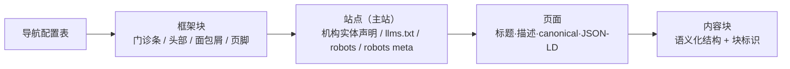
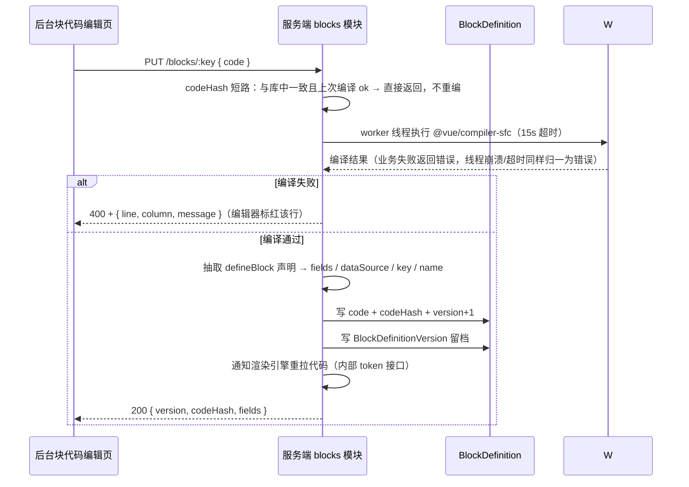
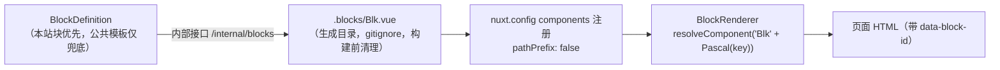
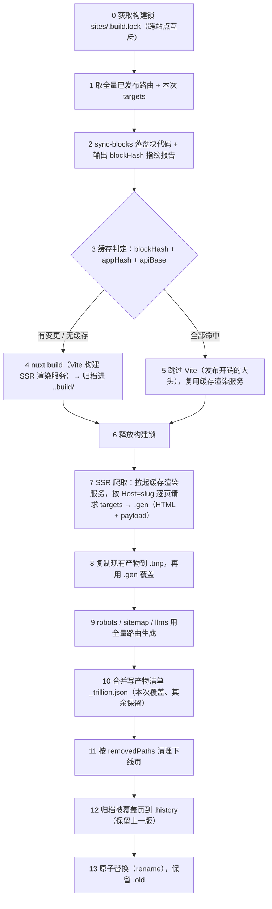

# 09 · 站点内容编辑器与块代码化（含完整建站）

> 本文是「站点内容编辑器」这一新子系统的**完整开发规格**，同时承载本轮设计稿落地的**建站目标**。
> 与既有编号文档的关系：数据模型增量见 [`04`](./04-data-model.md)（指针），接口见 [`05`](./05-api-contract.md)，发布与 GEO 见 [`06`](./06-publish-and-geo.md)，部署形态见 [`07`](./07-deployment.md)，取舍记录见 [`08`](./08-adr.md)（ADR-023 ~ ADR-029）。
>
> 状态：**待开发**（2026-10-06 需求定稿）；实现须遵守 `AGENTS.md` 与 `docs/REQUIREMENTS.md`。
> **术语**：专有名词（草稿 / 预览票据 / 块隔离 / 产物清单 / 内容指纹 …）统一解释见 [`../GLOSSARY.md`](../GLOSSARY.md)。

---

## 1. 背景与范围

### 1.1 目标

在「站点管理」下为每个站点提供一个内容编辑器工作台：左侧以访问地址（URL）为轴组织内容树（目录 → 页面 → 块），右侧直接渲染站点真实外观。不懂代码的人完成「看树、看页面、拼块、发布」；懂代码的人在线维护块组件代码。

### 1.2 范围

| 属于本期 | 不属于本期（Backlog，见 §14） |
| --- | --- |
| 内容树 + 页面元信息 + 块拼装（排序/增删/启停） | 拖拽排序与跨目录移动 |
| 块 = 数据库存储的 Vue SFC，在线代码编辑 + 字段声明驱动的数据表单 | SSR 站点形态（`renderMode` 字段保留、后台不暴露切换） |
| 保存草稿 / 预览 / 发布三态分离 | 乐观并发锁（baseHash 409） |
| 发布：单页 / 整站；待发布清单；发布前检查；影响面告知 | 块级发布 |
| 产物清单（页面 ↔ 产物一一对应）、回退上一版 | N 版历史列表与任意版本回退；301 重定向 |
| 站点下载（完整包 / 纯静态包） | 设备宽度切换、iframe 点击回传联动 |
| GEO：每页 JSON-LD / canonical / 标题描述；主站实体声明 / llms.txt / robots | 独立 GEO 就绪度面板（并入发布前检查清单） |
| 机构实体档案页为 NAP 唯一事实来源 | 危险 API 扫描引擎（仅一行警示） |
| 导航独立配置（头部主导航 + 页脚四列） | 下载包子路径（baseURL）部署 |
| 完整建站：按新设计稿落地（页数与块数以 `design/xara-bdf-site/99-blocks.html` 为准） | news 动态数据块（仅契约预留） |

### 1.3 已确认决策（用户拍板，权威；与早期讨论冲突以本表为准）

| # | 决策 |
| --- | --- |
| 1 | 编辑器骨架 = 左树 + 右侧「上预览下操作」 |
| 2 | 树操作一期：新建 / 删除 / 重命名 / 上下移；不做拖拽 |
| 3 | **URL 不可变**：页面发布后 slug 与所属目录锁定，服务端 400 拦截；删除已发布页 = 下线清理，不做 301 |
| 4 | `Page.path` / `Channel.path` 物化落库（`siteId+path` 唯一；首页 `slug=home` 映射 `/`） |
| 5 | 块 = 数据库存储的 **Vue SFC**（template / script / scss），在线纯代码编辑，服务端编译校验 |
| 6 | **字段声明写在块代码内**（`defineBlock({ key, name, fields, dataSource })`），后台解析声明自动生成数据表单 |
| 7 | 块编辑页必须有「数据注入契约」面板 |
| 8 | 块归属：**公共块 = 模板库**（只作模板）+ **站点块**（本站独有）；站点引用模板时复制一份本站副本，此后改动互不影响（§4.5）；平台级可编模板与任意站点块，站点级仅可编本站块 |
| 9 | 块代码版本留档 + 回退上一版 |
| 10 | 草稿 = 整页快照（后写覆盖） |
| 11 | 预览 = 站点渲染引擎以 dev 模式常驻 + HMR，读草稿与最新块代码；票据短时效、禁索引、关埋点 |
| 12 | 块代码装载：DB 拉取 → 落盘生成目录 → 动态解析渲染；块缺失渲染占位 |
| 13 | 发布 = 单页 / 整站；不做块级；发布前二次确认并告知影响线上 |
| 14 | 块代码发布跟随页面发布纳管；产物清单记录每页实际使用的块代码指纹 |
| 15 | 回退 = **只保留上一版** |
| 16 | 产物清单为页面 ↔ 产物对应关系的唯一事实来源（文件形态） |
| 17 | GEO 分层：块只输出语义化结构 + 块标识；页面负责 JSON-LD / canonical / 标题描述；站点负责机构实体声明 / llms.txt / robots |
| 18 | GEO 文档双模式：`自动+追加` / `全量覆盖`，可手动重新生成并查看实际生成内容 |
| 19 | 本阶段 SSG 生成 + dev 运行态预览；站点外观与后台主题完全解耦 |
| 20 | 后台沿用亮色控制台（`tokens.scss` 唯一颜色来源） |
| 21 | 站点下载：完整包 + 纯静态包 |
| 22 | **无 MCP 预留**（不做任何 agent/MCP 相关设计） |
| 23 | 导航为独立配置数据；内容树仅用于后台可视化管理，**不驱动**站点导航 |
| 24 | 详情页也统一在页面体系里维护（不引入内容库表驱动详情页） |
| 25 | 建站内容先用新设计稿占位内容 + 真实 NAP，后续在编辑器里替换 |

---

## 2. 三层职责划分（避免越界）



| 层 | 负责 | 不负责 |
| --- | --- | --- |
| 块 | 自身结构 / 样式 / 交互；语义化标签；输出 `data-block-id` | ❌ JSON-LD、canonical、llms.txt、站点元数据 |
| 页面 | JSON-LD（按页面类型）、canonical、标题 / 描述 / 关键词、页面级覆盖 | ❌ llms.txt、机构实体声明 |
| 站点 | 机构实体 JSON-LD、llms.txt、robots.txt、robots meta（完整摘要）、全局默认元数据 | ❌ 页面级内容 |

---

## 3. 数据模型增量

> 口径与既有约定一致：Prisma 多文件 schema、每个 model 与字段必写 `///` 中文注释、时间 `@db.DateTime(0)`、命名 camelCase + `@map` 下划线落库。

### 3.1 `Site` 扩展（企业实体 + NAP + 平台配置）

| 分组 | 新增字段 | 说明 |
| --- | --- | --- |
| 标识 | `legalName`、`commonName`、`abbrName`（Json 数组） | 工商全称 / 对外常用名 / 简称与曾用名 |
| 资质 | `clinicRegNo`、`licenseValidFrom`、`licenseValidTo`、`orgType`、`level`、`legalPerson`、`principal`、`foundDate`、`practiceScopes`（Json 数组） | 医疗机构登记号、执业许可证有效期、机构类型与等级、法定代表人、主要负责人、成立日期、诊疗科目 |
| NAP-A | `addressFull`、`postalCode`、`lat`、`lng` | 现存 `companyAddress` 保留兼容，`addressFull` 为对外逐字口径 |
| NAP-P | `phone`（对外唯一）、`phoneServiceHours` | 与 `contactPhone` 并存：前者对外，后者内部联系 |
| 门诊 | `openingHours`（Json：`{season, weekday, open, close, note}`[]） | 支持季节区分与"午间不休息 / 周末节假日正常"的备注 |
| 医保 | `medicalInsurance`（bool）、`insuranceNo` | 医保定点标识与编号 |
| 关联标识 | `sameAs`（Json：`{platform, url, status, checkedAt}`[]） | 官网 / 公众号 / 地图 / 卫健委公示 / 企业信用公示等 |
| 主题 | `themeTokens`（Json） | 站点设计令牌（见 §11.4） |
| GEO | `geoJsonLd`、`geoJsonLdMode`、`llmsTxt`、`llmsTxtMode`、`headExtra`、`headExtraMode`、`robotsMeta` | 见 §10 |

> **补充（2026-10-08）**：设计稿框架块（门诊条 / 头部 / 页脚）还需要 4 个**档案级展示字段**，此前未在表中登记，现补齐。它们都是「机构档案事实」，不是页面内容，因此归属 `Site`：
>
> | 分组 | 字段 | 说明 | 设计稿取值出处 |
> | --- | --- | --- | --- |
> | 标识 | `logoSubtitle` | 头部 LOGO 英文副标（原型 `.logo .s`） | 设计稿固定为 `XARA · VITILIGO SPECIALTY` |
> | 标识 | `logoMark` | 头部 LOGO 方形标记内单字（原型 `.logo .mark`） | 设计稿固定为机构首字「仁」 |
> | 资质 | `issuingAuthority` | 执业许可证**发证机关**（法定信息，页脚须可见） | 设计稿：`西安市新城区卫生健康局` |
> | 医保 | `insuranceNote` | 医保口径补充说明（非定点时的院内减免口径） | 设计稿：`白癜风专项诊疗目前不在医保统筹报销范围，院内另设慢病专病直报减免` |
>
> 四者均可为空（为空时框架块按退化形态渲染，不得编造）；`logoMark` 为空时取 `commonName` 首字。**医疗合规字段（`issuingAuthority` / `insuranceNote`）必须来自机构证件原件，禁止推测填写**（§11.2 硬约束 1）。

### 3.2 `Channel` / `Page` 扩展

| 表 | 新增字段 | 说明 |
| --- | --- | --- |
| `Channel` | `path`（`@unique([siteId, path])`） | 物化路径；目录默认不超 5 层，仅校验不成环 |
| `Page` | `path`（`@unique([siteId, path])`） | 物化访问地址；首页为 `/` |
| | `kind`（`static` / `list` / `detail`） | 静态页 / 列表页 / 详情页 |
| | `draft`（Json） | 整页草稿快照：`{ title, slug, summary, seo*, authorName, blocks, editorial, updatedAt }` |
| | `contentHash`、`publishedHash` | 内容指纹 / 上次发布指纹（徽标派生用） |
| | `jsonLd`（Json）、`jsonLdMode`（`auto_append` / `override`） | 页面级结构化数据覆盖 |
| | `sort` | 同级排序 |
| | `isPublished`（`status` 既有的复用），`downAt` | 下线时间（保留记录） |

> **URL 不可变规则**：`status = published` 的页面，服务端拒绝修改 `slug` 与 `channelId`（`400 已发布页面的访问地址不可修改`）；目录下存在已发布页面时，目录 `slug` 同样锁定。删除已发布页 = 下线（清理产物 + 重生成索引），不写重定向。

### 3.3 `BlockDefinition` + `BlockDefinitionVersion`（新表）

```prisma
/// 块定义：块代码的唯一事实来源（公共模板 / 站点块）
/// siteId = 0 → 公共模板（模板库）；siteId = 站点 id → 本站块（站点独有副本，见 §4.5）
model BlockDefinition {
  id            Int      @id @default(autoincrement())
  /// 块标识：^[a-z][a-z0-9-]{1,40}$
  key           String
  /// 展示名
  name          String
  /// 用途说明（块库卡片）
  hint          String   @default("")
  /// 归属：public = 公共模板（模板库）/ site = 本站块
  scope         String   @default("public")
  /// 归属站点 ID；**0 = 公共模板**（不用 NULL：唯一索引不约束多个 NULL）
  siteId        Int      @default(0)
  /// Vue SFC 源码（template / script / style）
  code          String   @db.LongText
  /// 代码指纹（产物清单比对用）
  codeHash      String
  /// 编译校验状态 ok / error
  compileStatus String   @default("ok")
  /// 编译错误（含行号）
  compileError  String?  @db.Text
  /// 版本号（每次保存 +1）
  version       Int      @default(1)
  createdAt     DateTime @default(now()) @db.DateTime(0)
  updatedAt     DateTime @updatedAt @db.DateTime(0)

  @@unique([key, siteId])
}

/// 块代码版本留档（回退上一版用）
model BlockDefinitionVersion {
  id        Int      @id @default(autoincrement())
  blockId   Int
  version   Int
  code      String   @db.LongText
  codeHash  String
  createdBy Int?
  createdAt DateTime @default(now()) @db.DateTime(0)

  @@unique([blockId, version])
}
```

### 3.4 `Navigation` + `NavigationItem`（新表）

| 表 | 字段 | 说明 |
| --- | --- | --- |
| `Navigation` | `id`、`siteId`、`key`（`header` / `footer-1`~`footer-4`）、`title`、`sort` | 导航分组：头部主导航 + 页脚四列 |
| `NavigationItem` | `id`、`navigationId`、`label`、`pageId`（可空）、`href`（可空，外部链接）、`sort`、`status` | 导航项；未指向页面且无 href 的项在后台告警 |

> 导航**不**从内容树推导（树仅用于后台可视化管理）；页面内互相跳转属于页面开发逻辑（由块代码自行实现）。

### 3.5 `StaticFile` 扩展

新增 `caption`（图片说明）、`location`（拍摄区域/楼层）、`takenAt`（拍摄日期）、`imageNo`（图片编号）—— 对应图集块的"每张图必须有文字、可追溯"要求。

### 3.6 `PublishTask` 扩展

新增 `scope`（`page` / `site`）、`targets`（Json：`{ pageIds, paths, removedPaths }`）、`buildId`、`artifact`（Json 摘要）。**移除**块级语义。

### 3.7 迁移与回填

- 迁移方式：**手工维护 SQL + `prisma migrate deploy`**（Windows 下 `lower_case_table_names=1` 会让 `migrate dev` 误报 drift，禁止 reset 开发库）
- 回填内容：① `Channel.path` / `Page.path` 按现有 `parentId` + `slug` 推导；② 旧 `Page.blocks` JSON 数组补 `id`（nanoid）与 `enabled`，并迁移为 `{ id, key, enabled, data }`；③ 站点 `Site` 新增字段给默认值
- 种子：侧栏新增「内容管理」父菜单并把五个入口（内容 / 页面 · 内容编辑器 · 块库 · 块模板 · 导航管理）挂为同级；**内置角色按定位补齐授权**（只增不减，否则老库的侧栏看不到后加的菜单）+ 站点内置块定义（写入模板库，`siteId = 0`）+ 为示例站点补站点副本（§4.5）
- 菜单种子幂等键是 **`path`**（不是「上级 + 名称」）：调整层级时旧行才能被找到并改父级，否则会多出一份重复菜单

---

## 4. 块代码化（核心机制）

### 4.1 块代码契约（`defineBlock`）

块代码是单文件 Vue SFC，字段声明与代码同文件，由服务端从源码抽取：

```vue
<script setup lang="ts">
import { defineBlock } from '#blocks'   // 运行时注入的全局宏（构建期由渲染引擎提供）

defineBlock({
  key: 'hero-dark',
  name: '深色首屏',
  hint: '页面主视觉 + 一句话定义 + 行动点',
  fields: [
    { key: 'eyebrow', label: '标签语', type: 'text', required: true },
    { key: 'h1', label: '主标题（页面唯一 H1）', type: 'text', required: true },
    { key: 'lead', label: '导语', type: 'textarea', required: true, hint: '60–120 字，须自包含' },
    { key: 'chips', label: '标签组', type: 'list', item: { type: 'text' } },
    { key: 'actions', label: '行动点', type: 'list',
      item: { type: 'group', fields: [
        { key: 'label', label: '文案', type: 'text' },
        { key: 'href', label: '链接', type: 'url' },
        { key: 'variant', label: '样式', type: 'select', options: ['primary', 'line'] }
      ] } }
  ],
  dataSource: { kind: 'manual' }        // 或 { kind: 'childPages', channelSlug: 'doctors' }
})

const props = defineProps<{ data: Record<string, any>; context: BlockContext }>()
</script>

<template>
  <section class="blk-hero-dark" :data-block-id="context.block.id">
    <p v-if="data.eyebrow" class="eyebrow">{{ data.eyebrow }}</p>
    <h2 v-if="data.h1">{{ data.h1 }}</h2>
    <p v-if="data.lead">{{ data.lead }}</p>
  </section>
</template>

<style lang="scss" scoped>
.blk-hero-dark { /* 只用站点主题 CSS 变量，禁止写死色值 */ }
</style>
```

**字段类型**（`BlockFieldSchema`）：`text` / `textarea` / `number` / `switch` / `select` / `file` / `url` / `link` / `list`（子项为任意字段）/ `group`。**不提供富文本**（守「禁止富文本自由编辑 Block」）。

**数据来源**（`dataSource`）：
- `{ kind: 'manual' }` —— 数据在本页录入
- `{ kind: 'childPages', channelSlug }` —— 列表页取"所在目录下的子页面集合"（§4.4）

### 4.2 保存链路（编译校验 + 声明抽取）



**编译在 worker 线程执行**（`src/common/workers/sfc.worker.ts`）：parse/compileScript/compileTemplate/compileStyle 是同步 CPU 重活，放在主线程会阻塞整个 NestJS 事件循环（保存块时所有在线请求一起停顿）。worker 超时/崩溃归一为 400，**不回退主线程编译**（那正是要避免的阻塞路径）；仅 worker 产物缺失（未编译源码环境）时降级主线程并告警。**codeHash 短路**：同一份代码重复保存（自动保存反复触发）直接复用上次编译结果，不重编、不空转版本号。编译产物（JS/CSS）不落库——发布走构建缓存 + SSR 爬取链路，不消费块的编译产物（ADR-032）。

安全约束：`key` 白名单正则、代码体积上限（建议 200KB）、仅写白名单文件名（`Blk<PascalKey>.vue`）、保存页常驻风险提示（**代码将在构建与渲染进程执行，等价任意代码执行**）。

### 4.3 装载与渲染链路



- 生成目录：`apps/geo/.blocks/`（不入库、构建前清理，避免已删除块残留仍可渲染）
- 渲染跳过 `enabled = false` 的块；**块缺失**（页面引用的 key 在库中不存在）渲染占位提示并在后台标记"块缺失"，避免整页 500
- 预览即时性：渲染引擎以 dev 模式常驻 + HMR，代码落盘即热更新，后台刷新 iframe 即可见

### 4.4 列表块取数（构建期）

列表页（`kind = list`）所在**目录下的子页面集合**即列表数据源：

| 页面 | 目录 | 数据来源 | 卡片字段来源 |
| --- | --- | --- | --- |
| `/doctors` | `doctors` | 子页面（每个医师详情页） | 详情页中 `doctor-profile` 块声明的字段 |
| `/articles` | `articles` | 子页面 | `post-meta` 块字段（标题/摘要/分类/日期/审核医师） |
| `/news` | `news` | 子页面 | `post-meta` 块字段（发布部门/生效时间） |
| `/cases` | `cases` | 子页面 | `case-meta` 块字段（脱敏口径） |
| `/videos` | `videos` | 子页面 | `video-meta` 块字段（时长/文字摘要） |

服务端在构建期提供 `GET /public/list/:siteKey?channel=<slug>` 返回卡片数据；同一份数据不在列表页重复录入。

### 4.5 块隔离：公共块 = 模板，站点块 = 副本（2026-10-07）

**问题**：公共块若被多个站点共享同一行记录，A 站改一次块代码就会改掉 B 站的线上页面——站点之间没有隔离。

**口径**：

1. `siteId = 0` 的行是**公共模板（模板库）**，只作模板，不是任何站点的渲染来源；
2. 站点一旦**引用**某个块，就把模板复制一份成本站自有块（`scope = site`、`siteId = 站点 id`、`version = 1` + 版本留档）；
3. 之后：改**站点块**只影响本站；改**模板**只影响「之后新引入」的站点，不影响已引入的站点；
4. 复制逻辑只有一处实现（`src/modules/blocks/block-copy.ts` 的 `copyTemplatesToSite`，幂等），调用点：

| 时机 | 位置 | 说明 |
| --- | --- | --- |
| 首次引用（主路径） | `PUT /content/editor/pages/:id/draft` | 保存草稿提交的 blocks 里有本站尚未持有的 key 即复制 |
| 建站导入 | `POST /sites/:id/bootstrap` | 导入描述里的块先落成本站副本，再算页面内容指纹 |
| 发布前兜底 | `PublishService.enqueue` | 目标页（正式 + 草稿）引用到的块补齐副本，失败只告警不阻断 |
| 手动引入 | `POST /blocks/:key/apply` | 块库页「引入本站」按钮 |
| 存量数据迁移 | `prisma/backfill.ts` / `prisma/seed.ts` | 按各站点现有页面引用把历史公共块补成站点副本 |

**显式复制兜底之外的读取口径**：`BlocksService.codeHashMap` / `rendererManifest`（以及 `PublicService.routes`）仍是「本站块优先 + 公共模板兜底」——兜底只用于「不因半迁移数据而块缺失」，正常路径下站点都已持有副本。

**权限**：模板库（`siteId = 0`）任何读写都是平台级（`assertSiteAccess(user, 0)`）；站点块读写为站点级。站点尚未持有某块时读接口回落到模板（便于先看字段声明），此时保存会自动先复制再落笔。

**界面落点**（侧栏「内容管理」父菜单下，五个入口同级）：

| 入口 | 内容 | 权限 |
| --- | --- | --- |
| `块库` | **本站块** + 公共模板（标注「已引入 / 未引入」，未引入可一键「引入本站」） | 站点级 |
| `块模板` | 公共模板库（新建模板 / 改代码 / 回退上一版） | 平台级 |
| `块代码页`（`/blocks/:key?siteId=`） | `siteId = 0` 编辑模板，其余编辑本站块；由列表以**新标签页**打开 | 对应归属权限 |

---

## 5. 数据注入契约（块可直接拿到什么）

块代码通过 `props.context` 与组合式 API 获取以下数据（编辑页右侧面板逐项展示 + 可复制示例）：

| 注入项 | 类型要点 | 说明 |
| --- | --- | --- |
| `context.site` | `{ name, commonName, legalName, domain, icpNumber, phone, addressFull, openingHours, medicalInsurance, themeTokens, seo* }` | 站点配置（实体档案字段只读引用） |
| `context.page` | `{ id, title, path, kind, summary, seoTitle, seoDescription, seoKeywords, publishedAt, updatedAt, authorName }` | 当前页面 |
| `context.channel` | `{ id, name, slug, path, ancestors[] }` | 所属目录与祖先链（面包屑用） |
| `context.block` | `{ id, key, enabled }` | 当前块实例 |
| `context.items` | `Array` | 仅 `dataSource.kind = childPages` 时注入的列表数据 |
| `context.entities` | `Array` | 站点实体（品牌/别名，GEO 一致性用） |
| `context.now` / `context.locale` | `string` | 构建期/请求期时间（`YYYY-MM-DD`）与语言（v1 固定 `zh-CN`） |
| 组合式 | `useSite()` / `usePage()` / `useEntities()` | 已有能力，块内可直接调用 |

> 客户端交互（如需要 JS）用 `.client.vue` 形态；**公开内容必须直出 HTML**，不得依赖客户端渲染。

---

## 6. 编辑器（管理后台）

### 6.1 信息架构（侧栏「内容管理」菜单下的入口）

侧栏结构：`内容管理`（父菜单，容器不可点）→ **同级五个入口**：内容 / 页面 · 内容编辑器 · 块库 · 块模板 · 导航管理。
「内容 / 页面」与「块库」是兄弟关系——它不再是容器（有子菜单的节点在侧栏里不可点击，会让页面列表点不进去）。

| 路由 | 界面 | 权限 |
| --- | --- | --- |
| `/content?siteId=` | 内容 / 页面（页面列表：状态三态、GEO 分、提交审核与发布） | 站点级 |
| `/content/editor?siteId=` | **站点内容编辑器**（核心工作台） | 站点级 |
| `/blocks?siteId=` | **块库**：本站块 + 公共模板（标注「已引入 / 未引入」，未引入可「引入本站」；含「使用位置」） | 站点级 |
| `/blocks/templates` | **块模板库**：公共模板的新建 / 改代码 / 回退上一版（§4.5） | 平台级 |
| `/blocks/[key]?siteId=` | 块代码编辑页（SFC 源码 + 行号 + 字段声明 + 使用位置）；`siteId=0` 编的是公共模板 | 对应归属权限 |
| `/navigations?siteId=` | 导航管理（头部主导航 + 页脚四列） | 站点级 |
| 站点管理列表（改造） | **构建状态列**（未构建 / 排队中 / 构建中 / 构建成功 / 构建失败 + 时间，失败悬停看原因，进行中自动轮询）；操作列：预览 → 编辑 → **内容编辑** → **下载** → 删除 | — |

### 6.2 工作台布局（左树 + 预览满屏 + 操作抽屉）

```text
[站点] 构建状态ⓘ · 增量发布(n)ⓘ · 整站重建ⓘ · GEO 索引更新ⓘ · 刷新
┌────────────┬──────────────────────────────────────────────┐
│ 内容树      │ 预览头部：预览态标记 · 访问地址 · 复制地址          │
│ 搜索框      │          · 页面/块/发布(抽屉入口) · 刷新          │
│ 目录/页面/块 ├──────────────────────────────────────────────┤
│ 徽标        │ 预览画布（iframe：站点真实外观，占满一屏高度）      │
│ 新建目录/页面│                                              │
│ 上移/下移/编辑│                                             │
│ /删除       │                                              │
└────────────┴──────────────────────────────────────────────┘
右侧抽屉（原底部页签）：页面（元信息 / URL 片段 / 摘要 / SEO / 编审 / JSON-LD）
                       · 块（实例清单 + 动态数据表单）· 发布（状态 / 回退 / GEO 体检）
```

设计要点：

- 内容树带**搜索框**：命中名称 / 路径 / URL 片段即保留（命中子节点的祖先目录由 `el-tree` 自动保留），内容多时不必逐级点开
- **点目录 = 直接打开其下第一个页面**：目录本身没有可编辑内容，只选中目录会让画布与操作区整片空白
- 页面**访问地址**由 shared 的 `buildSiteUrl` 拼装（主域名 + 站点前缀 + 物化 `path`），在预览头部与「页面」抽屉均可一键复制——用户配块内链接时照抄该地址即可，不必猜 URL（与站点列表「预览」、预览票据同源，ADR-031）
- 操作区由「底部常驻」改为**右侧抽屉**，高度让给预览画布（一屏内同时看得到画布与操作）
- 顶部工具条「**增量发布(n)**」= 一次性发布本站全部**待发布**页面（见 §6.3），按钮内 `?` 气泡说明其含义
- 顶部工具条展示**构建状态**（未构建 / 排队中 / 构建中 / 构建成功 / 构建失败 + 时间，失败可悬停看原因）：**进行中（排队中 / 构建中）时三个按钮全部禁用**——增量发布与整站重建显示转圈，GEO 索引更新只禁用（构建期间它与构建同写产物目录，必须互斥）；状态每 **3 秒**轮询，结束时自动刷新左树与产物徽标并提示「构建完成 / 构建失败原因」。锁定以**服务端状态**为准（刷新页面、换人换浏览器同样锁定），不依赖本地请求状态
- 「整站重建」与「GEO 索引更新」同样带 `?` 说明（与增量发布同一套 `TermHint`）
- **预览态提示条移出 iframe**（原渲染引擎页面内提示条会把站点外观顶下去），改由后台画布头部展示（§7.5）
- 「块」抽屉里的**编辑代码**以**新标签页**打开块代码页：工作台现场（左树 / 抽屉 / 未保存的草稿）不会因跳转而丢失，编辑完关掉标签页即回到原地

### 6.3 三态与交互

| 动作 | 行为 |
| --- | --- |
| 保存草稿 | 写 `Page.draft`，**不构建、不改线上**；提示「草稿已保存」，对应节点短暂闪烁 |
| 预览 | 签发短时票据 → iframe 打开 `?__preview=<ticket>`；**预览态标记（预览模式 · 展示草稿）在 iframe 外的画布头部展示**；点左树块 → 画布滚动定位 + 柔和描边高亮（单向联动） |
| 发布 | 打开发布确认弹窗（见 §8.3）→ 通过后写正式字段 + 入队构建 |
| 增量发布 | 取产物清单中 `status = pending` 的页面集合（徽标派生同源）→ 二次确认 → `POST /publish/page/:siteId` 一次性提交（级联规则同单页发布）；无待发布页时提示「当前没有待发布的页面」，不触发构建 |
| 回退上一版 | 二次确认 → 用上一版产物覆盖 + 更新清单 → 该页显示「待发布」 |
| 构建状态（进行中） | 工具条显示「● 构建中 / 排队中」+ 已运行时长，三个构建按钮禁用；每 3 秒轮询 `GET /publish/artifacts/:siteId` 的 `task` 字段 |
| 构建状态（结束） | 成功 → 提示「构建完成，线上已更新」并刷新左树 + 徽标；失败 → 提示失败原因（悬停状态可看完整日志尾部），按钮恢复可点 |

**关键提示**：已发布页面的 slug 与所属目录为只读，并提示「已发布地址不可修改」。

### 6.4 接口（服务端）

| 分组 | 接口 |
| --- | --- |
| 内容树 | `GET /content/tree?siteId=`（一次返回目录 + 页面 + 块摘要 + 徽标）、目录/页面 CRUD 与上下移 |
| 草稿 | `GET /content/pages/:id/draft`、`PUT /content/pages/:id/draft`、`DELETE /content/pages/:id/draft` |
| 块定义 | `GET /blocks?siteId=`（本站块 + 公共模板）、`GET /blocks/:key`（`?template=1` 只读模板）、`PUT /blocks/:key`（站点维度自动先复制副本）、`POST /blocks`、`GET /blocks/:key/usages`、`POST /blocks/:key/rollback`、`POST /blocks/:key/apply`（把模板引入本站，§4.5） |
| 导航 | `GET /navigations?siteId=`、`PUT /navigations/:key`（整组全量提交 + 排序） |
| 预览 | `POST /preview/ticket`、`GET /preview/page/:id`（渲染引擎调用，JWT 内部） |
| 发布 | `POST /publish/page/:siteId`、`POST /publish/site/:siteId`、`POST /publish/rollback`、`POST /publish/repair`、`GET /publish/artifacts/:siteId`、`GET /publish/download/:siteId?mode=full\|html` |
| 建站 | `POST /sites/:id/bootstrap`（§12.2） |

鉴权：草稿编辑 / 预览 / 单页发布 / 下载 / 本站块代码 = 站点级；整站发布 / **公共模板与模板库（`siteId = 0`）** / renderMode 切换 = 平台级。

---

## 7. 渲染引擎（`apps/geo`）

### 7.1 框架块（布局层，不进页面 blocks）

| 块 | 数据来源 | 要点 |
| --- | --- | --- |
| `top-bar` 门诊信息条 | `Site.openingHours`、`medicalInsurance` + 固定入口 | 门诊时间逐字来自站点配置 |
| `site-header` 头部 | `Site`（标识）+ `Navigation(header)` | LOGO/常用名 + 主导航 + 双 CTA（电话 / 预约） |
| `breadcrumb` 面包屑 | 由 `page.path` + `channel.ancestors` 派生 | `<nav><ol><li>` |
| `site-footer` 页脚 | `Site` + `Navigation(footer-1..4)` + 法定信息 | 工商全称 / 地址 / 电话 / 信用代码 / 备案 / 免责 / 隐私·版权入口，备案用 `<small>` |

### 7.2 内容块（43 个，语义化强制）

全量块清单见 `03` §3.2（`Blk*.vue` 43 个 + BlockRenderer）；通用块定义唯一真源为 `apps/server/prisma/blocks/*.vue`（41 个公共模板 + `telbar`/`vcard-grid` 等按需新增），站点首次使用后自动生成站点私有副本（§4.5 块隔离）。**改块流程：改 `prisma/blocks/*.vue` → `pnpm db:seed`（更新公共模板）→ 对已引入站点执行副本重同步（`apps/server/resync-site-blocks.mjs <siteSlug>`）→ `geo blocks:sync` 落盘 `Blk*.vue` → 重建**。只 seed 不同步副本时，站点线上仍渲染旧版块代码（rendererManifest 按 siteId 升序，站点副本优先）。

> **块定义变更（2026-10-14，新闻去分类）**：`post-list` 去 `ptag` / `category` 字段，新增 `pageSize` 字段（默认 10）+ **客户端分页**——`onMounted` 解析 `?page=`（SSG / SSR 首屏恒第 1 页），渲染原型 `.pager` 结构（`?page=N` 相对链接、原生 `<a>` 整页跳转，当前页 `.on`），`total ≤ pageSize` 不渲染 pager；`article-meta` 去 `category` 字段。公共模板更新后，已引入站点按 §4.5 块隔离口径经 **`PUT /blocks/:key`（site 维度，服务端自动写入本站副本）** 显式同步——本次即照此执行（替代脚本重同步路径）并整站重发；未同步前站点线上仍渲染旧版块代码。

字段清单与约束以设计稿 `design/xara-bdf-site/99-blocks.html`（块元素对照总表）为准，其中**必须落实的硬约束**：

1. `stat-bar` 的 `source` 字段**必填**（每个数字标注统计口径与日期）
2. `faq-list` 答案直接可读、**不做折叠**
3. `case-card` **不提供**姓名 / 面部图片 / 前后对比 / 满意度 / 疗效描述 / 费用字段
4. `job-list` **不设薪酬字段**，过期岗位改状态不删除
5. `gallery` 每张图必须有 `caption` + `location` + `takenAt` + `imageNo`
6. `article-body` 的 `sidebar.editorial`（撰稿/审核医师/来源/日期/下次复核）与 `disclaimer` 必填

#### 7.2.1 页面节奏提示（section hint，ADR-038）

原型（`design/xara-bdf-site/*.html`）的间距节奏是**页面级**的：`section{padding:56px 0}`，深浅底（`.alt`）交替由整页排版决定，单个块自身不携带该信息。为此块实例支持可选 `section` 字段（`plain` 浅底 / `alt` 深底 / `plain-flush` `alt-flush` 去顶部内边距），未设置时回退 BlockRenderer 内置 `SECTION_OF` 清单。规则：

- 提示仅影响外层 `<section class="site-section">` 的底色与内边距，不进块数据表单（`normalizeBlockInstances` 透传，计入 `computePageContentHash`）
- `section-head` 与紧随其后的内容块由 BlockRenderer **合并为一个 `<section>`**（原型 sec-head + grid 同节）；内容块的 `section` 提示决定该节底色
- `hero-panel` 紧随 `hero-dark` 时合并进 hero 的 `panel` 字段（`.hero-in` 双栏）

#### 7.2.2 尾部预约条（`telbar`）

原型除 `02-about` 外所有内容页尾部都有 `.telbar`（初诊预约提示 + 门诊时间地址 + 预约热线按钮），尾句按页面主题各不相同（提取自原型逐页文案）。建站数据源须逐页补 `telbar` 块；框架页（about/entity/legal/sitemap/visit）无。

### 7.3 页面模板（按新设计稿 + 详情页）

页面 URL 与「页面 × Block」矩阵以 `design/xara-bdf-site/` 的新设计稿为准（整页清单见 `FILE-LIST.md`，块清单见 `99-blocks.html`），逐页落地。

### 7.4 站点主题（与后台主题解耦）

设计稿 `assets/theme-b.css` 的 `:root` 令牌转写为站点 `themeTokens`，构建/请求期注入 CSS 变量。

> **勘误（2026-10-08）**：本表此前把 `--bg` 记为 `#F5F8FC`，与设计稿实际取值不符，已导致整站底色偏灰。设计稿 `assets/theme-b.css` 第 5–31 行原文为 `--bg:#FFFFFF; --bg-2:#F5F8FC;`，**页面底色是 `#FFFFFF`，`#F5F8FC` 只是次级底色（`--bg-2`）**。此处以设计稿为唯一真源。

**① `SiteThemeTokens` 受管令牌（进 Prisma / 后台可配，键固定）**

```text
--teal   #2DD4BF     --teal-dk #0E9F8E    --deep   #0A1628    --deep-2 #0F2A46    --blue #3B82F6
--ink    #0D1B2A     --ink-2   #41556E    --ink-3  #7688A0    --line   #E2E9F2    --bg   #FFFFFF
--ok     #0E7C66     --amber   #C2410C    圆角 10/14/18px     --wrap 1180px
```

**② 设计稿派生变量（不进 `SiteThemeTokens`，由渲染引擎在站点样式层固定补齐）**

这些变量在设计稿里是常量、不随站点品牌变化，故不做成站点可配字段，由 `apps/geo` 的站点样式层统一声明，保证 41 个块与框架组件里的原型类名引用得到值：

```text
--deep-3 #163857   --teal-lt #E6FBF8   --line-2 #EDF2F8   --bg-2 #F5F8FC   --card #FFFFFF
--warn   #B45309   --shadow 0 12px 34px rgba(13,27,42,.10)
```

**③ 命名别名（强制）**

设计稿用短名 `--r-sm/--r-md/--r-lg`；CMS 令牌映射为 `--radius-sm/--radius-md/--radius-lg`。为让原型 CSS 与原型类名**零改动**落地，站点样式层同时注册短名别名：

```text
--r-sm = --radius-sm (10px)   --r-md = --radius-md (14px)   --r-lg = --radius-lg (18px)
```

块与页面**只使用这些变量与站点主题类**，禁止写死色值（块代码里出现色值属违规，需在块库卡片上标记）。站点主题默认值的三处真源必须一致：`apps/admin/app/config/site-defaults.ts`、`apps/server/src/modules/sites/constants.ts` 的 `SITE_DEFAULTS.theme`、`apps/geo/app/utils/theme.ts` 的 `DEFAULT_THEME_TOKENS`（AGENTS.md §7）。

#### 7.4.1 设计稿样式与资产的落地方式（1:1 还原口径，见 ADR-036 / ADR-037）

**问题**：站点外观的最终验收标准是「与设计稿逐页视觉一致」。若把设计稿的 CSS 类体系"翻译"成自创类名再手写样式，翻译过程必然引入偏差（间距、卡片结构、响应式断点），且设计稿一改就要重新翻译。

**口径（强制）**：

1. **原型 CSS 原样落地，不做转写**。`design/xara-bdf-site/assets/theme-b.css` 与 `site.css` 两个文件**逐字节复制**到 `apps/geo/public/assets/css/`，由站点样式层在 `app.vue` 引入。块组件与框架组件的 HTML **直接复用原型类名与 DOM 结构**，不自创类名。原型 CSS 只允许两种改动：一是**追加**不改变原型语义的补充规则，二是**不得改动**原有选择器与声明。
2. **令牌通过变量桥接，不靠改 CSS**。原型 CSS 的 `:root` 令牌与 §7.4 ①②③ 的变量注入是同一套名字（含 `--r-sm/md/lg` 别名），因此原型 CSS 无需改动即读到站点品牌色。**禁止**把原型 CSS 里的 `var(--x)` 换成字面量。
3. **图片资产双轨**（用户决策，ADR-037）：
   - **轨 1 · 静态站点**：`design/xara-bdf-site/assets/img/**` 整体复制到 `apps/geo/public/assets/img/**`，依赖 Vite 的 `public/` 直出，构建后落进 `sites/<slug>/assets/img/**`。块内图片 `src` 一律写**站点根相对路径** `/assets/img/<group>/<file>`（如 `/assets/img/device/xtrac308.jpg`），由 shared 的 `buildSiteUrl` 在需要绝对 URL 时补站点前缀。
   - **轨 2 · CMS 素材库**：同一批图片经 `POST /files/upload` 传入素材库（`StaticFile`），供后台在内容编辑器里检索复用；`StaticFile` 的 `caption/location/takenAt/imageNo`（§3.5）同步写入，供 `gallery`/`env-grid`/`cert-grid` 的合规字段使用。
   - 两轨内容必须可对账：`apps/geo/public/assets/img/**` 的文件集合 = 素材库中 `siteId` 归属本站的图片集合（同一批内容，路径一致）。
4. **`public/` 触发重建**：`build-sites.mjs` 的 `computeAppFingerprint()` 已包含 `public`，因此增删改 `apps/geo/public/**` 会变更 `appHash` → 强制 `nuxt build`。这是预期行为，不需要改构建脚本。

### 7.5 预览通道

1. 后台 `POST /preview/ticket` → `{ url, ticket, expiresAt }`（默认 30 分钟）
2. iframe 打开 `http://<previewHost>/<slug><path>?__preview=<ticket>`，地址统一由 shared 的 `buildSiteUrl` 拼装：**预览基址是回环地址（本地多站点共用同一 GEO 端口）时带站点前缀 `/<slug>`**，否则渲染引擎按 URL 首段解析不到站点、退回环境变量默认站点，表现为「预览 B 站点却看到 A 站点」（见 ADR-031）
3. 渲染引擎中间件校验票据 → 取草稿（`GET /preview/page/:id`）→ 注入渲染
4. 预览态：`X-Robots-Tag: noindex`、关闭埋点；**预览提示不注入页面内部**（iframe 内的提示条会把站点外观顶下去），由管理后台「内容编辑器」在画布头部展示「预览模式 · 展示草稿」
5. iframe 内一切站内跳转（导航配置、页脚、Block 内链）由全局中间件 `app/middleware/site-prefix.global.ts` 统一补上站点前缀并保留 `__preview` 票据——点击、刷新、新窗口都不掉站、不掉预览态

---

## 8. 发布管线

### 8.1 构建流程（缓存复用 + SSR 爬取，见 ADR-028 / ADR-032）

> ADR-028 修正的历史缺陷：旧实现「新建临时目录 → 只渲染选中路由 → 整体改名覆盖站点目录」会**丢掉站点其他页面**，并使 sitemap / llms.txt / 全站导览缩水为只含变更页。现行流程已含「复制现有产物再合并」的修复。

`apps/geo/scripts/build-sites.mjs` 流程（`pnpm build:sites --site <slug> [--pages 1,2] [--rebuild]`）：



**为什么不再用 `nuxt generate`**：generate = Vite 整站冷构建 + 预渲染，而块代码在保存时已由服务端 worker 编译校验（§4.2），发布时把全部块连同整站资源从零重编是纯浪费——内容编辑（不改代码）占发布动作的绝大多数。缓存命中时发布开销降为 O(目标页) 的 SSR 爬取（ADR-032）。

**构建期不预渲染**：`nuxt.config` 的 `nitro.prerender.routes` 固定为空（不注入路由）。Nitro 的预渲染会把「页面路径 → 构建期 HTML 文件」烘焙进 server bundle 的静态资产表，后果有二：① 爬取请求命中该表后直接返回构建期旧 HTML，SSR 被短路、内容更新不生效；② 缓存命中路径下 `.gen` 是新建空目录，资产表命中却读不到文件 → 静态 handler 抛 ENOENT → 500 且响应不结束，爬取只能逐页等超时（表现为构建长时间无反馈）。页面 HTML 的唯一产出路径是 SSR 爬取。

**为什么先生成再合并**：任何会清空输出目录的生成方式都不能「先复制现有产物再生成」（会被清掉）。正确顺序是**生成到独立目录，再把生成结果合并进现有产物的副本**，与「未重建页面不丢失」等价，顺序不可颠倒。

**构建互斥锁**：`sync-blocks` 写共享的 `app/components/blocks/Blk*.vue`、`nuxt build` 读写根 `.nuxt/` 与 `.output/`，跨站点并发构建会互相覆盖（缓存投毒）。锁范围 = sync-blocks → nuxt build → 归档站点缓存；之后的 SSR 爬取与产物合并只操作站点私有目录，可并行。等锁 30 分钟超时报错；持锁进程已死或超过 45 分钟视为陈旧锁接管（崩溃不卡死后续发布）。

**失败不落线上**：任何页面渲染失败（HTTP 非 200）脚本以非零码退出，合并/替换不发生——线上保持原样；产物替换为 rename 原子操作。

目录布局（均在 `apps/geo/sites/` 下，隐藏目录为构建中间态，`sites/` 整体不入库）：

| 路径 | 说明 |
| --- | --- |
| `sites/<slug>/` | 正式产物（可直接托管） |
| `apps/geo/.<slug>.build/` | 构建缓存：`meta.json`（blockHash + appHash + apiBase）+ 归档渲染服务（`server/` 等，**必须在 geo 根下且内容直接放根层**——Nitro 把 publicDir 相对化到 `.output`，渲染服务按同层级基准解析回 `sites/.<slug>.gen`，放错层级则静态文件全 500） |
| `sites/.<slug>.gen/` | 本次 SSR 爬取输出（targets + `_nuxt` 资源，成功后清理） |
| `sites/.<slug>.tmp/` | 合并工作目录（现有产物 + 本次覆盖），成功后改名为正式目录 |
| `sites/.<slug>.old/` | 上一次完整产物（「回退上一版」的数据源，不再删除） |
| `sites/.<slug>.history/<pageId>/` | 单页上一版归档（只保留最近一版，会话目录最多 20 个） |
| `sites/.build.lock` | 跨站点构建互斥锁（持有者 pid + 起始时间） |

> 注：构建锁与缓存目录的父级不同（锁在 `sites/`，缓存在 geo 根）是有意为之——锁保护的是「写 `sites/` 与共享构建目录」的整段临界区，缓存则受 Nitro 相对路径机制约束只能放 geo 根。

### 8.2 产物清单（唯一事实来源）

`sites/<站点slug>/_trillion.json`：

```json
{
  "buildId": "20261006-153012-9f3c",
  "siteId": 7,
  "slug": "example-site",
  "domain": "localhost:3002",
  "generatedAt": "2026-10-06 15:30:12",
  "routes": ["/", "/entity"],
  "pages": [
    {
      "pageId": 123,
      "path": "/entity",
      "file": "entity/index.html",
      "contentHash": "…",
      "fileHash": "…",
      "publishedAt": "2026-10-06 15:30:12",
      "blocks": [{ "id": "b_9f3c…", "key": "hero-dark", "codeHash": "…" }]
    }
  ]
}
```

**字段口径（不可漂移，`packages/shared/src/types/editor.ts` 为权威类型）**：

| 字段 | 来源 | 消费方 |
| --- | --- | --- |
| `buildId` / `generatedAt` | 构建脚本（北京时间） | 发布任务 `buildId`；后台「当前线上版本时间」=`generatedAt` |
| `siteId` / `slug` / `domain` | `GET /public/site/:key` | 下载包与排查 |
| `routes` | 全量已发布路由的**路径字符串数组** | 后台统计 `routes.length`；GEO 索引更新重写该字段 |
| `pages[].pageId` | `GET /public/routes/:key` 的 `id` | 后台徽标 `pageEntry(pageId)`、回退取上一版指纹 |
| `pages[].file` / `fileHash` | 产物相对路径 / 该文件 sha1 | 下载与一致性排查 |
| `pages[].contentHash` | `Page.contentHash` | 徽标：与 `Page.publishedHash` 三方相等 → 已发布 |
| `pages[].blocks[].codeHash` | `GET /public/routes/:key`（本站块优先，公共模板仅兜底，§4.5） | 「块代码变更牵连」判定 |

> ⚠️ 实现约束（ADR-033）：脚本**只接纳 `pageId` 为数字的旧条目**参与合并，历史遗留的错误格式条目会在下次构建自然淘汰。

**徽标派生**：`contentHash == 清单该页 hash` → 已发布；不等 → 待发布；清单无该 pageId → 产物缺失。块 `codeHash` 与当前块定义不一致的页面同样进入「待发布清单」（增量构建只重建目标页，不会静默影响其他页）。

### 8.3 发布确认弹窗（必须告知影响线上）

内容：① 本次要发布/级联的页面清单与线上地址；② 当前线上版本时间；③ 发布前检查结果（§10.4）；④ 整站发布需勾选确认。

级联规则：单页发布 → 该页 + 站点首页 + 站内索引（sitemap / llms.txt / 全站导览）；整站发布 → 全量重建；站点配置或主题变更 → 降级整站重建；页面删除下线 → 清理产物 + 重生成索引。

### 8.4 回退与修复

| 能力 | 实现 |
| --- | --- |
| 回退上一版 | 仅保留上一版：构建时不删除 `.old`，改为保留最近一份；回退 = 从 `.old` 拷回该页文件 + 更新清单 + 该页标记「待发布」（**不回退数据库内容**） |
| 整站重建 | `POST /publish/site/:siteId`（平台级） |
| GEO 索引更新 | `POST /publish/repair`：仅重生成 robots / sitemap / llms / 清单，不重渲染页面（界面旧称「产物修复」） |

### 8.5 站点下载

`GET /publish/download/:siteId?mode=full|html`（流式 zip）：
- `full`：HTML + `_nuxt` + `_payload.json` + robots/sitemap/llms + 清单 + `DEPLOY.md`（可直接托管）
- `html`：仅 HTML + 上述 GEO 产物 + 清单（CDN 回源场景；**注意**不含客户端资源时页面交互与会员岛屿会失效，属预期边界）
- 前置：从未构建 → 提示先发布；存在未发布改动 → 二次确认（下载的是上次构建产物）；下载动作记审计日志

---

## 9. 编辑器导出与可见性边界

- 树与画布都是**后台可视化管理工具**，不对外暴露
- 站点导航、页内跳转由**导航配置 + 块代码**决定，不从内容树生成
- 预览票据短时效、仅能读单页草稿、不能触发构建

---

## 10. GEO 元数据

### 10.1 分层归属

| 位置 | 内容 |
| --- | --- |
| 页面 | JSON-LD（按 `kind` 与页面类型：`Article` / `WebPage` / `FAQPage` / `ItemList` + `BreadcrumbList`）、canonical、`title` / `description` / `keywords` |
| 站点 | `MedicalClinic` 实体声明（实体档案页输出，其他页用 `@id` 引用）、`llms.txt`、`robots.txt`（含 AI 爬虫策略说明）、`robots meta`（完整摘要：`max-snippet:-1`、`max-image-preview:large`） |

### 10.2 机构实体唯一性

`/entity` 页输出最完整的机构实体 JSON-LD：

```json
{
  "@context": "https://schema.org",
  "@type": "MedicalClinic",
  "@id": "https://<domain>/#organization",
  "legalName": "机构工商全称",
  "alternateName": ["对外常用名", "简称"],
  "taxID": "统一社会信用代码",
  "address": { "@type": "PostalAddress", "streetAddress": "…", "postalCode": "…" },
  "telephone": "…",
  "openingHoursSpecification": [{ "@type": "OpeningHoursSpecification", "opens": "08:30", "closes": "17:30" }],
  "sameAs": ["公众号", "地图标注", "卫健委公示", "企业信用公示"]
}
```

其他页面只写 `{ "@type": "Organization", "@id": "https://<domain>/#organization" }`，**全站实体只定义一次**。

### 10.3 双模式与手动生成

GEO 文档类型：`GeoDoc { mode: 'auto_append' | 'override', custom: string }`

| 模式 | 最终输出 |
| --- | --- |
| `auto_append` | 系统自动生成的内容 + 用户追加内容（拼接） |
| `override` | 只用用户内容，系统不再注入 |

后台提供：只读展示「实际会输出的内容」（`POST /geo/preview` 纯计算、不落盘）+ 手动「重新生成」+「以自动结果为基础编辑」。适用范围：页面 JSON-LD、站点 `MedicalClinic`、站点 `llms.txt`、站点 head 扩展、`robots meta`。

变量占位符：`{{site.*}}` / `{{page.*}}` / `{{now:YYYY-MM-DD}}`，解析器位于 `packages/shared`，仅构建期 / 请求期解析。

### 10.4 发布前检查清单

| 检查项 | 级别 |
| --- | --- |
| 缺 `title` / `description` | 阻断 |
| canonical 重复（同 `siteId + path` 冲突） | 阻断 |
| 医疗类页面缺编审信息（撰稿 / 审核医师 / 下次复核） | 阻断 |
| 案例类出现禁止字段（姓名 / 疗效 / 费用 / 满意度 / 对比图） | 阻断 |
| 无机构实体声明（`/entity` 页缺失或未输出 `MedicalClinic`） | 阻断 |
| 无 `llms.txt` / robots 缺 AI 爬虫策略说明 | 阻断 |
| `robots meta` 未开启完整摘要 | 警告 |
| NAP 三处（实体档案 / 首页 / 就诊指南）不一致 | 警告 |
| `stat-bar` 缺 `source` 统计口径 | 警告 |
| sitemap 无核心 URL（自动判定：首页 + 一级目录页） | 警告 |

---

## 11. 设计稿落地对照

### 11.1 页面 → Block 矩阵

以 `design/xara-bdf-site/99-blocks.html` 的块清单为准，逐页落块；页面 URL 见 §7.3。

### 11.2 四条硬约束（来自设计稿，实现必须遵守）

1. `Site` 的 NAP 字段只有**实体档案页**可写，其他页面只读引用
2. 正文用 **Block 数组**，不在正文写死 HTML
3. 医疗类内容的编审信息（`reviewerId` / `nextReviewDate` 等价字段）为**发布前置**
4. 案例类模板**不提供**疗效 / 评价 / 费用字段（结构上杜绝）

### 11.3 设计令牌

见 §7.4。

### 11.4 语义化要求（渲染引擎强制）

唯一 H1、层级不跳级、`article/section/figure/address/time/dl/small` 用在正确位置、图片有 `alt`、结构化数据只经 `useHead` 注入（禁止在 SFC 模板写 `<script>`）。

---

## 12. 完整建站（本次交付）

> 建站目标、清理口径与落地批次见 `design/xara-bdf-site/RENAI-CLEANUP-AND-REBUILD-PLAN.md` §六。
> 本章只保留**通用规格与执行口径**，具体站点的名称、代码、字段值不进架构文档。

### 12.1 目标站点数据

| 字段 | 值 | 状态 |
| --- | --- | --- |
| 对外常用名 `commonName` | 按新设计稿填写（真实机构名） | ✅ |
| 工商全称 `legalName` | 缺失时先等于常用名，并在实体档案页标注待补 | ⏳ 待补 |
| slug | 见建站方案 §6.3（已定稿） | ✅ |
| 主域名 `domain` | 本地 `localhost:3002`，上线换正式域名（**禁止硬编码**） | ✅ |
| 电话 `phone` | 真实 NAP | ✅ |
| 地址 `addressFull` | 真实 NAP | ✅ |
| 门诊时间 `openingHours` | 真实口径 | ✅ |
| 统一社会信用代码 `creditCode` | 待补 | ⏳ |
| 医疗机构登记号 `clinicRegNo` | 待补 | ⏳ |
| 执业许可证有效期 | 待补 | ⏳ |
| 机构类型 / 等级、诊疗科目、法定代表人、成立日期 | 待补 | ⏳ |
| 医保定点编号 `insuranceNo` | 待补 | ⏳ |
| 主题令牌 `themeTokens` | 设计稿 `assets/theme-b.css` 全套（见 §7.4） | ✅ |
| 页面文件 | 按新设计稿落地（页数与块数以 `99-blocks.html` 为准），内容先用设计稿占位文字 | ✅ 采用 |

> **字段与页数以 `design/xara-bdf-site/RENAI-CLEANUP-AND-REBUILD-PLAN.md` §6.1 / §6.2 为准。**
> 待补字段来源于机构营业执照 / 执业许可证原件，或知识库导出（需人工核对）。

### 12.2 建站描述导入器

`POST /sites/:id/bootstrap`（平台级）+ `scripts/bootstrap-site.mjs`，入参为一份**建站描述 JSON**，事务落库：

```jsonc
{
  "site": { "commonName": "…", "phone": "…", "addressFull": "…", "openingHours": [ /* … */ ], "themeTokens": { /* … */ } },
  "blocks": [{ "key": "hero-dark", "scope": "public", "code": "…" /* SFC 源码 */ }],
  "channels": [{ "slug": "doctors", "name": "医师团队", "parent": null }],
  "pages": [
    {
      "channel": "doctors", "slug": "li-ming", "kind": "detail",
      "title": "李明 主任医师", "summary": "…",
      "blocks": [{ "key": "doctor-profile", "enabled": true, "data": { /* … */ } }]
    }
  ],
  "navigations": [{ "key": "header", "items": [{ "label": "首页", "page": "/home" }] }]
}
```

幂等要求：按 `slug` / `path` upsert，重复执行不产生重复页面与块。

### 12.3 执行顺序

1. 站点与站点配置（真实 NAP + 主题令牌 + 待补字段占位）
2. 目录树 + 整页 + 详情页骨架（页数以新设计稿为准）
3. 内容块代码入库（新设计稿的块清单，作为**块模板**种子）
4. 每页按矩阵落块实例与占位数据
5. 导航（头部主导航 + 页脚独立配置）
6. GEO 产物与 JSON-LD（站点实体声明 + 其他页引用）
7. **预览校验（逐页看画布）**
8. 整站发布 + 产物核对 + 站点下载验证
9. **设计稿视觉比对（与第 7 步并列，不可省略）** —— 见 §12.5

> **勘误（2026-10-08）**：首次执行时第 7 步被替换成了「跑机械扫描脚本」（标签闭合 / title / JSON-LD / NAP / 内链），**从未在画布或浏览器里看一眼真实外观**，导致「整站无图 + 样式与设计稿不符」漏过验收。第 7 步与新增的第 9 步都必须是**人眼比对**，扫描脚本只能作为补充，不能替代。

### 12.4 验收清单

- [ ] 全部页面可在工作台打开、画布渲染真实外观、点块可定位高亮
- [ ] **设计稿视觉比对通过**（§12.5）：抽检页面与设计稿同屏截图比对，布局 / 间距 / 卡片结构 / 断点表现一致
- [ ] **图片全部可达**：站点产物内的 `` 逐一可 200，且文件集合 = 设计稿 `assets/img/**`
- [ ] 块库显示本站块与块模板（未引入可「引入本站」）；块代码可改、编译错误能定位行号、可回退上一版
- [ ] **块隔离生效**：A 站改块代码后 B 站同 key 块代码与线上页面不变；改块模板不影响已引入的站点
- [ ] 保存草稿不改线上；预览读草稿与最新块代码；发布才重生成产物
- [ ] 单页发布后**其他页面产物不丢**，sitemap / llms.txt 仍为全量
- [ ] 产物清单可回答"某页线上是什么版本、有没有未发布改动"
- [ ] 已发布页面的 URL 改不动（服务端 400）
- [ ] 回退上一版可用；下载完整包解压后可直接托管
- [ ] 每页有唯一 canonical 与完整 title/description；站点层输出实体声明，其他页 `@id` 引用
- [ ] `llms.txt` 含实体声明段；`robots.txt` 含 AI 爬虫策略说明；`robots meta` 含 `max-snippet:-1`
- [ ] 医疗内容缺编审信息时发布被阻断；案例页无禁止字段

### 12.5 设计稿视觉比对（强制步骤）

建站完成后的最终验收，标准是**与设计稿逐页视觉一致**，做法：

1. 同时起两个本地服务：设计稿 `design/xara-bdf-site/*.html`（`file://` 或静态服务）与站点产物 `apps/geo/sites/<slug>/`（`nuxt preview` / 静态服务）。
2. 对每类页面模板**至少各抽 1 页**（首页、目录页、详情页、FAQ 页、实体页、法律/工具页），同视口宽（桌面 1440 / 移动 390）截图并排比对。
3. 比对项：页面底色、区块顺序、栅格（`.grid-2/3/4`）、卡片结构（`.tcard/.pcard/.doc/.envgrid/.certgrid`）、间距节奏、字体层级、`.stats` 数字样式、按钮与徽标样式、断点折叠行为、图片是否出现且比例正确。
4. 差异必须**改块组件或框架组件**消除，不允许以"接近即可"结案；确实无法一致的（设计稿用了 CMS 不支持的交互）须记入本节表格并说明原因。

| 页面模板 | 抽检 URL | 与设计稿差异 | 结论 |
| --- | --- | --- | --- |
| 首页 | `01-index.html` vs `/`（1440 / 390） | 无：8 节结构、双栏 hero（`.hero-in`）、深色实体条、8 项浅色数据条、`.alt` 交替、证书照片医师卡、vcard 三卡、telbar、页脚四列 | **一致，通过** |
| 目录页（诊疗项目） | `11-services.html` vs `/services`（1440） | 首版 22 张 itemcard 各自成节（块粒度节奏）；按 ADR-038 改分组块（3 组 `grid-3` + section hint）并补 telbar 后与原型逐节一致 | **已修复，通过** |
| 目录页（设备实景） | `09-devices.html` vs `/devices`（1440） | 首版 18 行各自成节；改单块 `.device-rows` 纵向行组后一致 | **已修复，通过** |
| 目录页（医师团队） | `07-doctors.html` vs `/doctors`（1440） | 无：双列证书照片卡 + 执业证号行 + 标签 chips（照片为执业证书特写，合规选择） | **一致，通过** |
| 详情页（项目） | `12-item.html` vs `/services/atomization`（1440） | 原型是「演示页 + 全部数据常量」（FILE-LIST §4 明确 CMS 承接为每项一页）；承接后 hero 化、价格由侧栏卡改为 hero 徽标，`table.tb` 字段行 → vcard 行一一对应、`.cmpl` 保留、telbar 已补 | **符合既定映射，通过** |
| FAQ 页 | `15-faq.html` vs `/faq`（1440） | 无：深色 hero + 锚点条 + 六分组问答列表 + telbar | **一致，通过** |
| 实体页 | （原型无对应页）vs `/entity`（1440） | GEO 规则页（MedicalClinic 全站唯一声明，ADR 既有口径），无原型可比；块结构与全站一致 | **按设计生成** |
| 法律/工具页 | `17-terms.html` vs `/terms`（1440） | 首版 H1 缺「白癜风」前缀与条数、eyebrow/chips 不符、缺尾部 telbar；数据源逐字修正 + telbar 补全后一致 | **已修复，通过** |

> 执行备注（2026-10-08）：截图工具 playwright-core + Edge（`1440×900` / `390×844`，fullPage），产物与原型同时本地静态服务；抽检截图存 `.workbuddy/shots/`。首轮暴露的三类系统性缺陷——块粒度节奏（→ ADR-038 section hint + head/hero 合并）、telbar 缺失（→ 生成器逐页补全）、terms 文案漂移——均已改数据源或块组件消除。

> 本节是 `BLOCK-CLASS-MAPPING.md` 施工图的验收出口：块组件必须使用原型类名与 DOM 结构（§7.4.1），本节确认这一要求是否落实。


---

## 13. 埋点与监控（沿用既有，不新增）

预览与后台操作不入埋点；站点埋点沿用现有 `plugins/analytics.ts`（仅客户端、`sendBeacon`）。

---

## 14. Backlog（明确后置，勿在本期实现）

| 项 | 说明 |
| --- | --- |
| 301 重定向 | URL 不可变前提下暂不需要；若将来允许改地址再引入 `PageRedirect` 表 |
| 拖拽排序 / 跨目录移动 | 本期用上下移与重建 |
| 乐观并发（`baseHash` 409） | 多人同时编辑同一页时后写覆盖；冲突提示后续再加 |
| 构建期代码快照冻结校验 | 本期构建开始时拉取一次代码（构建串行） |
| N 版历史与任意版本回退 | 本期只保留上一版 |
| iframe 内点击回传联动 | 本期只做画布单向定位 |
| 设备宽度切换 | 一期不做 |
| 危险 API 扫描引擎 | 只在保存页给一行警示 |
| 独立 GEO 就绪度面板 | 已并入发布前检查清单 |
| news 动态数据块 | 仅契约预留 `dataSource.kind` |
| SSR 站点形态 | `renderMode` 字段保留，后台不暴露切换 |
| 下载包子路径部署（baseURL） | 一期仅支持根路径 |
| MCP / agent 相关能力 | **明确不做**（用户已否决） |

---

> 下一步：本文落地时需同步更新 [`04`](./04-data-model.md)（表与字段口径）、[`05`](./05-api-contract.md)（接口清单）、[`06`](./06-publish-and-geo.md)（构建与 GEO 流程）、[`07`](./07-deployment.md)（运行形态）、[`08`](./08-adr.md)（ADR-023 ~ ADR-029）与 [`../PROJECT_STRUCTURE.md`](../PROJECT_STRUCTURE.md)（文件条目）。
