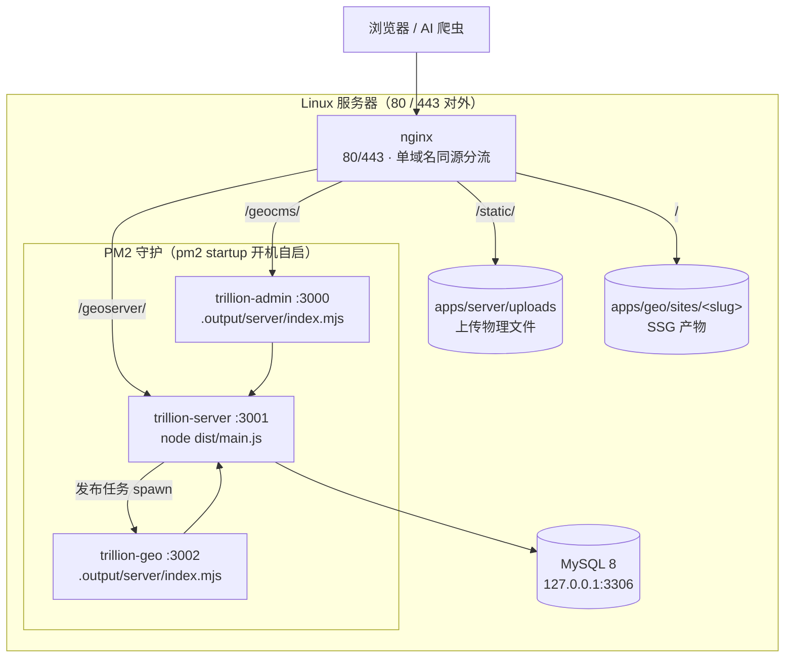
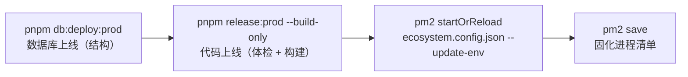

# 10 · 上线流程手册（Linux 直装 · PM2 守护）

> 面向**公网 Linux 服务器**的操作级上线手册（Runbook）：服务器初始化、首次部署、日常更新、进程守护（PM2）、nginx 反代、验收、回滚与备份。
> 部署架构（拓扑 / 端口 / 环境变量三层分工 / Docker 形态）见 [`07`](./07-deployment.md)；两条命令分离原则见 ADR-034；PM2 守护的决策背景见 ADR-041。
> 本手册涉及的 `scripts/pm2-config.mjs` 与上线器 `--build-only` 已于 2026-10-16 落地（实施记录见 §12）。

***

## 1. 适用范围与形态选型

| 形态                             | 适用场景                                                                    | 操作手册                               |
| ------------------------------ | ----------------------------------------------------------------------- | ---------------------------------- |
| **形态 A · 仓库形态（非部署包，当前采用）**     | 服务器**自己装好 Node / pnpm / PM2 / MySQL / nginx**，源码经 git 拉到服务器；单机公网生产 / 测试 | §3 → §4.1\~§4.6（日常见 §5 / §6）       |
| **形态 B · 部署包形态（ADR-042，当前不用）** | 服务器**无 git / pnpm / PM2**：本地构建并打包，整体拷贝上传，`node start.mjs` 一条命令运行        | §4.0（含末尾「部署包日常更新」）                 |
| Docker 编排                      | 容器化交付（本期不采用，形态保留）                                                       | [`07`](./07-deployment.md) §1、§3.4 |
| 开发形态（`pnpm allDev`）            | 本地开发联调，前台托管                                                             | `README.md` / `AGENTS.md` §9       |

两形态**共用**：环境值口径与派生逻辑（§4.1）、数据库上线（§4.2；部署包对应 `node db.mjs deploy`，同一套迁移）、nginx 反代（§7）、验收清单（§8）。
**只在两点上分叉**：① **代码怎么上服务器**——形态 A `git pull` + `pnpm install` + 构建；形态 B 本地打包整体覆盖。② **进程怎么起停**——形态 A 用 PM2（§2 / §4.4 / §6）；形态 B 用包内 `start.mjs`（自带守护，**不需要 PM2**）。

生产形态三端进程与开发形态一致，仅启动方式不同（构建产物常驻）：

| 进程     | 生产启动（`start:prod`）              | 工作目录（cwd）     | 端口   | 职责                                       |
| ------ | ------------------------------- | ------------- | ---- | ---------------------------------------- |
| 服务端    | `node dist/main.js`             | `apps/server` | 3001 | API / 鉴权 / 发布任务（spawn SSG 构建）/ 静态文件      |
| 管理后台   | `node .output/server/index.mjs` | `apps/admin`  | 3000 | Nuxt SSR（挂 `/geocms/` 基础路径，ADR-040）      |
| GEO 项目 | `node .output/server/index.mjs` | `apps/geo`    | 3002 | SSR 模式站点运行时 + 预览；SSG 构建由服务端按需 spawn（非常驻） |

> **cwd 必须对齐各应用包目录**：`UPLOAD_DIR`（缺省 `uploads`）、`SITES_OUTPUT_DIR`（缺省 `../geo/sites`）等相对路径按服务端 cwd（`apps/server`）解析——这是 PM2 配置里逐应用声明 `cwd` 的原因。

部署拓扑（Linux 直装 + PM2 + nginx）：



***

## 2. 进程守护：PM2（ADR-041）

### 2.1 为什么是 PM2

`pnpm release:*` 在**前台托管**三端进程，SSH 会话断开即全部退出，公网生产不可接受。备选中：

- **systemd unit 直写**：三端各一份 unit，环境变量要么散落 unit 文件（第二份事实来源，与 `config/` 派生体系脱节），要么绕行 `EnvironmentFile` 改造派生逻辑——维护成本高、易漂移；
- **Docker**：本期不采用（镜像与构建链路维护成本，形态保留见 `07`）；
- **PM2**：崩溃自动拉起、`pm2 startup` 桥接 systemd 开机自启、统一 logs / monit / reload 命令面，且**只做进程守护、不接管配置派生**。

PM2 在服务器上**全局安装**（`npm i -g pm2`），不进 `package.json`——它是服务器运行时工具，不是工程依赖，不破坏「根脚本零第三方依赖」约定。

### 2.2 生成式 PM2 配置（唯一事实来源不搬家）

新增 [`scripts/pm2-config.mjs`](../../scripts/pm2-config.mjs)（零第三方依赖，`pnpm pm2:config`）：

```bash
node scripts/pm2-config.mjs --env production
# 复用 config/index.mjs 的 loadConfig() + buildAppEnv() 派生三端进程定义，
# 写入仓库根 ecosystem.config.json（PM2 原生 JSON 配置）
```

生成结果要点：

| 项        | 值                                                                               | 说明                                         |
| -------- | ------------------------------------------------------------------------------- | ------------------------------------------ |
| 进程名      | `trillion-server` / `trillion-admin` / `trillion-geo`                           | `pm2` 命令按名寻址                               |
| `cwd`    | `apps/server` / `apps/admin` / `apps/geo`                                       | 相对路径口径与 `start:prod` 一致（§1）                |
| `script` | `dist/main.js` / `.output/server/index.mjs`                                     | 与 ADR-034 的 `start:prod` 同口径               |
| `env`    | `buildAppEnv(config, name)` 派生结果                                                | 含 `PORT` / `DATABASE_URL` / `JWT_SECRET` 等 |
| 守护参数     | `min_uptime: "10s"` / `max_restarts: 10` / `restart_delay: 4000` / `time: true` | 防崩溃风暴重启，日志带时间戳                             |
| 执行模式     | `fork` × `instances: 1`                                                         | 单机单实例；不上 cluster（无多实例需求，构建目录共享也不支撑）        |

**为什么生成而不是手写** **`ecosystem.config.js`**：端口、连接串、API 基址、密钥的唯一事实来源是 `env/.env.<环境>` + `config/`（AGENTS §4：应用内禁止端口与数据库字面量）；手写 PM2 配置等于第二份事实来源，且 Node 20 下 CJS 进程无法同步 `require` ESM 派生逻辑。生成 JSON 是 PM2 原生支持格式，零模块系统问题。

**安全边界**：生成文件含数据库口令与 JWT 密钥 → **加入** **`.gitignore`，永不入库**；每台服务器各自生成，禁止跨机拷贝。

### 2.3 上线器 `--build-only`

服务器上**不使用**上线器的前台启动段（§1 进程启停一律交给 PM2）。给 `scripts/release.mjs` 增加 `--build-only` 选项：

```bash
pnpm release:prod --build-only    # 体检（含数据库只读检查）→ 构建 → 停止；不释放端口、不启动进程
```

体检 → 构建的完整链路（JWT 占位值检查、迁移落后拦截、串行构建计时）全部复用，只是把「释放端口 → 启动 → 探测」三段让渡给 PM2。

> **等价手工路径**（不想用 `--build-only` 时）：`pnpm release --env production --check`（只体检）+ 手工构建 `pnpm build:server && pnpm build:admin && pnpm build:geo`（经根执行器注入同一套派生配置）。

### 2.4 与两条命令分离原则的关系

命令族不变，只是「启动」一段的执行者从上线器前台换成 PM2：



***

## 3. 服务器初始化（形态 A · 仓库形态前置 · 一次性）

以 Ubuntu 22.04 / Debian 12 为例，建议 **2C4G** 起步（Nuxt 构建峰值内存约 2G；2G 内存的机器必须先加 swap）。

> **若服务器已装好 Node / pnpm / PM2 / MySQL / nginx（复用既有环境）**：跳过下表的安装动作，但这几项**必须核对**，不一致会直接卡住上线：
>
> | 核对项      | 怎么核                                                                                   | 不一致的后果                                                  |
> | -------- | ------------------------------------------------------------------------------------- | ------------------------------------------------------- |
> | MySQL 库名 | `mysql -u<user> -p -e "show databases;"`，库名大小写要与 `env/.env.<环境>` 的 `DB_NAME` **完全一致** | Linux 下库名区分大小写（开发机 Windows 不区分），不一致 `db:deploy` 报「库不存在」 |
> | MySQL 账号 | `DB_USER` / `DB_PASSWORD` 要能真连上目标库（`mysql -h<host> -u<user> -p <库名> -e "select 1;"`）  | 连接被拒，`db:status` / `db:deploy` 第一步即失败                   |
> | MySQL 时区 | `mysql -e "select @@global.time_zone, @@session.time_zone;"` 应为 `+08:00`              | 时间字段读写漂 8 小时                                            |
> | Node 版本  | `node -v`；**PM2 用哪个 Node 跑，就用同一个 Node 执行** **`pnpm install`** **/ 构建**                | 原生模块 ABI 不一致，进程拉起即崩                                     |
> | PM2 进程面  | `pm2 ls` 看既有应用；`startOrReload` 只增改 `trillion-*` 三端，`pm2 save` 会整体固化当前清单（期望行为）         | ——                                                      |
> | nginx    | 见 §7 开头「本文件是模板，勿覆盖既有 server 块」；先 `ss -lntp \| grep 8080` 确认端口空闲                       | port 冲突导致 `nginx -t` / reload 失败或站点错乱                   |
>
> 库与账号若已存在，本节末的建库 SQL 只做**比对**，不要重复建。
>
> 本节是\*\*形态 A（仓库形态，§4 主线）**的前置：需要 git + pnpm + PM2 + Node 20 + MySQL 8 + nginx。走**形态 B（部署包，§4.0，当前不用）\*\*时服务器只需 **Node 与 nginx**，不装 pnpm / PM2、不需要 git（以下 pnpm / PM2 / git 三项跳过）。

| 项              | 操作                                                                                                          | 说明                                |
| -------------- | ----------------------------------------------------------------------------------------------------------- | --------------------------------- |
| 时区             | `timedatectl set-timezone Asia/Shanghai`                                                                    | 与业务时间口径一致（`TZ` 缺省即 Asia/Shanghai） |
| Node.js        | NodeSource 安装 **20.x LTS**                                                                                  | `engines: node >= 20`             |
| pnpm           | `corepack enable && corepack prepare pnpm@latest --activate`                                                | `packageManager: pnpm >= 9`       |
| PM2            | `npm i -g pm2`                                                                                              | 全局安装，不进依赖（§2.1）                   |
| MySQL          | MySQL 8.0，仅监听 `127.0.0.1`                                                                                   | utf8mb4 + `+08:00` 时区，见下方 my.cnf  |
| nginx          | `apt install nginx`                                                                                         | 站点反代与静态托管（§7）                     |
| git            | `apt install git`                                                                                           | 拉取仓库                              |
| 防火墙            | `ufw allow 80,443/tcp`（+ SSH），**3000\~3002 不对公网开放**                                                         | 三端由 nginx 反代，公网只走 80/443          |
| swap（仅 2G 内存机） | `fallocate -l 2G /swapfile && chmod 600 /swapfile && mkswap /swapfile && swapon /swapfile`，并写入 `/etc/fstab` | 构建期 OOM 防护                        |

MySQL 配置（`/etc/mysql/mysql.conf.d/trillion.cnf`）：

```ini
[mysqld]
character-set-server = utf8mb4
collation-server     = utf8mb4_unicode_ci
default-time-zone    = '+08:00'
bind-address         = 127.0.0.1
```

建库与专用账号（**预建库**，专用账号即无需全局建库权限；`db:deploy` 对已存在空库直接应用迁移）：

```sql
CREATE DATABASE trillionCms CHARACTER SET utf8mb4 COLLATE utf8mb4_unicode_ci;
CREATE USER 'trillion'@'127.0.0.1' IDENTIFIED BY '<强口令>';
GRANT ALL PRIVILEGES ON trillionCms.* TO 'trillion'@'127.0.0.1';
FLUSH PRIVILEGES;
```

> **禁止在服务器上执行** **`pnpm db:migrate`**（`prisma migrate dev`，可能提示 reset）：结构变更唯一入口是 `pnpm db:deploy*`（`07` §3.5 / `04` §6）。

***

## 4. 首次部署（从零到线上）

约定仓库位置 `/srv/app/trillion-cms-platform`（下文以 `<repo>` 代指），执行用户为部署专用账号（pm2 进程归属该用户）。

本章含**两条路径**，按 §1 的形态选型对号入座：

| 路径                             | 前置环境                                            | 步骤                                                                     |
| ------------------------------ | ----------------------------------------------- | ---------------------------------------------------------------------- |
| **形态 A · 仓库形态（非部署包，当前采用）**     | 服务器自装 Node / pnpm / PM2 / MySQL / nginx（§3 核对表） | §4.1 env → §4.2 库 → §4.3 构建 → §4.4 PM2 接管 → §4.5 nginx + SSG → §4.6 验收 |
| **形态 B · 部署包形态（ADR-042，当前不用）** | 服务器只需 Node / MySQL / nginx                      | §4.0（打包 → 上传 → `node db.mjs deploy` → `node start.mjs daemon`）         |

形态 A 的日常运维见 §5 / §6；形态 B 的更新流程见 §4.0 末尾「部署包日常更新」。

### 4.0 部署包形态（离线拷贝，免 git / pnpm，ADR-042，当前不用）

服务器只需要 **Node 20+ / MySQL / nginx**。整条链路：本地构建 → 打包 → 拷贝上传 → 两条命令（库、码分离）。

#### ① 本地：构建并打包（Windows / Linux 均可）

```bash
pnpm release:prod --build-only   # 体检 + 构建三端产物（已有产物可跳过）
pnpm pack:deploy                 # 产出仓库根 deploy/（自包含部署包，gitignore 不入库）
```

打包器 `scripts/pack-deploy.mjs` 会：体检产物齐备 → 拷 `config/` 与 `env/.env.production`（**含密钥**）→ 汇集三端产物与运行时入口（`start.mjs` / `db.mjs` / `README.md` / `nginx.conf.example`）。产物目录：

```
deploy/
├── start.mjs              # 进程入口：start（前台）/ daemon / stop / status / restart
├── db.mjs                 # 数据库入口：status / deploy / seed（用包内自带 prisma CLI）
├── nginx.conf.example     # nginx 单域名同源配置模板（多站点按 sites/ 子目录扩展）
├── config/  env/          # 派生逻辑 + 环境值（与仓库同一套文件）
└── apps/
    ├── server/            # dist + prisma(迁移) + uploads(素材) + 全量 node_modules（含 prisma CLI/tsx）
    ├── admin/.output/     # Nitro 自包含产物
    └── geo/               # 源码 + nuxt 工具链 + .output + sites/<slug>/ SSG 产物 + 构建缓存
```

> 包体约 800MB，压缩后 250\~300MB：`Compress-Archive -Path deploy -DestinationPath deploy.zip`（PowerShell）或 `tar -czf deploy.tar.gz deploy/`。**含数据库口令与 JWT 密钥，传输与留存注意保密。**

#### ② 服务器：解压 → 数据库上线 → 启动

```bash
tar -xzf deploy.tar.gz && cd deploy        # 或解压 zip
node db.mjs deploy                         # 数据库上线（增量应用迁移；空库自动建库；唯一改结构入口）
node db.mjs seed                           # 可选：初始化管理员与示例站点（首次部署）
node start.mjs daemon                      # 后台守护运行三端（日志落 logs/，pid 落 .run/）
node start.mjs status                      # 查看三端进程与端口健康
```

`node start.mjs`（不带参数）为**前台**运行，SSH 会话断开即全部退出——长期运行一律用 `daemon`。崩溃自动重启（间隔 4s、上限 10 次），日志在 `logs/<应用>-out.log` / `-error.log`。

#### ③ nginx

`nginx.conf.example` 为单域名同源模板（`/geocms/` → 3000、`/geoserver/` → 3001、`/static/` → `apps/server/uploads/`、`/` → `apps/geo/sites/<slug>/`），复制到 `/etc/nginx/sites-available/` 后按域名与部署路径改两处 root / alias，多站点按 `sites/` 子目录各配一个 server 块；`nginx -t && systemctl reload nginx` 生效（完整说明见 §7）。

#### 部署包日常更新（代码更新）

```bash
# 本地
pnpm release:prod --build-only && pnpm pack:deploy     # 重新打包
# 上传解压覆盖前：先 node start.mjs stop；服务器侧 uploads 有新增素材时先备份该目录，覆盖后还原
node db.mjs deploy                                     # 有结构变更时（先库后码）
node start.mjs daemon                                  # 重新拉起（env 有变更时重新打包即可，无需生成配置）
```

### 4.1 env/.env.production（逐项确认，不入库）

> 两形态共用同一套环境值与派生逻辑：形态 A 在仓库 `env/` 下维护（下步命令）；形态 B 的该文件随包打在 `deploy/env/`，改动后须重新打包（§4.0 末尾）。

```bash
cd <repo>
cp env/.env.example env/.env.production
chmod 600 env/.env.production        # 含口令与密钥，仅部署账号可读
```

| 变量                                 | 必填             | 取值说明                                                                                                                |
| ---------------------------------- | -------------- | ------------------------------------------------------------------------------------------------------------------- |
| `APP_ENV`                          | 是              | `production`                                                                                                        |
| `PUBLIC_HOST`                      | 是              | 对外域名（如 `www.example.com`）；**禁止回环地址**（体检会拦）                                                                          |
| `API_BASE`                         | HTTPS 部署**必填** | `https://<域名>/geoserver`（**绝对基址**，ADR-040）；派生缺省是 `http://<PUBLIC_HOST>:<端口>/geoserver`，nginx 终止 TLS 后必须显式给 https 基址 |
| `CORS_ORIGINS`                     | 建议             | `https://<域名>`（后台 / 站点真实来源；单域名同源拓扑下浏览器无跨域，显式填写使体检与将来分域拓扑都稳）                                                         |
| `DB_HOST/PORT/USER/PASSWORD/NAME`  | 是              | `127.0.0.1 / 3306 / trillion / <强口令> / trillionCms`（口令为空或疑似占位值会被 db 上线器阻断）                                          |
| `JWT_SECRET`                       | 是              | **32 位以上随机串**（`openssl rand -base64 48`）；占位值或过短会被体检阻断                                                               |
| `UPLOAD_DIR` / `PUBLIC_URL_PREFIX` | 缺省             | `uploads` / `/static`（nginx §7 同口径）                                                                                 |
| `NUXT_PUBLIC_SITE_SLUG`            | 可空             | 站点解析以请求 Host / `Site.domain` 匹配为主（ADR-031）；构建目标由 `build:sites --site` 指定                                            |
| `TZ`                               | 缺省             | `Asia/Shanghai`                                                                                                     |

> 服务端可选变量（`INTERNAL_API_TOKEN` / 预览票据等）留空即走派生或缺省（`config/index.mjs`、`apps/server/src/config/configuration.ts`），无需手工填写。

### 4.2 数据库上线（结构，唯一改结构入口）

```bash
pnpm install                          # 必须完整跑完（如环境禁符号链接：pnpm install --node-linker=hoisted）
                                      # ⚠️ install 阶段 @prisma/client 的 postinstall 是「先写占位 stub，再尝试 prisma generate」：
                                      #    生成失败（CLI 缺失 / 中断 / 报错）会把 stub 留在原地，类型检查直接失败（现象见 §11）
pnpm -F @trillion/server exec prisma -v     # 复核 prisma CLI 就位（属 devDependency，install 中断时会缺失）
pnpm db:generate --env production     # 【兜底】仅怀疑客户端仍是占位 stub 时补跑（正常构建已自动生成）
pnpm db:status:prod                   # 只读：目标库 + 已应用 / 未应用迁移 + 连通性
pnpm db:deploy:prod                   # 增量应用未执行的迁移（首次为全部迁移；空库自动建库）
node scripts/exec.mjs server prisma:seed --env production   # 初始化管理员与示例站点（按需）
```

> **为什么 `prisma generate` 不再需要手工跑**：`prisma/schema/*.prisma` 里的 `model` 是 **schema 声明（DSL）**，不是运行时代码；真正的客户端代码是按 schema 生成到 `node_modules/.prisma/client` 的产物。**`apps/server` 的 `build` 脚本已内建这一步**（2026-10-20 起：`"build": "prisma generate && nest build"`），因此 `pnpm release*` / `pnpm build:server` / `pnpm pack:deploy` 都会先重生成再编译，schema 变更后无需任何人工补跑。手工 `pnpm db:generate --env production` 只在一种情况下仍有价值：怀疑 `node_modules/.prisma/client` 里仍是 install 时留下的占位 stub（现象与处置见 §11）。

### 4.3 代码上线（体检 + 构建，不启动）

```bash
pnpm release:prod --build-only        # 体检（含数据库只读检查）→ 构建 → 停止（不启动）
```

### 4.4 PM2 接管 + 开机自启

首次部署可以直接用一条命令把「构建 → 生成配置 → 拉起 → 固化清单」串起来（对尚未启动的进程，`startOrReload` 等价 `start`）：

```bash
pnpm release:pm2:prod                            # 体检 + 构建 → 生成 ecosystem.config.json → startOrReload → pm2 save
pm2 startup systemd -u <部署用户> --hp /home/<部署用户>   # 按打印出的命令执行一次，开机自启
pm2 ls                                           # 复核三端 online
```

分步等价写法（想逐段确认时用）：

```bash
node scripts/pm2-config.mjs --env production     # 生成 ecosystem.config.json（或 pnpm pm2:config）
pm2 start ecosystem.config.json                  # 三端拉起（cwd=仓库根执行，§2.2）
pm2 save                                         # 固化当前进程清单
pm2 startup systemd -u <部署用户> --hp /home/<部署用户>   # 按打印出的命令执行一次，开机自启
```

### 4.5 nginx 与 SSG 产物（**先 nginx，后构建**）

顺序不能颠倒：`pnpm build:sites`（以及服务端的发布任务）都按 `NUXT_PUBLIC_API_BASE` 请求接口，生产环境即「对外地址/geoserver」，nginx 没起来就取不到站点数据（排障见 §11 对应条目）。

```bash
sudo nginx -t && sudo systemctl reload nginx     # ① 先按 §7 配好 nginx（listen + 四处 location）并生效
pnpm build:sites --site xian-renai-skin --env production   # ② 再全量构建当前唯一站点（slug=xian-renai-skin，站点 id=3）
```

产物落在 `apps/geo/sites/xian-renai-skin/`，§7 的 `location /` 直接出该目录；此后内容发布由服务端自动增量重建，无需手工重复此步。

> **`--env production`** **必带**：`--env` 决定读哪个 `env/.env.<环境>`，缺省是 `development`（读 `env/.env.development`，apiBase 落到 `127.0.0.1:3001`）——生产端口与地址全都不生效，表现为连不上接口。手动执行构建命令时一律显式给出环境（`--env` 由根执行器 `scripts/exec.mjs` 识别，位置在脚本名前后均可）。

### 4.6 验收

按 §8 清单逐项确认后，首次部署完成。

***

## 5. 日常更新上线

| 场景                            | 是否登录服务器 | 操作                                                                                        |
| ----------------------------- | ------- | ----------------------------------------------------------------------------------------- |
| **仅内容更新**（页面 / 新闻 / 问答 / 块数据） | 否       | 后台发布任务自动完成 sync-blocks + 页面级 SSG + 产物原子替换，无需服务器操作                                         |
| **仅重启 / 停止某端**（不换产物、不换 env）   | 是       | 直接用 PM2，**不用跑 release**：`pm2 restart trillion-<app>` / `pm2 stop trillion-<app>`（命令表见 §6） |
| **代码更新**（三端源码 / 共享包）          | 是       | 下表标准序列；**部署包形态**改走 §4.0「部署包日常更新」（本地重新打包覆盖）                                                |
| **环境变量变更**                    | 是       | 改 `env/.env.production` → 重新生成 PM2 配置 → `--update-env` 重载                                 |
| **数据库结构变更**（代码已含迁移）           | 是       | 标准序列第 2\~3 步（先库后码，`07` §3.5）                                                              |

标准序列（代码更新）：

```bash
cd <repo>
git pull
pnpm install                                    # lockfile 变化时必需
pnpm db:status:prod                             # 看是否有未应用迁移
pnpm db:deploy:prod                             # 有则先应用（唯一改结构入口）
pnpm release:prod --build-only                  # 体检 + 构建（不启动）
pm2 startOrReload ecosystem.config.json --update-env   # 按新产物重载三端
pm2 save
```

> 后三步（构建 → 生成 PM2 配置 → 重载 + save）可合并为一条命令：`pnpm release:pm2:prod`（= `release --env production --build-only && pm2:config && pm2 startOrReload --update-env && pm2 save`）。数据库那两步**不能合并进来**（库/码分离，ADR-034），仍需先单独跑 `db:deploy:prod`。
> `--update-env` 必须带上：PM2 在 start/reload 时快照环境变量，漏掉会用**旧 env** 跑新代码。env 文件有改动时先重跑 `node scripts/pm2-config.mjs --env production` 再重载；配置结构变化导致重载异常时 `pm2 delete trillion-<app>` 后重新 `pm2 start ecosystem.config.json`。

***

## 6. PM2 日常运维

| 命令                                                     | 用途                                                                               |
| ------------------------------------------------------ | -------------------------------------------------------------------------------- |
| `pm2 status` / `pm2 ls`                                | 进程状态（online / restart 次数 / 内存）                                                   |
| `pm2 logs` / `pm2 logs trillion-server`                | 实时日志（默认落盘 `~/.pm2/logs/<name>-out.log` 与 `-error.log`）                           |
| `pm2 monit`                                            | 终端仪表盘（CPU / 内存）                                                                  |
| `pm2 restart trillion-server`                          | 单独重启某端（不换产物、不换 env 时）                                                            |
| `pm2 reload trillion-<app>`                            | 优雅重载某一端（不换产物、不换 env，零停机）                                                         |
| `pm2 stop trillion-<app>`                              | 停止某端；**长期停用要** **`pm2 delete trillion-<app>`** **再** **`pm2 save`**，否则开机自启会把它拉回来 |
| `pm2 delete trillion-<app>`                            | 从进程清单移除（增删进程后必须 `pm2 save`）                                                      |
| `pm2 startOrReload ecosystem.config.json --update-env` | 按配置与最新产物重载（§5 标准序列）                                                              |
| `pm2 save`                                             | 固化进程清单（`startup` 恢复的依据；**每次增删改进程后都要执行**）                                         |
| `pm2 flush`                                            | 清空日志（排查磁盘占用）                                                                     |

日志轮转（可选）：`pm2 install pm2-logrotate`（默认按大小切分，参数 `pm2 set pm2-logrotate:max_size 50M` 等）。

***

## 7. nginx 参考配置（单域名同源）

推荐**单域名同源**拓扑：站点页面、管理后台（`/geocms/`）、服务端 API（`/geoserver/`）、上传资源（`/static/`）同域分流——浏览器侧零跨域，`CORS_ORIGINS` 仅作声明。路径前缀与服务端全局前缀（ADR-040）一致，**proxy\_pass 不做路径重写**：

```nginx
server {
    listen 80;
    server_name www.example.com;

    # 管理后台：Nuxt app.baseURL=/geocms/，前缀原样透传
    location /geocms/ {
        proxy_pass http://127.0.0.1:3000;
        proxy_set_header Host $host;
        proxy_set_header X-Real-IP $remote_addr;
        proxy_set_header X-Forwarded-For $proxy_add_x_forwarded_for;
        proxy_set_header X-Forwarded-Proto $scheme;
    }

    # 服务端 API：全局前缀 /geoserver，前缀原样透传；client_max_body_size 放开素材上传
    location /geoserver/ {
        proxy_pass http://127.0.0.1:3001;
        proxy_set_header Host $host;
        proxy_set_header X-Real-IP $remote_addr;
        proxy_set_header X-Forwarded-For $proxy_add_x_forwarded_for;
        proxy_set_header X-Forwarded-Proto $scheme;
        client_max_body_size 20m;
    }

    # 上传资源直出（PUBLIC_URL_PREFIX=/static；物理目录 apps/server/uploads）
    location /static/ {
        alias /srv/app/trillion-cms-platform/apps/server/uploads/;
        expires 7d;
    }

    # 站点 SSG 产物（按站点目录分发；多站点时按 server_name 各配一份 root）
    location / {
        # 内容编辑器草稿预览：带 ?__preview=<票据> 的请求交给 GEO 渲染进程；
        # 418 + 有名 location 是「条件代理」的安全写法（不建议把 proxy_pass 写进 if）
        error_page 418 = @geo_preview;
        if ($arg___preview) { return 418; }
        root /srv/app/trillion-cms-platform/apps/geo/sites/xian-renai-skin;
        index index.html;
        try_files $uri $uri/ $uri.html =404;
    }

    # GEO 渲染进程（SSR，端口 = env 的 PORT_GEO）：只承接预览票据请求
    location @geo_preview {
        proxy_pass http://127.0.0.1:3002;
        proxy_set_header Host $host;
        proxy_set_header X-Real-IP $remote_addr;
        proxy_set_header X-Forwarded-For $proxy_add_x_forwarded_for;
        proxy_set_header X-Forwarded-Proto $scheme;
    }
}
```

> - 本文件是**参考模板**：仓库内没有任何脚本会安装 / 写入 / reload nginx（`release:*`、`pm2:*`、`db:*`、`dev.mjs` 均不碰），它只在部署包形态被当作参考附带（`deploy-runtime/nginx.conf.example`）。服务器**已有 nginx** 时**禁止覆盖既有 server 块**：按自身发行版约定新增独立块或把四处 `location` 合并进去（Debian/Ubuntu 走 `sites-available` + `sites-enabled` 软链，RHEL/CentOS 走 `conf.d/*.conf`），改完 `nginx -t` 通过再 `systemctl reload nginx`（不要 `restart`）。
> - 对外端口由 `listen` 决定：本示例 `listen 80`（HTTPS 再补 443）。若服务器直连高位端口（如 `listen 8080`、公网只放行 8080），则 `env/.env.production` 的 `API_BASE` 与 `CORS_ORIGINS` 必须同口径写成 `http://<IP 或域名>:8080`，§8 验收地址亦同口径。
> - HTTPS：`certbot --nginx` 签发后同 server 块补 443 段；**启用 HTTPS 后必须把** **`API_BASE`** **显式设为** **`https://<域名>/geoserver`**（§4.1）。
> - SSR 模式站点不适用 `location /` 的静态 root，改为 `proxy_pass http://127.0.0.1:3002;`（渲染模式是站点级开关，见 `03` / `09`）。
> - **内容编辑器预览必配三件套**（缺一则 iframe 超时或渲染报错）：① 上例 `?__preview=` 分流到 `PORT_GEO` 的 location；② `env/.env.production` 显式给 `GEO_BASE_URL=<对外基址>`（`config/index.mjs` 的 `GEO_BASE_URL` 已支持 env 覆盖派生值；缺省派生值落在 GEO 内部端口，浏览器打不开）；③ 站点表 `domain` 写**纯主机名**（渲染引擎按 `Host` 去端口反查站点）。GEO 进程仍只监听本机，不直接对公网开放；票据是 HMAC 短时效签名，未持票请求一律走静态产物。

***

## 8. 上线验收清单

| #  | 检查项          | 通过标准                                                                       |
| -- | ------------ | -------------------------------------------------------------------------- |
| 1  | `pm2 status` | 三端 online，restart 计数稳定不增长                                                  |
| 2  | 服务端健康        | `curl http://127.0.0.1:3001/geoserver/health` 返回 `{"status":"ok"}`（含数据库连通） |
| 3  | 管理后台         | `https://<域名>/geocms/` 可登录（默认 `admin`，**首次登录即改密**）                         |
| 4  | 站点首页         | `https://<域名>/` 200，品牌色 / 图片 / telbar 正常                                   |
| 5  | 栏目与详情抽检      | `/news/`、`/faq/` 及任一详情页 200；列表排序、分页正常                                      |
| 6  | 静态资源         | 任一 `/static/...` 图片 200；页面无 404 资源（浏览器控制台）                                 |
| 7  | GEO 四层产物     | `/robots.txt`、`/sitemap.xml`、`/llms.txt` 可达；详情页源码含 JSON-LD                 |
| 8  | 内容发布闭环       | 后台改一篇新闻保存 → 站点详情页出现更新（发布任务自动 SSG）                                          |
| 9  | 崩溃自愈         | `pm2 restart trillion-server`（或 kill 进程）后数秒内自动 online                      |
| 10 | 开机自启         | `pm2 save` 已执行、`pm2 startup` 已挂 systemd；服务器重启后 `pm2 ls` 三端自动 online        |
| 11 | 入口清单         | 仓库根 `release-endpoints.txt` 已落盘（体检构建产生，不入库）                                |

***

## 9. 回滚

| 层      | 手段                                                                                                                 | 说明                                  |
| ------ | ------------------------------------------------------------------------------------------------------------------ | ----------------------------------- |
| 代码     | `git checkout <上一可用提交/Tag>` → `pnpm release:prod --build-only` → `pm2 startOrReload ... --update-env` → `pm2 save` | 回滚前 `git log --oneline` 记录当前提交，便于恢复 |
| 数据库结构  | **不自动回滚**（迁移 forward-only）：回滚到旧代码后，如有不兼容迁移需手写反向迁移再走 `pnpm db:deploy:prod`                                          | 与 ADR-034 一致：结构变更不可 reset           |
| SSG 产物 | 后台「回退上一版」（`.old` 目录保留上一版，ADR-032）；或重新构建                                                                            | 产物可再生成，属可再生产物                       |
| 环境变量   | 还原 `env/.env.production` → `node scripts/pm2-config.mjs --env production` → `pm2 startOrReload ... --update-env`   | 密钥轮换（如 `JWT_SECRET`）会使现有登录态失效，属预期   |

***

## 10. 备份

| 对象      | 内容     | 频率建议        | 方式                                                                           | <br />                                                     |
| ------- | ------ | ----------- | ---------------------------------------------------------------------------- | :--------------------------------------------------------- |
| MySQL   | 全部业务数据 | 每日          | \`mysqldump --single-transaction --default-character-set=utf8mb4 trillionCms | gzip > backup/trillionCms-\$(date +%F).sql.gz\`（cron 凌晨执行） |
| uploads | 上传物理文件 | 每日增量 / 每周全量 | `rsync` 或打包 `apps/server/uploads/`                                           | <br />                                                     |
| SSG 产物  | 可再生产物  | 按需          | 留档加速回滚（`07` §4）                                                              | <br />                                                     |

备份文件**异地留存**（对象存储 / 其他机器），保留策略 ≥ 30 天；恢复 = 解包 SQL 导入空库 + 覆盖 uploads，再按 §4 验证。

***

## 11. Linux 环境已知坑

| 坑                                                                                                                                    | 处理                                                                                                                                                                                                                                                                                                                                                           |
| ------------------------------------------------------------------------------------------------------------------------------------ | ------------------------------------------------------------------------------------------------------------------------------------------------------------------------------------------------------------------------------------------------------------------------------------------------------------------------------------------------------------ |
| 首次 `pnpm install` 时 geo 的 `prepare`（nuxt prepare）报 `Cannot find module .../apps/geo/node_modules/@trillion/shared`                   | 根因：`packages/shared` 是编译型包（`exports` 指向 `dist/`，dist 不入库），而 geo 的 `nuxt.config.ts` 顶层 import 它（admin 不在配置层引用故不受影响）。已修复：geo 的 `prepare` 现内置先构建 shared（`pnpm -F @trillion/shared build && nuxt prepare`）；存量克隆手动执行 `pnpm build:shared` 后重跑 `pnpm install` 即可                                                                                                    |
| `exec.mjs` 执行的包脚本（如 `pnpm db:generate`）报 `ERR_PNPM_EXECUTOR_RUN_SCRIPT_SPAWN`（`No such file or directory`），且依赖实际齐全（`.bin/prisma` 存在） | 历史坑：`buildAppEnv` 曾只派生业务变量、不继承系统环境，Node spawn 的 env 是子进程完整环境 → 子进程缺 `PATH` → Linux 下 CLI shebang（`#!/usr/bin/env node`）解析失败；Windows 因 `.cmd` wrapper 走文件关联不查 PATH 而被掩盖。已在 `buildAppEnv` 以 `...process.env` 为基底修复（业务派生值在后覆盖同名），`exec.mjs` / `release.mjs` / PM2 配置全部受益                                                                                        |
| `pm2 startOrReload` 报端口被占用                                                                                                           | 旧进程未被 PM2 收管（如手工 `node` 起过）：先 `pm2 delete` 对应项或 `kill` 旧进程再重载                                                                                                                                                                                                                                                                                                |
| `pm2 startup` 打印的命令带 sudo                                                                                                            | 必须按打印原样执行一次，否则重启后进程清单不会自动恢复                                                                                                                                                                                                                                                                                                                                  |
| 忘带 `--update-env`                                                                                                                    | reload 后仍是旧环境变量——env 变更后必须带（必要时 `pm2 delete` 后 start，§5）                                                                                                                                                                                                                                                                                                     |
| Prisma 引擎 / npm 下载慢                                                                                                                  | 配置 npm 镜像与 `prisma` 官方镜像变量（按机房网络情况，一次性配置）                                                                                                                                                                                                                                                                                                                    |
| Linux MySQL 大小写敏感默认值与开发机（Windows `lower_case_table_names=1`）不一致                                                                      | 表名全小写无实际影响；**严禁**为对齐开发机去改 `lower_case_table_names`（8.0 初始化后不可变更），迁移状态一律以 `pnpm db:status:prod` 为准                                                                                                                                                                                                                                                            |
| 服务器时区 / MySQL 时区不对                                                                                                                   | `timedatectl` 与 my.cnf `default-time-zone='+08:00'` 双确认（§3），否则时间字段漂 8 小时                                                                                                                                                                                                                                                                                     |
| 上传文件写入失败                                                                                                                             | 确认部署用户对 `apps/server/uploads/` 有写权限；nginx `/static/` alias 路径与 `UPLOAD_DIR` 实际落点一致                                                                                                                                                                                                                                                                           |
| 站点构建 / 发布任务取不到接口数据                                                                                                                   | 手动构建必须带 `--env production`（漏掉会按 development 读 `env/.env.development`，apiBase 落到 `127.0.0.1:3001`，见 §4.5）；`pnpm build:sites` 与服务端发布任务都按 `NUXT_PUBLIC_API_BASE` 请求接口（生产即对外地址），**nginx 必须先起来**（§4.5）；若云主机访问不了自己的公网 IP（NAT 回环不生效），把 `env/.env.production` 的 `API_BASE` 改成 `http://127.0.0.1:<nginx 对外端口>/geoserver`——服务端与构建脚本走本机 nginx，浏览器端会自动换成当前页面主机名（ADR-021） |
| 服务端 `nest build` 报 `TS2694: Namespace '...Prisma' has no exported member 'InputJsonValue'`、模型类型退化成 `unknown`                           | 根因：`@prisma/client` 的 postinstall **先**把占位 stub（`scripts/default-index.d.ts`，`PrismaClient` 全部 `any`）写进 `node_modules/.prisma/client`，**再**尝试 `prisma generate`；生成失败（CLI 缺失 / 中断 / 报错）时 stub 会留在原地，TS 解析到的就是它。已修复：`apps/server` 的 `build` 脚本内建 `prisma generate`；未拉到该改动时先手工补 `pnpm db:generate --env production`（先让 `pnpm install` 完整跑完，确保 prisma CLI 存在） |
| 服务端报 `The table \`AdminUser\` does not exist in the current database`（表名大小写不匹配）                                                            | 根因：Linux MySQL 默认 `lower_case_table_names=0`（区分大小写），而 Windows（`lctn=1`）导出会把表名**落成小写**，从 Windows 导库到 Linux 后表名全变 `adminuser`；Prisma 模型未写 `@@map`，按模型名 `AdminUser` 查 → 报「表不存在」。处理：`RENAME TABLE \`adminuser\` TO \`AdminUser\`, …`（21 张业务表一次原子改名，**`_prisma_migrations` 必须保持小写不要改**）；InnoDB 会自动改写子表里指向被改名表的外键定义（已在生产同版本 8.0.40 / `lctn=0` 实测：外键定义同步更新、插入正常）。**每次从 Windows 导库到 Linux 都要跑一遍**；彻底免除需给所有 model 加 `@@map` 把物理名钉成小写（代价：同步改迁移基线 DDL 与线上台账 checksum）。脚本：`apps/server/prisma/maintenance/fix-table-name-case.sql`（幂等，含前后核对与外键复查，已实测） |

***

## 12. 实施清单（2026-10-16 已完成）

本手册 §2 / §4 / §5 引用的能力按本节规格落地（规格先行，实现照此执行）：

| # | 项                                       | 内容                                                                                                                                                                                                                           | 已同步                                                                          |
| - | --------------------------------------- | ---------------------------------------------------------------------------------------------------------------------------------------------------------------------------------------------------------------------------- | ---------------------------------------------------------------------------- |
| 1 | `scripts/pm2-config.mjs`（新文件）           | ✅ 零第三方依赖：`loadConfig({ appEnv })` → 遍历 `APPS` 生成三端进程定义（§2.2 表）→ 写仓库根 `ecosystem.config.json`；支持 `--env`，缺省 production；产物缺失只警告；生成后打印安全提示（含密钥勿入库勿拷贝）                                                                           | `PROJECT_STRUCTURE.md` 根 scripts 小节                                          |
| 2 | `scripts/release.mjs` 增加 `--build-only` | ✅ 体检（含数据库只读检查）→ 构建 → 收尾输出 PM2 后续命令（不释放端口、不启动进程、不探测）；与 `--check` / `--skip-build` 互斥（启动即报错）                                                                                                                                   | 文件头注释用法段、`07` §3.5 选项表                                                       |
| 3 | `.gitignore`                            | ✅ 追加 `ecosystem.config.json`（与 `release-endpoints.txt` 同段）                                                                                                                                                                   | ——                                                                           |
| 4 | 根 `package.json`                        | ✅ `"pm2:config": "node scripts/pm2-config.mjs"` 别名                                                                                                                                                                           | `AGENTS.md` §9、`README.md` §4                                                |
| 5 | 文档回写                                    | ✅ `07` §3.5 / §7、README 上线段、`release.mjs` 托管提示语均已对齐 PM2 口径                                                                                                                                                                   | `07`、`README`                                                                |
| 6 | 部署包形态（ADR-042）                          | ✅ `scripts/pack-deploy.mjs`（本地打包，`pnpm pack:deploy`）+ `scripts/deploy-runtime/` 运行时模板（`start.mjs` 清单驱动守护 / `db.mjs` 库上线 / `README.md` / `nginx.conf.example`）→ 仓库根 `deploy/`（gitignore）；操作口径见 §4.0                           | `07` §1、本手册 §1 / §4.0 / §5、`AGENTS.md` §9、`README.md`、`PROJECT_STRUCTURE.md` |
| 7 | 一条命令上线（PM2 形态）                          | ✅ 根 `package.json` 增 `release:pm2:prod` / `release:pm2:test`：`release --build-only && pm2:config && pm2 startOrReload --update-env && pm2 save`（只是包一层别名，不动 `release.mjs` / `pm2-config.mjs` 边界；数据库仍单独走 `db:deploy*`，ADR-034） | `AGENTS.md` §9、本手册 §4.4 / §5                                                 |

> 代码侧已全部完成；剩余动作在服务器侧：按 §4 走一遍完整首次部署，并按 §8 验收。

