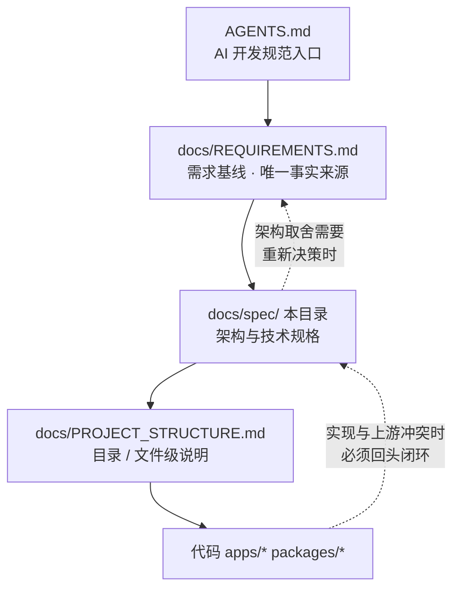

# Spec 规范索引 · trillion-cms-platform

> **本目录是项目的架构与技术规格层（Spec Layer）**，回答"系统是怎么设计的、为什么这么设计、各部件怎么协作"。
> 上层 **`../REQUIREMENTS.md`** 是需求基线（回答"做什么、为什么做、什么不能做"），下层 **`../PROJECT_STRUCTURE.md`** 是目录/文件级说明（回答"某个文件是干什么的"）。三者构成单向依赖，**任何一方冲突以上游为准**。

---

## 1. 文档分层与优先级



| 层级    | 文档                        | 变更触发条件                                     | 冲突裁决       |
| ------- | --------------------------- | ------------------------------------------------ | -------------- |
| L0 入口 | `AGENTS.md`                 | 命令、流程、AI 协作方式变化                      | ——             |
| L1 需求 | `docs/REQUIREMENTS.md`      | 业务范围、验收标准、否决项变化                   | **最高优先级** |
| L2 架构 | `docs/spec/*.md`            | 组件职责、数据流、接口、数据模型、部署、ADR 变化 | 以 L1 为准     |
| L3 结构 | `docs/PROJECT_STRUCTURE.md` | 文件增删改、用途变化                             | 以 L2 为准     |
| L4 实现 | 源码                        | 日常开发                                         | 以 L3 为准     |

**硬约束**：任何 L2 以下的改动，若涉及"跨服务边界、数据模型、接口契约、部署形态、渲染模式"，必须先在 L2 更新，再动代码。

---

## 2. 文档地图

| 编号 | 文档                                                           | 回答的问题                               | 主要负责人视角 |
| ---- | -------------------------------------------------------------- | ---------------------------------------- | -------------- |
| —    | `INDEX.md`（本文）                                             | 从哪里读起、文档之间什么关系             | 所有人         |
| —    | [`../GLOSSARY.md`](../GLOSSARY.md)（术语表）                   | 专有名词（slug / canonical / 产物清单 …）是什么意思 | 所有人         |
| 00   | [`00-overview.md`](./00-overview.md)                           | 系统定位、架构原则、质量属性目标与边界   | 架构负责人     |
| 01   | [`01-system-context.md`](./01-system-context.md)               | 系统边界与外部依赖，容器如何划分与协作   | 后端 / 全栈    |
| 02   | [`02-server-architecture.md`](./02-server-architecture.md)     | 服务端分层、模块职责、横切机制与依赖规则 | 后端           |
| 03   | [`03-frontend-architecture.md`](./03-frontend-architecture.md) | admin 与 GEO 项目的结构与渲染模式        | 前端           |
| 04   | [`04-data-model.md`](./04-data-model.md)                       | 13 张表的职责、字段口径、隔离与索引      | 后端 / DBA     |
| 05   | [`05-api-contract.md`](./05-api-contract.md)                   | 接口清单、鉴权矩阵、响应结构与错误约定   | 前后端共同     |
| 06   | [`06-publish-and-geo.md`](./06-publish-and-geo.md)             | 发布流水线、SSG 增量发布、GEO 四层产物   | 全栈 / 运营    |
| 07   | [`07-deployment.md`](./07-deployment.md)                       | 环境、容器编排、静态托管、备份与健康检查 | 运维           |
| 08   | [`08-adr.md`](./08-adr.md)                                     | 关键取舍的决策记录（ADR）                | 架构负责人     |
| 09   | [`09-site-editor.md`](./09-site-editor.md)                     | 站点内容编辑器、块代码化、发布与 GEO、完整建站规格 | 全栈 / 前端    |
| 10   | [`10-launch-runbook.md`](./10-launch-runbook.md)               | Linux 直装上线操作手册：服务器初始化、PM2 守护、首次部署、日常更新、nginx、验收与回滚 | 运维 |

---

## 3. 阅读顺序

**首次接触 / AI 接手开发**

```
AGENTS.md → REQUIREMENTS.md（§1~§5 精读，§14 否决专区必须读）
  → 00-overview → 01-system-context → 04-data-model → 05-api-contract
  → PROJECT_STRUCTURE.md（定位到具体目录）→ 阅读该目录代码
  ↳ 途中遇到不认识的专有名词：查 ../GLOSSARY.md（术语表）
```

**做前端（管理后台）**：`00` → `03` → `05` → `PROJECT_STRUCTURE.md#appsadmin`
**做前端（GEO 项目/站点）**：`00` → `03` → `01` → `06`
**做服务端**：`00` → `02` → `04` → `05`
**做发布/GEO 优化**：`06` 全文 → `02` 的 Publish 模块 → `05` 的 public 接口
**做部署运维**：`07` 全文 → `10`（Linux 上线操作手册）→ `01` 部署图 → `AGENTS.md` 命令表
**做站点编辑器 / 块代码化 / 完整建站**：`09` 全文 → `03` → `04` → `05` → `06`

---

## 4. 本文集的维护契约

| 场景                             | 必须同步更新的文档                                          |
| -------------------------------- | ----------------------------------------------------------- |
| 新增/删除 Prisma model 或字段    | `04-data-model.md` + `PROJECT_STRUCTURE.md` 对应条目        |
| 新增接口 / 改响应结构 / 改鉴权   | `05-api-contract.md`                                        |
| 新增服务端模块                   | `02-server-architecture.md` 模块表 + `PROJECT_STRUCTURE.md` |
| 新增管理后台页面或 config 模块   | `03-frontend-architecture.md` + `PROJECT_STRUCTURE.md`      |
| 新增/变更 GEO 页面或 Block 渲染  | `03-frontend-architecture.md` §4 语义化规范 + `PROJECT_STRUCTURE.md` |
| 改变渲染模式、发布流程、GEO 产物 | `06-publish-and-geo.md`（可能还要新增 ADR）                 |
| 改变部署形态、环境变量、容器服务 | `07-deployment.md` + `README.md`                            |
| 上线操作流程 / PM2 守护 / 服务器运维变更 | `10-launch-runbook.md`（涉及部署形态再同步 `07-deployment.md`） |
| 新增/变更根命令（启动、上线、数据库） | `07-deployment.md` + `README.md` + `AGENTS.md` §9 + `PROJECT_STRUCTURE.md` |
| 任何"二选一"的架构取舍           | `08-adr.md` 新增一条 ADR（superseded 旧条目，勿删）         |
| 上述改动导致文件用途变化         | `PROJECT_STRUCTURE.md`（每次例行同步，强制）                |
| 新增站点编辑器 / 块代码化能力    | `09-site-editor.md` + `03` / `04` / `05` / `06` 对应小节    |
| 新增/改名专有名词                | `../GLOSSARY.md`（+ 界面文案 `apps/admin/app/config/glossary.ts`） |
| 完整建站（新增站点、页面与内容） | `09-site-editor.md` §12 + `PROJECT_STRUCTURE.md`            |

---

## 5. 编号与书写约定

- 文件名 `NN-主题.md`，`NN` 两位数字，序号代表阅读先后而非重要性
- 正文一律简体中文；代码、字段名、命令保留原文，不加翻译
- 图表统一 **Mermaid**，且必须能用常见 Markdown 渲染器直接出图（不使用未知主题变量）
- 文档中的"已禁止/勿回退"内容，必须在正文明确标出原因，避免后来者误改回去
- 每条 ADR 必须有状态（accepted / superseded / deprecated）与日期，便于追溯

## 6. 与其他文档的交叉关系

- 需求侧定义（范围、分期 P0/P1/P2、指标）→ `../REQUIREMENTS.md`
- 目录/文件逐条说明 → `../PROJECT_STRUCTURE.md`
- 专有名词解释（slug / canonical / 产物清单 / 内容指纹 …）→ `../GLOSSARY.md`（界面上的问号提示文案来源是 `apps/admin/app/config/glossary.ts`）
- 上手命令与环境准备 → `../../README.md`
- AI 开发流程与禁止事项 → `../../AGENTS.md`
